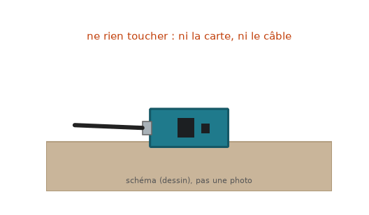
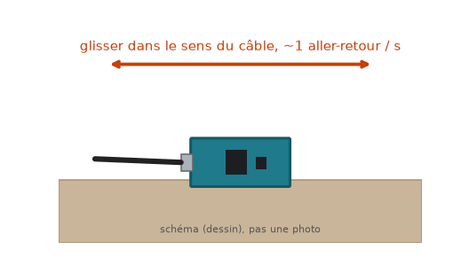
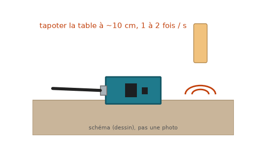

# TinyML 2027

**Un cours de TinyML complet, en français, sur une seule carte Arduino Nano 33 BLE Sense.**
Du signal du capteur au réseau de neurones qui tourne sur le microcontrôleur, avec de vraies mesures à chaque étape.

[](LICENSE)
[](LICENSE-docs.md)
[](docs/INSTALLATION.md)
[](https://docs.arduino.cc/hardware/nano-33-ble-sense/)
[](https://github.com/tensorflow/tflite-micro)


## Ce que vous allez construire

Vous enregistrez trois gestes avec l'accéléromètre de la carte : **immobile**, **glisser** et **tapoter**. Vous en tirez un dataset propre, vous entraînez un petit réseau de neurones, vous le quantifiez en INT8, puis la carte reconnaît le geste **en direct**, seule, sans ordinateur pour calculer.

|  |  |  |
|:---:|:---:|:---:|
| `stationary` | `periodic` | `impact` |

**Résultats obtenus sur la carte de référence :**

| | |
|---|---|
| Test sur une session jamais vue | 96 % de bonnes réponses (macro-F1 0,961) |
| Taille du modèle INT8 | 2 176 octets |
| Calcul des features + inférence sur la carte | ≈ 0,8 ms par fenêtre |
| Carte = Python, sur 8 fenêtres témoins | 8/8, aucun écart |
| Reconnaissance en direct | 50 fenêtres justes sur 51 |

## Le parcours

| Module | Durée | Vous apprenez à… |
|---|---|---|
| [Tutoriel 01 — Python et Jupyter](tutorials/01-python-jupyter/README.md) | 2 h | utiliser l'environnement du cours, NumPy, contrôler un fichier de capteur |
| [Tutoriel 02 — Prendre en main la Nano](tutorials/02-arduino-nano/README.md) | 45 min | téléverser un programme, identifier la carte, lire l'IMU (terminal ou Arduino IDE) |
| [Exemples 01 à 05](examples/) | — | faire tourner un premier réseau sur la carte, en FP32 puis en INT8 |
| [TP01 — Du capteur au dataset](labs/01-sensor-data/README.md) | 4 h | enregistrer, contrôler la qualité, découper en fenêtres, calculer 4 features |
| [TP02 — Entraîner sans tricher](labs/02-model-training/README.md) | 4 h | séparer par session, comparer à des modèles simples, évaluer honnêtement |
| [TP03 — Le modèle sur la carte](labs/03-embedded-inference/README.md) | 4 h | quantifier en INT8, vérifier la carte avec des golden vectors, passer en direct |
| [Pour aller plus loin — Edge Impulse](advanced/edge-impulse/README.md) | 2–3 h | reconnaître des mots avec le micro et une plateforme en ligne |
| [Pour aller plus loin — Edge MLOps](advanced/edge-mlops/README.md) | 2–3 h | versionner un modèle, refuser une mauvaise version, revenir en arrière |

Les trois TP fonctionnent **sans Internet ni compte en ligne**. Seule l'extension Edge Impulse en demande un.

## Démarrage rapide

```sh
git clone https://github.com/wld-code/TinyML2027.git
cd TinyML2027
./scripts/setup.sh          # installe tout dans le dossier du projet (≈ 3 Go)
uv run pytest -q            # vérifie l'installation
```

Il faut d'abord `git` et [uv](https://docs.astral.sh/uv/). Les détails pour macOS, Linux et Windows sont dans le **[guide d'installation](docs/INSTALLATION.md)**.

Puis branchez la carte et commencez le [tutoriel 02](tutorials/02-arduino-nano/README.md).

**Pas de carte ?** Les TP02 et TP03 (partie ordinateur) fonctionnent avec le dataset réel fourni, [`datasets/motion-nano-v1`](datasets/motion-nano-v1/README.md).

## Matériel

- Une **Arduino Nano 33 BLE Sense**, originale (ABX00031) ou Rev2 (ABX00069). Attention : la Nano 33 BLE *sans* « Sense » n'a pas les capteurs.
- Un câble micro-USB **de données**. Beaucoup de câbles ne font que la charge : si la carte n'apparaît pas, changez de câble en premier.
- Un ordinateur sous macOS, Linux ou Windows.

Pas de capteur externe, pas de breadboard, pas de cloud payant.

## Principes du cours

- **De vraies mesures.** Chaque capture d'écran et chaque chiffre vient d'un essai réel, daté. Les journaux sont dans [`evidence/`](evidence/).
- **Une évaluation honnête.** Le test se fait sur une session entière jamais vue ; la normalisation et la calibration INT8 n'utilisent que l'entraînement.
- **La carte calcule comme Python.** Avant le direct, la carte rejoue des fenêtres témoins (*golden vectors*) et doit retrouver les mêmes valeurs.
- **Des versions figées.** Toute la chaîne est verrouillée ([`config/versions.lock`](config/versions.lock), [`uv.lock`](uv.lock)) et n'utilise que des bibliothèques officielles.

## Où en sont les tests

| Système | Sans carte | Avec la carte originale | Avec une Rev2 |
|---|---|---|---|
| macOS 15 (Apple Silicon) | ✅ | ✅ tout le parcours | compilé seulement |
| Linux (Debian 12 arm64) | ✅ | non testé | non testé |
| Windows 10 | en cours | en cours | non testé |

Détail et preuves : [docs/VALIDATION.md](docs/VALIDATION.md). Vous avez une Rev2, un PC Windows ou Linux ? Vos retours sont les bienvenus.

## Organisation du dépôt

```text
tutorials/    tutoriels 01 (Python) et 02 (Arduino)
examples/     petits sketches : Blink, hello_world, modèle sinus FP32 et INT8, IMU
labs/         TP01 à TP03, avec leurs firmwares
advanced/     extensions facultatives
datasets/     dataset réel de la carte de référence
src/          code Python des TP (package tinyml2027)
scripts/      installation, compilation, téléversement
tests/        tests automatiques, sans carte
docs/         installation, contrat de données, validation, figures et captures
evidence/     journaux et mesures des essais réels
```

## Contribuer

Les signalements d'erreur et les retours d'essai sont les bienvenus, via les *issues* GitHub. Pour un retour d'essai, indiquez : le système, la révision de la carte, la commande lancée et la sortie complète. Avant de proposer une modification, lancez `uv run pytest -q`.

## Licence et crédits

- Code (Python, C++, sketches, scripts) : [MIT](LICENSE).
- Textes, figures et captures : [CC BY 4.0](LICENSE-docs.md). Photos de la carte et du câble : CC BY-SA ([crédits](docs/photos/CREDITS.md)).
- Composants tiers : leur propre licence (TensorFlow Lite Micro : Apache-2.0).

Le cours adapte des travaux de [AIoT-Book](https://github.com/wld-code/AIoT-Book/tree/main/labs) et de [TinyML-for-motor](https://github.com/wld-code/TinyML-for-motor). Auteur : Walid Abdaoui.
