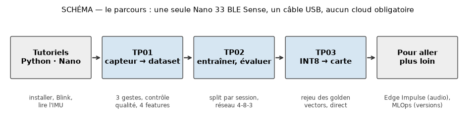

# TinyML 2027

Cours de TinyML sur Arduino Nano 33 BLE Sense. Nous enregistrons trois gestes avec l’accéléromètre, entraînons un modèle à reconnaître leurs signatures et exécutons ce modèle sur le microcontrôleur.



## Matériel et installation

- Une **Arduino Nano 33 BLE Sense** originale (ABX00031) ou Rev2 (ABX00069). Choisissez bien un modèle **Sense**, équipé des capteurs utilisés en TP.
- Un câble micro-USB de données et un ordinateur sous macOS, Linux ou Windows.
- Git, uv et environ 3 Go d’espace libre. Sous Windows, lancez les commandes depuis Git Bash.

Suivez le [guide d’installation](docs/INSTALLATION.md) pour préparer les outils de votre système et récupérer le dépôt.

```sh
git clone https://github.com/wld-code/TinyML2027.git
cd TinyML2027
./scripts/setup.sh          # installe tout dans le dossier du projet (≈ 3 Go)
uv run pytest -q            # vérifie l'installation
```

Les versions du Python et de la chaîne Arduino sont fixées dans [uv.lock](uv.lock) et [config/versions.lock](config/versions.lock). Après installation, les trois TP se font hors ligne.

## Parcours

| Support | Durée | Travail |
|---|---|---|
| [Tutoriel 01 — Python et Jupyter](tutorials/01-python-jupyter/README.md) | 2 h | Ouvrir les notebooks, manipuler un signal et contrôler un CSV. |
| [Tutoriel 02 — Prise en main de la Nano](tutorials/02-arduino-nano/README.md) | 30 à 45 min | Téléverser un programme, identifier la révision et lire les capteurs de mouvement. |
| [TP01 — Du capteur au jeu de données](labs/01-sensor-data/README.md) | 4 h | Enregistrer les gestes, contrôler les mesures et résumer les fenêtres de signal. |
| [TP02 — Entraînement et évaluation du modèle](labs/02-model-training/README.md) | 4 h | Comparer trois modèles et les évaluer sur une session réservée. |
| [TP03 — Quantification et inférence sur la Nano](labs/03-embedded-inference/README.md) | 4 h | Convertir en INT8, vérifier le rejeu des fenêtres témoins et tester en direct. |

Les [exemples Arduino](examples/) permettent de s’exercer entre les tutoriels et les TP. Sans carte, utilisez les [enregistrements publiés](datasets/motion-nano-v1/README.md) pour l’analyse du TP01, le TP02 et les étapes sur ordinateur du TP03.

## Extensions

- [Edge Impulse](advanced/edge-impulse/README.md) — reconnaître deux mots à partir du microphone (2 à 3 h, compte et connexion Internet).
- [Edge MLOps](advanced/edge-mlops/README.md) — préparer une version, vérifier son exécution et restaurer une version confirmée (2 à 3 h).
- [Edge MLOps avec Edge Impulse](advanced/edge-impulse-mlops/README.md) — évaluer deux modèles de commandes vocales, contrôler leur promotion et restaurer une version par USB (3 à 4 h, Nano 33 BLE Sense originale et compte Edge Impulse).
- [Nano et ESP32-S3](advanced/distributed-tinyml-esp32s3/README.md) — compilation expérimentale d’un exemple TensorFlow Lite Micro.

## Références et validation

Le [contrat de données](docs/DATA_CONTRACT.md) décrit le calcul des caractéristiques, le prétraitement et les tolérances appliquées au rejeu. Le [rapport de validation](docs/VALIDATION.md) distingue les tests sur ordinateur, les compilations et les essais sur la Nano originale. Les journaux détaillés sont dans [evidence/](evidence/).

Pour signaler un problème dans les *issues* GitHub, indiquez le système, la révision de la carte, la commande lancée et le résultat observé.

Code sous licence [MIT](LICENSE). Supports sous licence [CC BY 4.0](LICENSE-docs.md). Les photos et composants tiers conservent leurs licences respectives. Les [crédits des photos](docs/photos/CREDITS.md) et les [références du cours](docs/REFERENCES.md) précisent les sources, notamment TinyML-for-motor. Cours adapté par Walid Abdaoui.
