# Edge MLOps — Du modèle entraîné au modèle maintenu en production

**Durée visée.** 3 à 4 h hors téléchargement et attente des jobs. **Matériel.** Un ordinateur, une Arduino Nano 33 BLE Sense originale (ABX00031) et un câble micro-USB de données. **Prérequis.** Un compte Edge Impulse, une connexion Internet, environ 6 Go libres pour les données et la [chaîne Python et Arduino du dépôt](../../docs/INSTALLATION.md). Les essais USB de référence ont été menés sur macOS arm64. Le mode de lecture automatique des clips par les haut-parleurs utilise `afplay` sur macOS.

## Introduction

Le MLOps relie le travail sur les données, l’entraînement des modèles et leur exploitation. Pour reproduire un résultat, nous conservons le jeu de données, la configuration et les mesures associées à chaque version. Sur un microcontrôleur, nous vérifions aussi que le modèle tient en mémoire, respecte la cadence d’acquisition et peut être remplacé par une version connue si une mise à jour échoue. [Edge Impulse, What is edge MLOps?](https://docs.edgeimpulse.com/knowledge/courses/edge-ai-fundamentals/what-is-edge-mlops)

Dans ce lab, la Nano reconnaîtra `go`, `stop` et `bruit`. Nous entraînerons une référence, mesurerons ses erreurs quand l’environnement acoustique change, puis testerons un candidat enrichi de nouveaux exemples. Les observations sur la carte alimentent le cycle suivant. Une décision de mise à jour repose sur des mesures comparables et sur une vérification du firmware. [Edge Impulse, Lifecycle management](https://docs.edgeimpulse.com/knowledge/concepts/lifecycle/lifecycle-management)

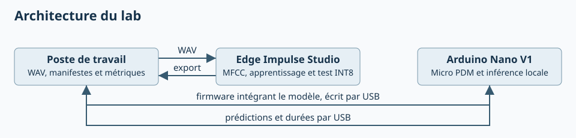

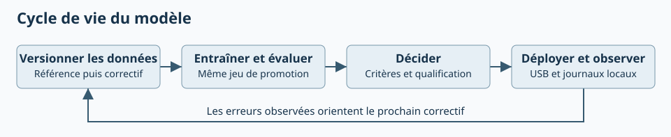

## 1. Préparer les jeux de données

Depuis la racine du dépôt, avec l’environnement [installé](../../docs/INSTALLATION.md), lancez la commande suivante. Le premier lancement récupère l’archive publique Speech Commands v0.02 (environ 2,43 Go), vérifie son SHA-256 et met les fichiers sources en cache sous `data/`. Un nouveau calcul peut réutiliser ce cache en indiquant un dossier distinct avec `--out`.

```sh
uv run --locked python advanced/edge-impulse-mlops/scripts/prepare_dataset.py
```

Ouvrez `data/edge-impulse-mlops/datasets/report.json` et vérifiez les effectifs par classe, puis ouvrez `manifest.csv` pour retrouver la provenance d’un clip. Chaque WAV contient une seconde d’audio mono à 16 kHz en PCM 16 bits.

| Jeu | Clips par classe | Utilisation |
|---|---:|---|
| `train-v1` | 200 | Entraînement de la référence |
| `corrective-v2` | 100 | Exemples issus de nouvelles sources pour v2 |
| `evaluation-clean`, `evaluation-shifted` | 50 chacun | Comparaison propre/dégradée pour la décision |
| `final-clean`, `final-shifted` | 50 chacun | Bilan après gel des modèles et des critères |

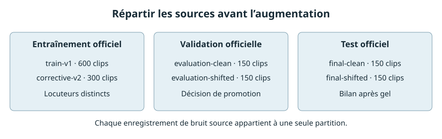

[Voir les effectifs et le SHA-256 du manifeste obtenus sur le poste](screenshots/dataset-report.png).

Nous séparons les locuteurs et les enregistrements de bruit avant de choisir les clips. Les deux versions d’une même fenêtre d’évaluation gardent le même identifiant de paire et restent dans la même partition. Conservez les clips `final-*` hors de Studio jusqu’au bilan. La classe `bruit` contient des mots hors vocabulaire et des extraits de bruit de fond choisis dans la partition correspondante.

Speech Commands v0.02 est un jeu public de Pete Warden distribué sous licence CC BY 4.0. Les clips dérivés générés sur le poste gardent cette attribution. [Article et provenance](https://arxiv.org/abs/1804.03209)

## 2. Observer l’effet des transformations acoustiques

```sh
uv run --locked python advanced/edge-impulse-mlops/scripts/plot_dataset.py --out data/edge-impulse-mlops/figures
```

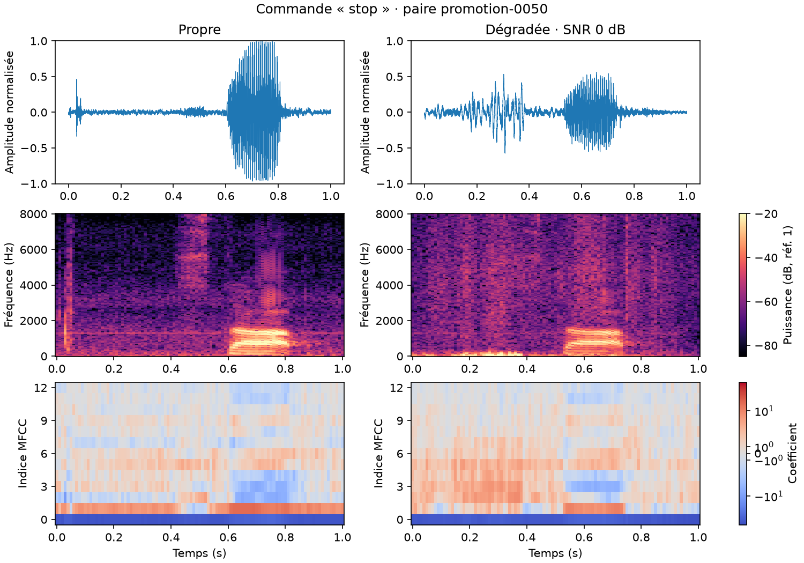

Comparez une paire avant et après transformation. Nous décalons le son dans la fenêtre, réduisons son niveau et ajoutons un bruit à un rapport signal/bruit (SNR) connu. Le spectrogramme montre où l’énergie se répartit dans le temps et en fréquence. Les MFCC de la figure, calculés sur ordinateur, illustrent une représentation compacte du spectre. Les coefficients produits ensuite par Studio dépendront de sa configuration DSP.

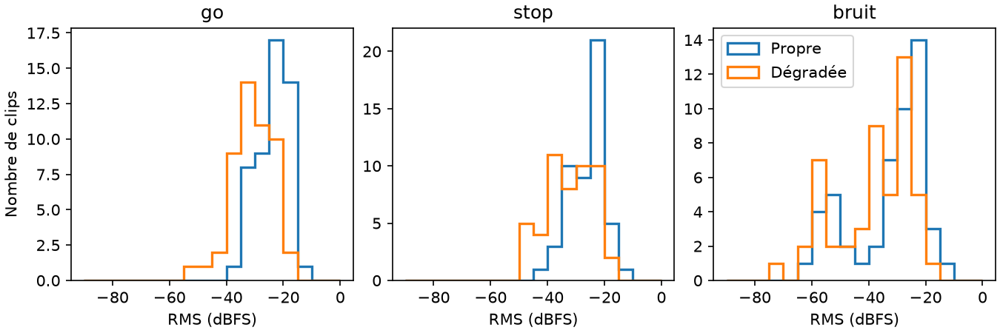

La RMS est la racine de la moyenne des amplitudes au carré. Elle mesure le niveau du signal sur une fenêtre. Dans l’histogramme RMS, comparez les niveaux avant et après transformation pour chaque classe. Ces mesures décrivent un changement des entrées. L’effet sur la reconnaissance sera mesuré avec les prédictions des modèles sur les mêmes clips étiquetés. Une **dérive des données** modifie la distribution des entrées, par exemple avec un bruit ambiant plus fort. Une **dérive du concept** modifie la relation entre l’entrée et l’étiquette attendue, par exemple si un opérateur doit désormais traiter une commande prononcée par un haut-parleur comme `bruit`. Ici, nous changeons les conditions acoustiques en conservant la règle d’étiquetage. Une baisse des scores de confiance invite à enquêter. Pour constater une dégradation des performances, comparez les erreurs sur des exemples étiquetés.

## 3. Configurer la référence dans Studio

Créez un projet **Personal** et **Private** dans [Edge Impulse Studio](https://studio.edgeimpulse.com/). Sélectionnez la cible **Arduino Nano 33 BLE Sense (Cortex-M4F 64MHz)**. Utilisez le même projet pour les deux expériences.

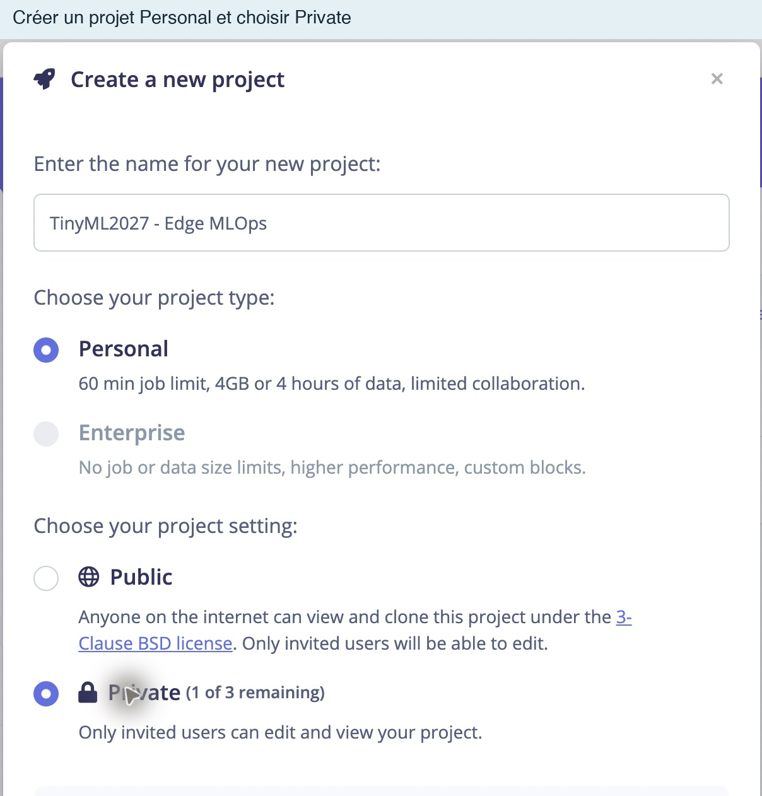

Dans **Data acquisition → Upload data**, choisissez **Select a folder**, puis le dossier `train-v1/`. Vérifiez **Training** et **Infer from filename** avant d’envoyer les 600 fichiers. Importez ensuite `evaluation-clean/` et `evaluation-shifted/` dans **Test**. À la fin, vérifiez **Training (600)** et **Test (300)**, ainsi que les trois étiquettes. Les noms des fichiers conservent la condition et l’identifiant de paire. [Réglage Training](screenshots/studio-upload-training.png) · [Réglage Test](screenshots/studio-upload-test.png) · [Catégories après l’ajout du correctif](screenshots/studio-dataset.png)

Dans **Create impulse**, gardez une fenêtre de **1 000 ms**, un pas de **500 ms** et la fréquence **16 000 Hz**. Ajoutez **Audio (MFCC)** et **Classification**, puis cliquez sur **Save Impulse**. Chaque clip d’une seconde fournit une fenêtre complète. Dans **MFCC**, vérifiez les 13 coefficients, les trames de 20 ms avec un pas de 20 ms, les 32 filtres et la FFT de 256 points. Cliquez sur **Save parameters**, puis **Generate features**. Studio doit annoncer 600 fenêtres d’entraînement réparties entre `bruit`, `go` et `stop`.

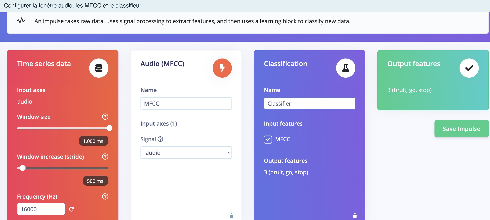

[Voir un aperçu MFCC dans Studio](screenshots/studio-v1-mfcc.png).

Dans **Classifier**, gardez les couches de convolution à 8 et 16 filtres. Choisissez 100 cycles, un taux d’apprentissage de **0,0001** et CPU. Dans **Advanced training settings**, gardez 20 % de validation interne et activez **Profile int8 model**. Laissez **Data augmentation** décochée. Le lot correctif apportera les transformations acoustiques pour v2. Cliquez sur **Save & train**.

La validation interne du classifieur utilise ici une fraction de `train-v1`, sans regroupement de locuteurs configuré dans Studio. Pour comparer les versions, utilisez les clips importés dans **Test**, dont les locuteurs ont été réservés lors de la préparation.

## 4. Évaluer la référence et préparer le candidat

Dans **Model testing**, ouvrez la roue dentée et choisissez **Test 'Quantized (int8)' model**. Vérifiez que la notification indique **Enabled testing**. L’option peut déjà être active dans le projet. Lancez **Classify all**, puis sélectionnez **Quantized (int8)** dans le menu de la section **Results**. Vérifiez le nombre de clips et examinez la colonne **Uncertain** de la matrice. Même avec le test INT8 activé, Studio peut afficher initialement les résultats FP32.

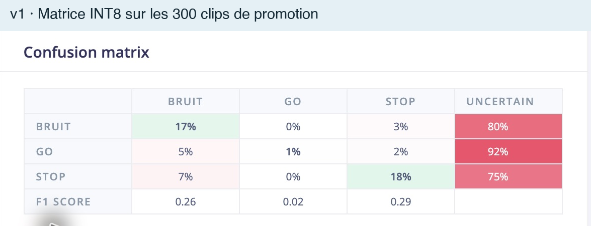

Dans **Deployment**, choisissez **Arduino library**, **EON Compiler** et **Quantized (int8)**. Lancez **Build** et archivez le ZIP obtenu avec son SHA-256, la configuration et le manifeste avant de modifier les données d’entraînement.

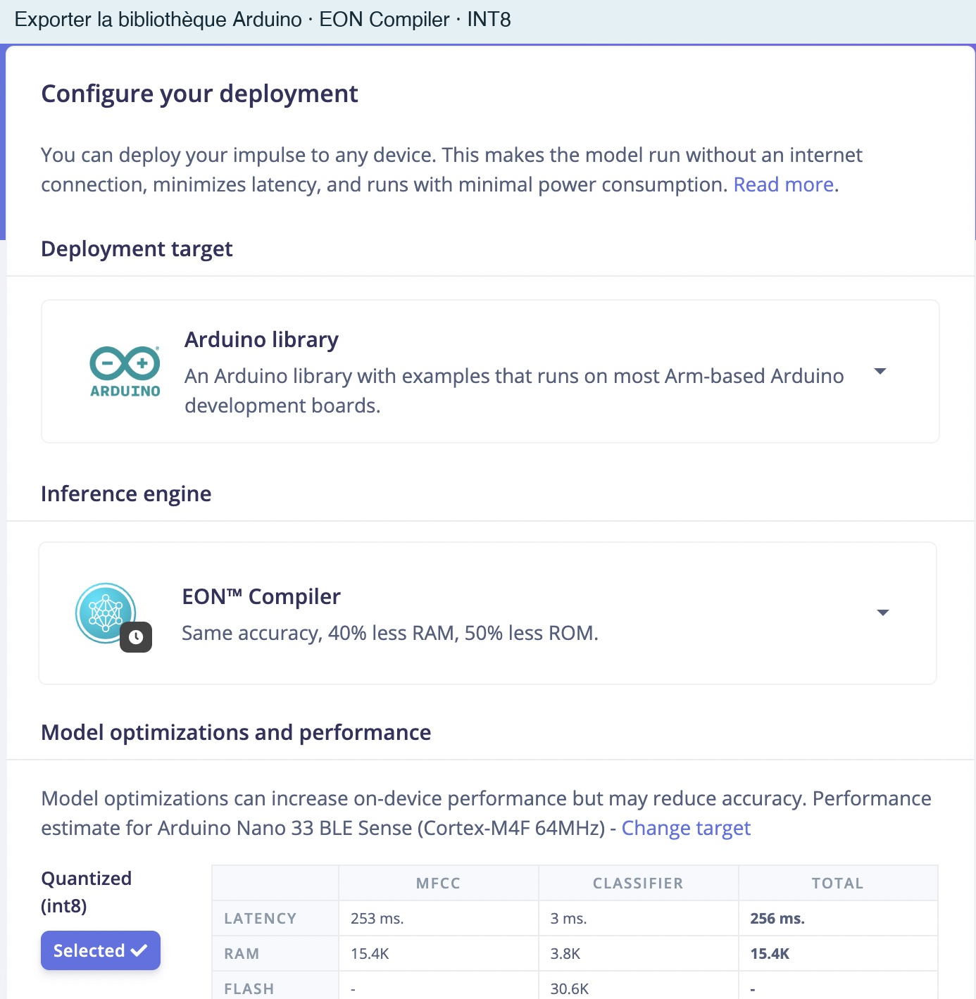

Dans **Experiments**, renommez l’expérience de référence `kws-v1`. Ouvrez son menu, choisissez **Clone**, nommez le clone `kws-v2` et gardez **Only the structure (blocks and config)**. Dans **Data acquisition**, importez `corrective-v2/` en **Training**. Vérifiez que le jeu d’entraînement compte 900 clips et que les 300 clips de promotion restent en **Test**. Générez les caractéristiques du clone et vérifiez qu’il utilise les 900 fenêtres. Entraînez-le avec les réglages de v1. [Capture du clonage de structure](screenshots/studio-clone.png)

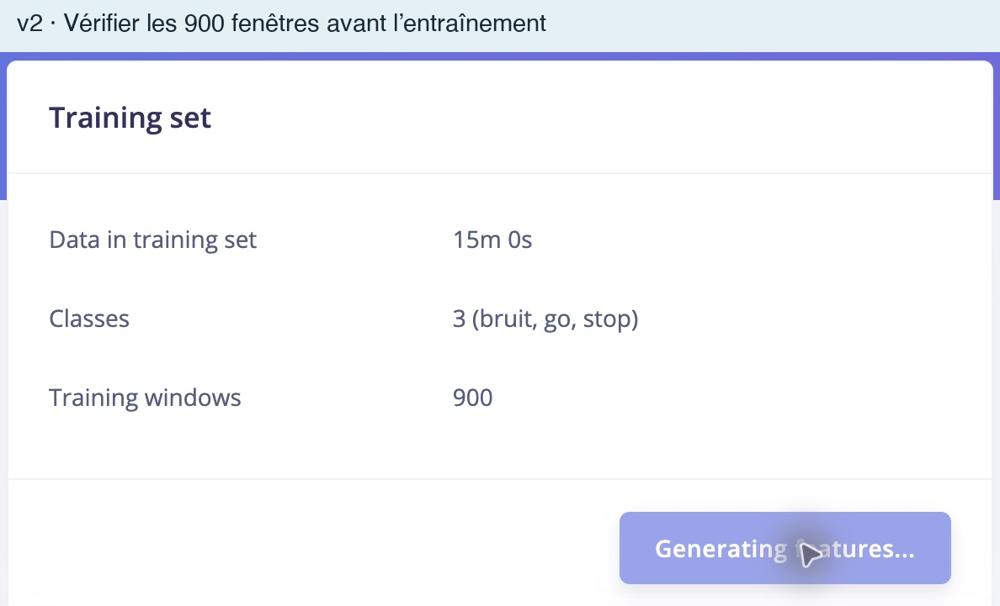

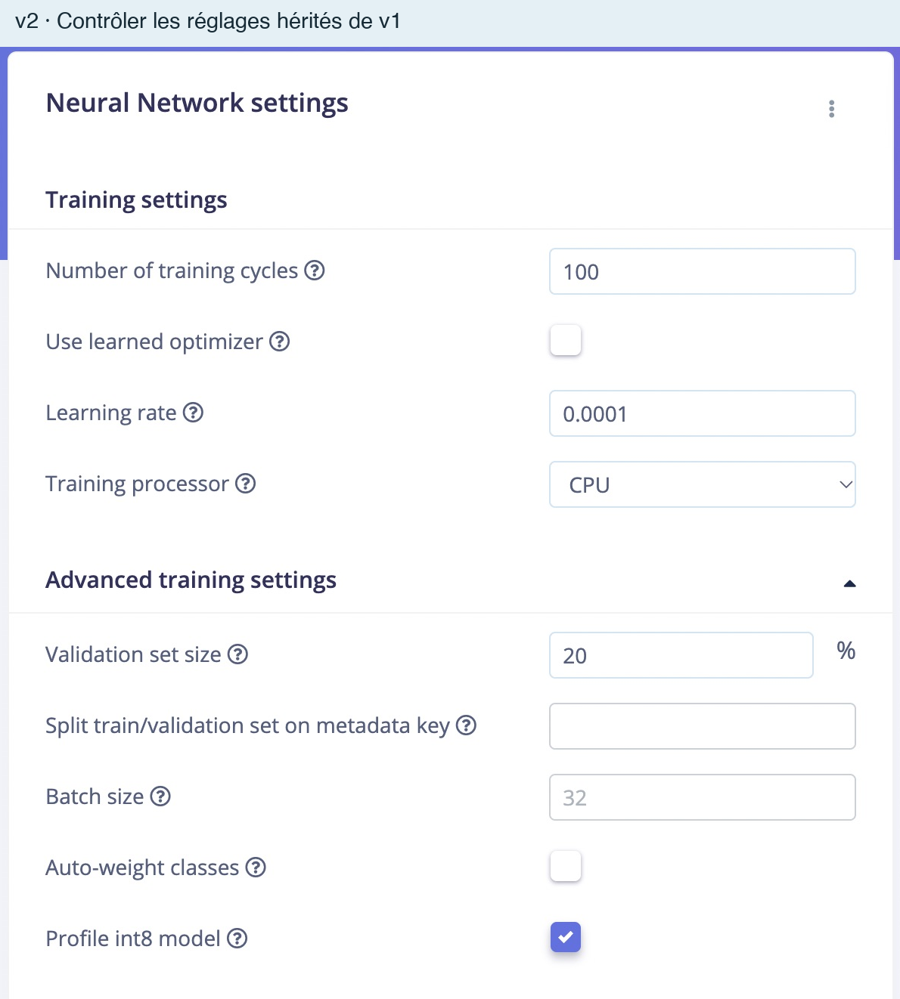

Archivez aussi le ZIP de v2 depuis **Deployment** en sélectionnant l’expérience correspondante. Le [fichier de critères](config/quality-gates.json) fixe les seuils avant la comparaison.

Les [résultats de référence](../../evidence/edge-impulse-mlops/studio-v1.md) distinguent l’évaluation dans Studio et l’export. L’accuracy agrégée de v1 est de 12 % dans cette expérience, avec de nombreuses réponses incertaines.

## 5. Comparer les expériences

Dans **Model testing**, évaluez `kws-v2` en INT8 sur les mêmes 300 clips. Depuis **Experiments**, vérifiez que chacune des deux lignes dispose d’un résultat de test INT8.

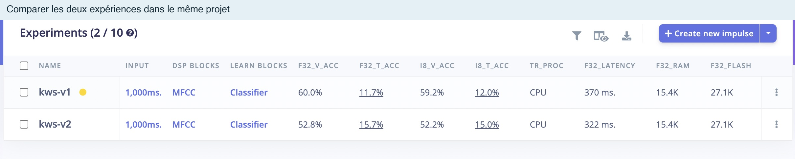

[Voir la variante INT8 sélectionnée dans les résultats de v2](screenshots/studio-v2-int8.png).

Pour chaque version, archivez les prédictions par clip. Joignez-les au manifeste pour séparer les conditions. Le dossier de sortie du script contient un CSV de prédictions et un JSON de métriques.

```sh
uv run --locked python advanced/edge-impulse-mlops/scripts/score_studio.py \
  data/edge-impulse-mlops/datasets/manifest.csv RESULTATS_STUDIO.json DOSSIER_SORTIE
```

Le fichier JSON d’entrée correspond à la réponse du [point de terminaison de résultats de classification](https://docs.edgeimpulse.com/apis/studio/classify/single-page-of-a-classify-job-result), avec `variant=int8`, `category=testing` et l’identifiant de l’expérience. Avec une session Studio ouverte, remplacez `PROJECT_ID` et `IMPULSE_ID` dans l’adresse suivante. Enregistrez le JSON localement. Le script vérifie que les 300 prédictions couvrent le jeu de promotion. Si la réponse ne contient qu’une page partielle, récupérez les pages restantes avant le calcul.

```text
https://studio.edgeimpulse.com/v1/api/PROJECT_ID/classify/all/result/page?variant=int8&category=testing&impulseId=IMPULSE_ID&limit=300&offset=0
```

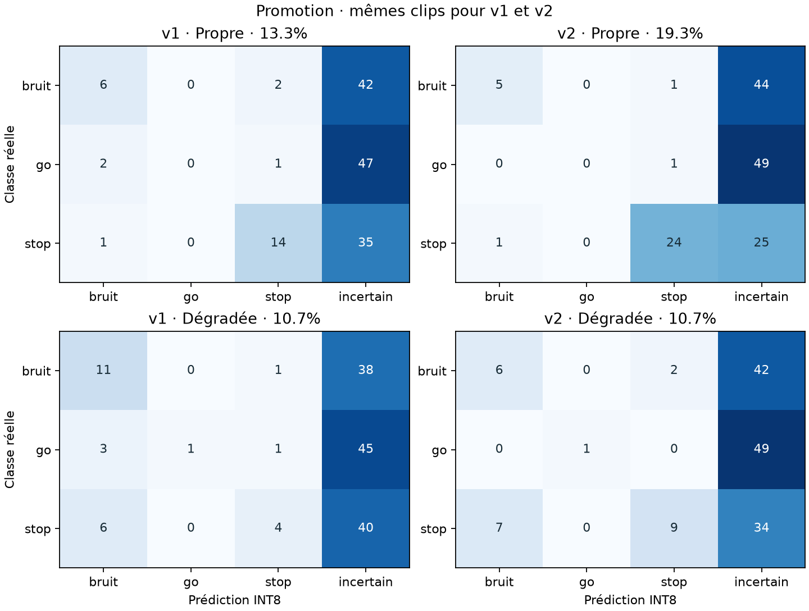

Le rappel est la proportion d’exemples d’une classe que le modèle reconnaît. Le F1 combine le rappel et la précision, qui mesure la part des prédictions de cette classe qui sont correctes. Le macro-F1 est la moyenne des F1 des trois classes. Dans ce lab, une réponse incertaine compte comme une commande manquée si le clip contient `go` ou `stop`.

Les deux versions reconnaissent très peu de `go` avec le seuil de 0,6. Sur les clips dégradés, v2 améliore le rappel de `stop` de 8 % à 18 %, mais l’accuracy reste à 10,67 %. Le gain de macro-F1 atteint environ 0,95 point. Le candidat est refusé par les critères fixés avant la comparaison. [Rapport des deux expériences](../../evidence/edge-impulse-mlops/studio-comparaison.md)

Les jeux `final-*` restent réservés à un bilan indépendant après le gel des choix. Si vous réalisez ce bilan, utilisez une évaluation séparée sur les exports gelés et conservez son rapport à part. Les résultats présentés ici portent sur le jeu de promotion.

## 6. Automatiser une expérience

Le script `pipeline.py` utilise la Studio API pour les jobs et l’Ingestion API pour les clips. Identifiez le projet par son nom et son numéro. Chargez `EI_API_KEY` dans l’environnement du terminal à partir d’un fichier local ignoré par Git. Copiez [.env.example](.env.example) dans `.env` à la racine du dépôt et renseignez la clé dans ce fichier. Chargez-la avec `source ./.env`. Gardez le fichier local.

```sh
lab=advanced/edge-impulse-mlops
project_id=1173087
project_name='TinyML2027 - Edge MLOps'
uv run --locked python "$lab/scripts/pipeline.py" --project "$project_id" --name "$project_name" check
uv run --locked python "$lab/scripts/pipeline.py" --project "$project_id" --name "$project_name" upload corrective-v2
```

Remplacez les valeurs d’exemple par l’identifiant et le nom de votre projet avant d’exécuter les commandes. `check` confirme sa visibilité privée. La seconde commande fait un **dry-run**. Vérifiez la catégorie et le nombre de clips prévus. Sur un projet préparé pour l’import API, ajoutez `--apply` avant `upload` pour l’exécuter. Chaque clip doit être accepté individuellement. À la reprise, le client vérifie l’inventaire distant et rapproche nom, catégorie, étiquette et SHA-256. Un clip importé à la main sans métadonnée d’empreinte demande une vérification dans Studio. Le client signale ce cas et interrompt l’import.

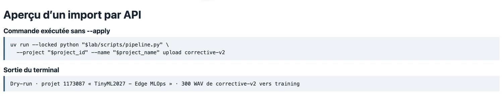

Avant l’entraînement, vérifiez la composition du jeu Training pour l’expérience ciblée. Après l’import correctif, un nouvel entraînement de v1 utiliserait les données courantes de v2. Préservez la référence archivée. Dans un projet de séance prêt à entraîner, utilisez les identifiants affichés dans Studio pour lancer successivement les jobs `features DSP_ID`, `train LEARN_ID` et `classify IMPULSE_ID`, avec `--apply` devant la sous-commande. Si une opération est indisponible, lancez son équivalent dans Studio. En cas d’interruption, notez l’identifiant imprimé et relancez `status JOB_ID` pour vérifier le job existant.

```sh
uv run --locked python "$lab/scripts/pipeline.py" --project "$project_id" --name "$project_name" results 1 data/edge-impulse-mlops/api-v1.json
uv run --locked python "$lab/scripts/pipeline.py" --project "$project_id" --name "$project_name" results 2 data/edge-impulse-mlops/api-v2.json
```

Remplacez `1` et `2` par les identifiants de vos expériences. Chaque fichier doit contenir 300 prédictions INT8. Passez ces fichiers à `score_studio.py` comme à l’étape 5. Pour préparer une bibliothèque, utilisez `export IMPULSE_ID CHEMIN.zip` avec `--apply`, ou `download VERSION_STUDIO CHEMIN.zip` pour un export déjà construit. Le client vérifie que le ZIP contient une bibliothèque Arduino et des entrées et sorties INT8.

## 7. Appliquer les critères de promotion

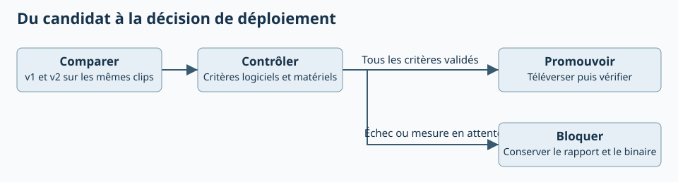

Passez les deux rapports produits par `score_studio.py` à `gate`.

```sh
uv run --locked python "$lab/scripts/pipeline.py" gate V1/promotion-metrics.json V2/promotion-metrics.json decision-v2.json
```

Le rapport donne une valeur, un seuil et un statut par critère. Le code de sortie vaut 0 pour une acceptation, 2 pour un rejet et 3 si les critères hors ligne passent mais que des mesures sur carte restent attendues. Dans l’essai de référence, v2 est refusée dès les critères hors ligne. Les critères de compilation, d’initialisation et de cadence sont en attente.

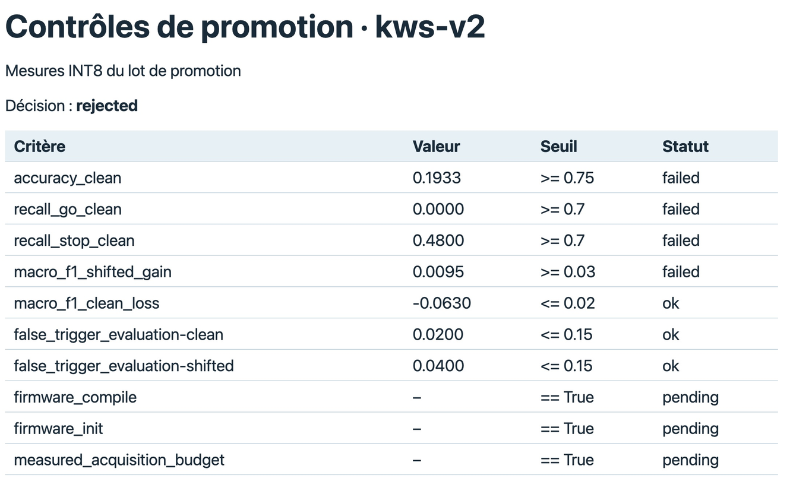

Répétez la commande avec un nouveau nom de rapport et `--inject-false-trigger`. Cet essai force le taux de faux déclenchements à 100 % sur les clips dégradés. Vérifiez le rejet de ce critère et la présence de la mention d’injection dans le rapport. Les métriques d’entrée restent les mêmes. [Capture du rapport d’injection](screenshots/gate-injection.png)

La commande `manifest` associe le ZIP et la décision au commit Git et aux empreintes des fichiers. Elle produit un manifeste de candidat. Le binaire, l’état de la carte et la preuve de rollback seront ajoutés pendant la qualification embarquée.

## 8. Compiler et identifier le firmware sur la Nano V1

Utilisez l’export Arduino EON INT8 de la référence pour qualifier la chaîne sur la carte. Le candidat v2 reste archivé. Le script vérifie les types INT8, prépare le sketch avec l’empreinte du ZIP et lance la chaîne Arduino du dépôt.

```sh
lab=advanced/edge-impulse-mlops
zip_v1=artifacts/edge-impulse-mlops/kws-v1/arduino-int8.zip
uv run --locked python "$lab/scripts/build_firmware.py" "$zip_v1" --release kws-v1
mkdir -p artifacts/edge-impulse-mlops/kws-v1/firmware
cp build/kws_nano/kws_nano.ino.bin artifacts/edge-impulse-mlops/kws-v1/firmware/
```

Relevez la Flash et la RAM statique dans la sortie. La copie du binaire préserve la version que vous allez vérifier sur la carte. Le tampon PCM mono occupe 32 000 octets. L’interpréteur et le traitement DSP utilisent aussi de la RAM pendant le calcul. Le sketch capture une fenêtre puis la classe. Le microphone continue de produire des échantillons pendant l’inférence, et le firmware compte ceux qu’il écarte durant ce calcul.

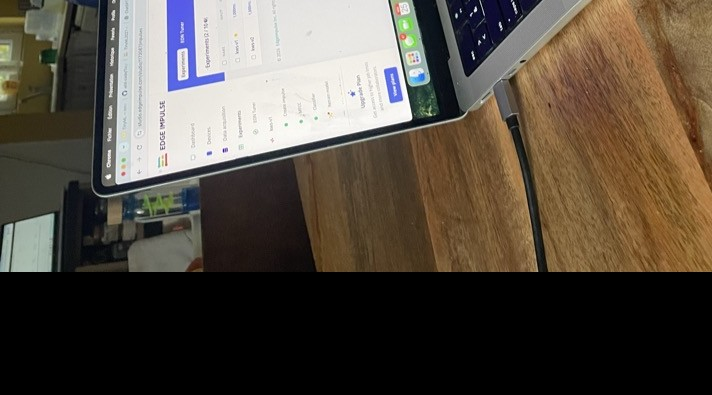

*Montage réel du lab. Photo fournie par Walid Abdaoui, recadrée sur la carte et le branchement.*

Branchez la Nano originale en USB et fermez tout moniteur série. Remplacez `CHEMIN_SKETCH` par le chemin imprimé par la compilation.

```sh
./scripts/upload.sh CHEMIN_SKETCH
uv run --locked python "$lab/scripts/monitor.py" check
```

Vérifiez les champs `board`, `release`, `export_sha256`, `mic_ok` et `model_ok`. L’identification de la V1 s’appuie sur le registre d’identité du LSM9DS1. L’annonce indique le résultat du démarrage du micro et d’une première inférence sur une fenêtre nulle. Comparez l’empreinte annoncée à celle du ZIP. Vous pouvez la faire vérifier par `--expect-sha256 EMPREINTE` avant la sous-commande `check`.

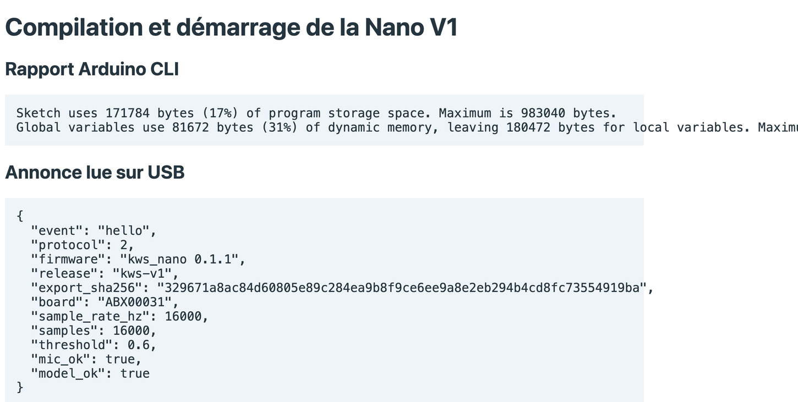

## 9. Rejouer une fenêtre PCM et mesurer en acoustique

En rejeu numérique, le moniteur convertit un WAV en 32 000 octets PCM little-endian et les envoie en USB par blocs de 128 octets confirmés par la Nano. Sur le Mac, chaque bloc est émis en écritures de 32 octets pour maîtriser la réception. Le firmware utilise le même calcul que pour le microphone et renvoie un CRC32. Le moniteur compare les scores aux résultats INT8 archivés de Studio sur les mêmes clips. La tolérance est d’un cran INT8 (1/256), avec une marge pour l’arrondi d’affichage, et la décision doit correspondre. Le rejeu vérifie les données numériques reçues et la classification.

```sh
dataset=data/edge-impulse-mlops/datasets
uv run --locked python "$lab/scripts/monitor.py" replay \
  --studio-json artifacts/edge-impulse-mlops/kws-v1/studio-predictions.json \
  --out results/kws/rejeu.jsonl "$dataset"/evaluation-clean/stop.evaluation-clean.promotion-0050.wav
```

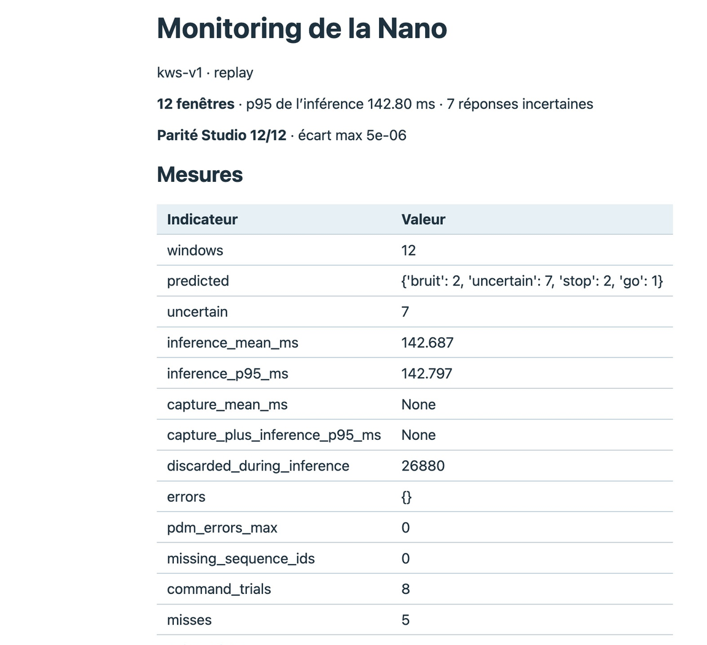

Pour mesurer le système acoustique, orientez le microphone vers le haut et notez la distance, la position et le volume de lecture. Sur le Mac, le mode `play` lance les clips publics avec `afplay` au début de la fenêtre. La liaison acoustique, la synchronisation de la lecture et le bruit ambiant peuvent modifier ce que la Nano reçoit. Gardez ce journal distinct du rejeu numérique.

```sh
uv run --locked python "$lab/scripts/monitor.py" play --volume 0.5 \
  --note 'Indiquer la sortie, le volume du système, la distance et l’orientation' \
  --out results/kws/acoustique.jsonl \
  "$dataset"/evaluation-clean/bruit.evaluation-clean.promotion-0115.wav \
  "$dataset"/evaluation-clean/bruit.evaluation-clean.promotion-0149.wav \
  "$dataset"/evaluation-clean/go.evaluation-clean.promotion-0000.wav \
  "$dataset"/evaluation-clean/go.evaluation-clean.promotion-0049.wav \
  "$dataset"/evaluation-clean/stop.evaluation-clean.promotion-0052.wav \
  "$dataset"/evaluation-clean/stop.evaluation-clean.promotion-0098.wav
```

Pour un essai vocal, utilisez `capture --count 3 --label stop --prompt --out results/kws/voix-stop.jsonl`. Prononcez le mot au signal. Pour repérer les faux déclenchements en silence, utilisez `--label bruit` et restez silencieux. Ces journaux contiennent des scores et des durées, et restent locaux.

```sh
uv run --locked python "$lab/scripts/monitor.py" report results/kws/acoustique.jsonl \
  --html results/kws/acoustique.html
```

Lisez le nombre de fenêtres, les réponses incertaines, les commandes manquées et les faux déclenchements. Le p95 estime une durée que 95 % des mesures ne dépassent pas. Avec six fenêtres, il reste proche de la durée maximale observée. Comparez aussi la moyenne et le p95 du temps de calcul à la durée d’acquisition. Une commande peut tomber pendant un temps mort. Le temps de calcul comptabilisé permet d’estimer ce temps mort, avec un intervalle encore plus long si la transmission série ou le déclenchement par le poste ajoute un délai.

[Capture du rapport de lecture à volume vérifié](screenshots/hardware-speaker-50pct.png) · [Mesures et journaux de la Nano V1](../../evidence/edge-impulse-mlops/nano-v1.md)

## 10. Archiver une release et réinstaller la référence

Une release associe une expérience, les données d’évaluation et le binaire exact qui sera écrit en Flash. Son manifeste fixe la cible, la version du firmware et les empreintes SHA-256. Conservez chaque dossier après sa création pour pouvoir réinstaller la même version par USB.

Pour compiler v2, reprenez la commande de l’étape 8 avec son ZIP et `--release kws-v2`. Après la compilation de chaque version, copiez immédiatement `build/kws_nano/kws_nano.ino.bin` vers le dossier de cette version. La compilation suivante réutilise le même répertoire de sortie. Préparez dans le dossier d’artefacts le ZIP, le manifeste des données et `experiment.json` avec les champs `name`, `project_id`, `impulse_id`, `arduino_export_sha256` et `manifest_sha256`. Calculez les deux empreintes sur les fichiers que vous archivez avec `shasum -a 256 arduino-int8.zip manifest.csv` depuis ce dossier sur macOS, ou `sha256sum arduino-int8.zip manifest.csv` sous Linux.

L’exemple ci-dessous archive le candidat. Copiez d’abord le manifeste produit à l’étape 1 en suivant la commande. Adaptez les chemins des métriques aux dossiers de sortie de l’étape 5.

```sh
release="$lab/scripts/release_kws.py"
art=artifacts/edge-impulse-mlops/kws-v2
mkdir -p "$art/firmware"
cp build/kws_nano/kws_nano.ino.bin "$art/firmware/"
cp data/edge-impulse-mlops/datasets/manifest.csv "$art/manifest.csv"
printf '{"firmware_compile": true}\n' > "$art/hardware.json"
uv run --locked python "$release" archive releases/kws-v2 \
  --artifacts "$art" --binary "$art/firmware/kws_nano.ino.bin" \
  --metrics METRIQUES_V2.json --baseline METRIQUES_V1.json --hardware "$art/hardware.json"
uv run --locked python "$release" verify releases/kws-v2
uv run --locked python "$release" flash releases/kws-v2
```

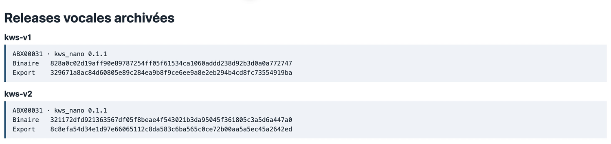

Ouvrez `gates.json` et reliez chaque échec aux métriques correspondantes. Dans l’essai du cours, `flash` s’arrête avant l’ouverture du port. Les critères d’initialisation et de cadence du candidat restent en attente. Un candidat qui satisfait l’évaluation logicielle peut être qualifié sur un banc distinct avant d’être promu. Une compilation seule valide uniquement le critère de compilation.

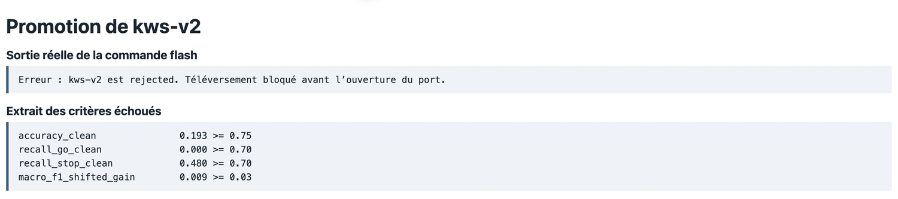

Pour archiver v1, reprenez la commande avec l’export et le binaire de v1, ainsi que les métriques de v1 pour les deux arguments. Après avoir vérifié cette référence sur la Nano, renseignez `firmware_init: true` et `verified_binary_sha256` dans le rapport matériel transmis à `archive`. L’empreinte doit correspondre au binaire effectivement essayé. La référence sert à l’exercice de restauration. Les résultats de classification de v1 restent en dessous des seuils de promotion.

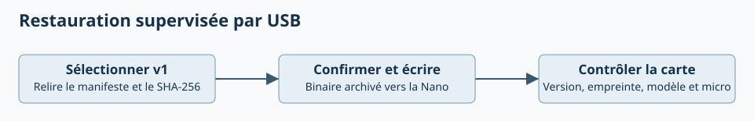

Fermez le moniteur série et lancez la restauration. Vérifiez la cible et l’empreinte affichées avant de confirmer.

```sh
uv run --locked python "$release" verify releases/kws-v1
uv run --locked python "$release" restore releases/kws-v1
```

Après l’écriture, la Nano doit annoncer `ABX00031`, `kws-v1`, la version du firmware et l’empreinte de la bibliothèque. Vérifiez aussi `mic_ok` et `model_ok`. Cette réinstallation utilise le binaire archivé. Le passage à v2 dépend de la décision de promotion.

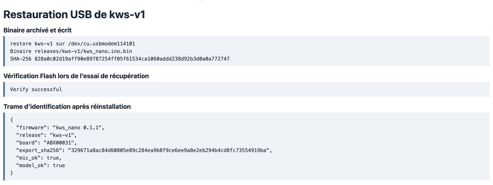

[Journal des vérifications et de la restauration sur la Nano V1](../../evidence/edge-impulse-mlops/releases.md)


## Questions de compréhension

1. Pourquoi séparer les locuteurs et les sources de bruit avant l’augmentation ? À quoi sert le jeu final, en plus du jeu de promotion ?
2. Quelle observation montre une dérive des entrées ? Quelles mesures permettent d’évaluer son effet sur la reconnaissance ?
3. À partir du rapport de v2, calculez le gain de macro-F1 en conditions dégradées en points de pourcentage. Pourquoi la compilation de v2 ne suffit-elle pas pour la promouvoir ?
4. Que vérifie le rejeu PCM sur USB ? Quelles sources d’erreur apparaissent lors de la lecture du même clip par un haut-parleur ?
5. Pourquoi conserver le binaire exact de v1 pour le retour arrière ? Quels champs de la trame série vérifiez-vous après la restauration ?

## Livrables

- Les références et empreintes des datasets et des exports, les identifiants des expériences, les matrices de confusion par condition et les rapports des critères pour l’essai normal et l’injection de défaut.
- Les deux manifestes de release, le journal du refus ou de l’installation supervisée, puis celui de la restauration. Indiquez les essais réellement effectués sur la carte.
- Un court compte rendu avec les réponses, le montage acoustique, les erreurs par classe et le p95 du traitement. Joignez un journal de rejeu et un journal acoustique distincts. Conservez les clés et les enregistrements personnels sur le poste.

<details>
<summary>Corrigé des questions</summary>

1. Plusieurs clips d’un même locuteur ou d’une même source peuvent se ressembler. En séparant les sources avant l’augmentation, nous évitons qu’une copie transformée serve à la fois à entraîner le modèle et à l’évaluer. Le jeu de promotion sert à choisir un candidat. Le jeu final estime ses performances sur des sources restées à l’écart de cette décision.
2. Une évolution de la distribution RMS entre clips propres et dégradés montre un changement du niveau des entrées. Avec les étiquettes, comparez le rappel de chaque commande, le macro-F1 et les faux déclenchements sur `bruit`. Les scores de confiance seuls ne donnent pas le nombre d’erreurs.
3. Le macro-F1 passe d’environ 0,16545 à 0,17492, soit un gain de 0,00947 ou 0,95 point. Le seuil est de 3 points. La compilation renseigne la compatibilité du code avec la chaîne Arduino. Les exigences de reconnaissance et de fonctionnement sur la carte restent des contrôles distincts.
4. Le rejeu vérifie le transfert PCM par le CRC32 et la concordance de l’inférence embarquée avec Studio. En acoustique, le haut-parleur, la distance, l’orientation, le bruit ambiant et le début de la fenêtre modifient le signal capté par le micro.
5. Le binaire archivé restitue le firmware précédemment vérifié, avec son modèle et sa configuration. Après l’écriture, vérifiez `board`, `release`, `firmware`, `export_sha256`, `mic_ok` et `model_ok`. Un rejeu connu permet de contrôler aussi le comportement du modèle.

</details>
