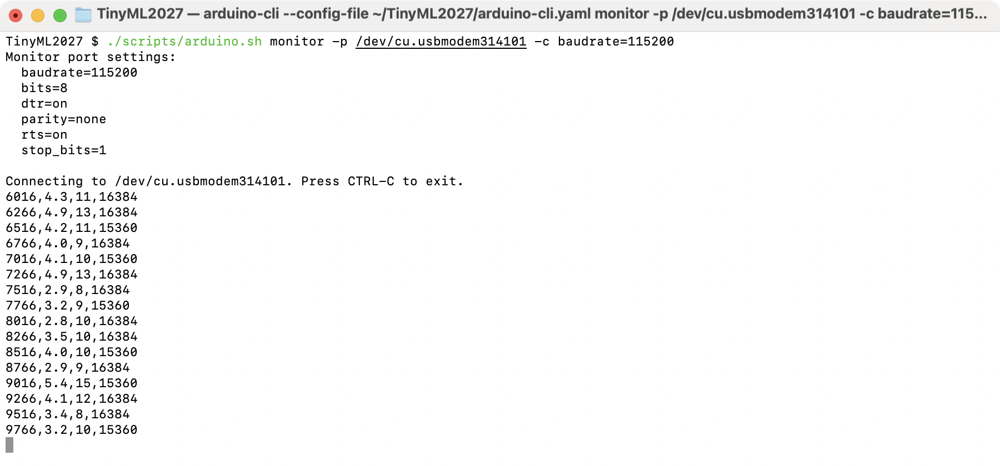
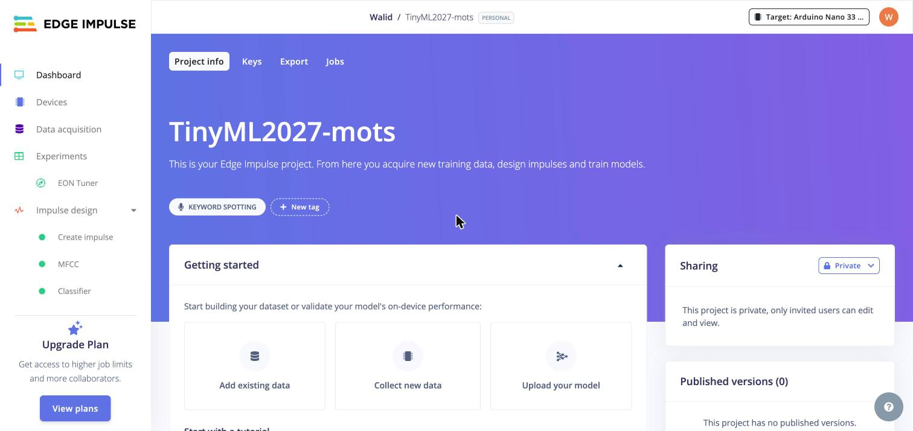
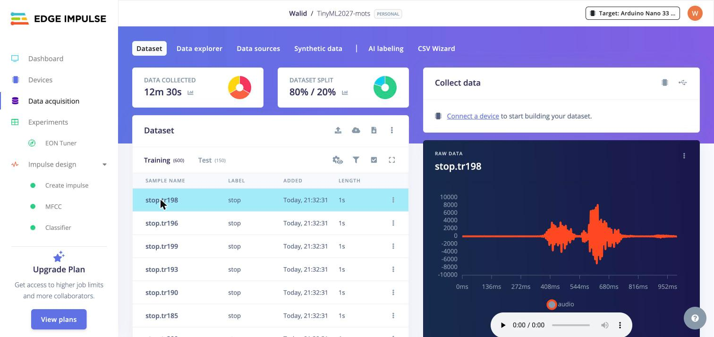
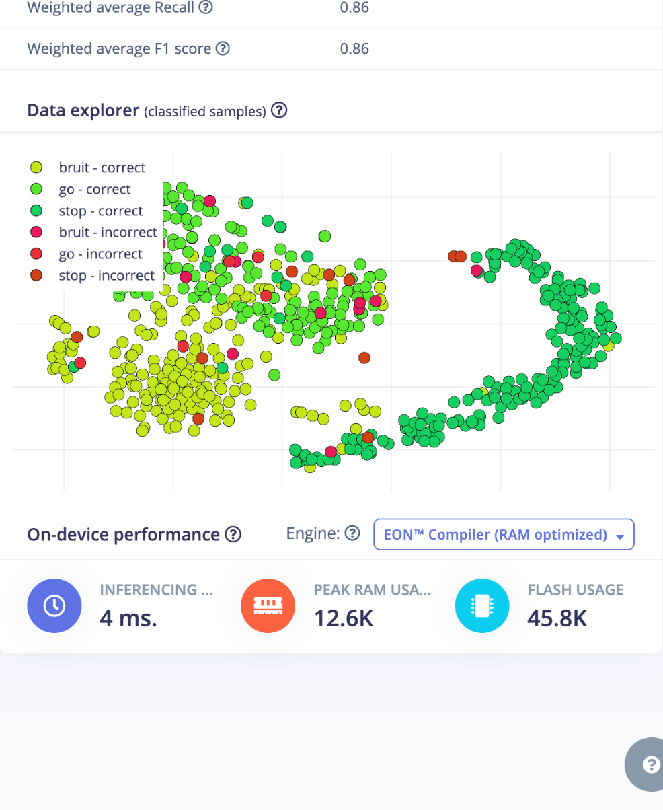
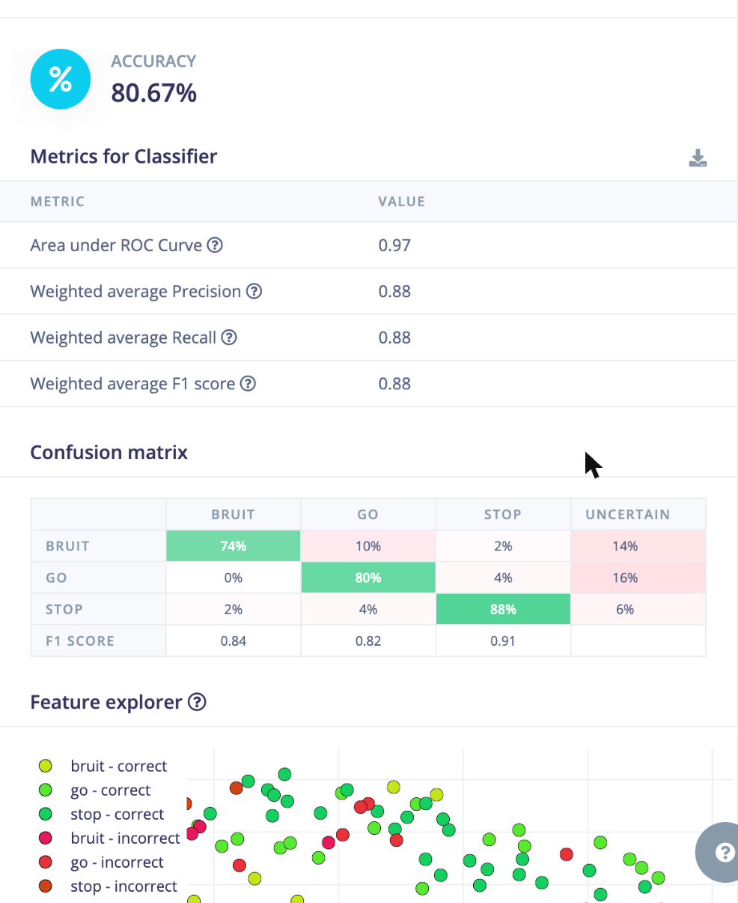
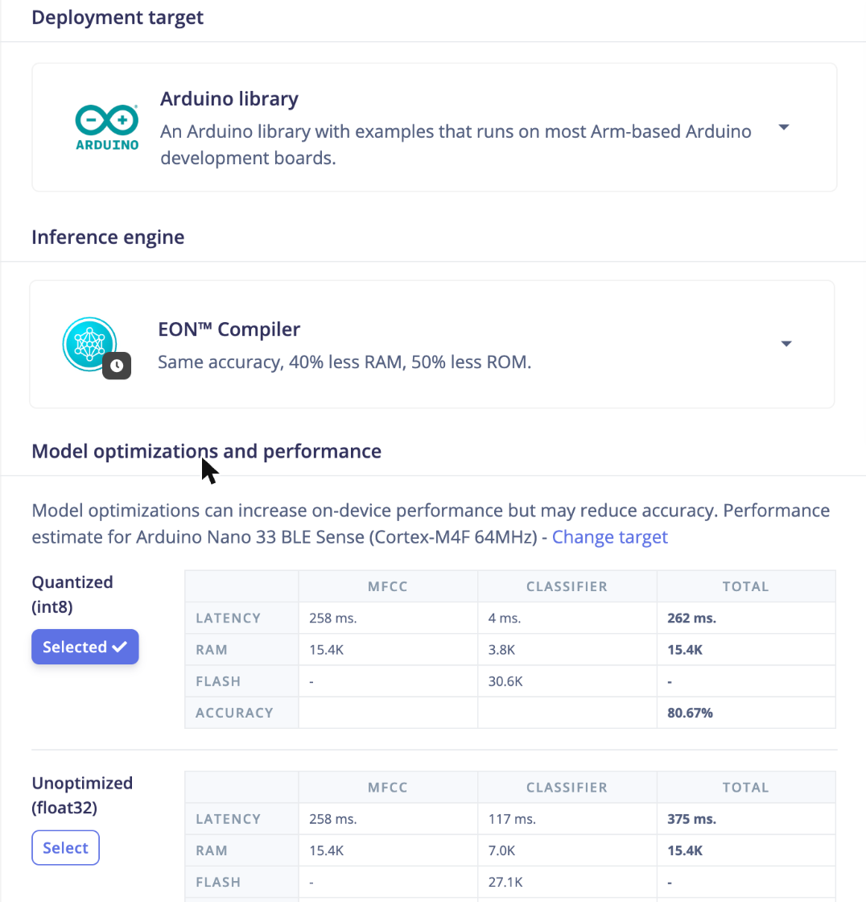

# Pour aller plus loin A — Reconnaître des mots avec Edge Impulse

**Durée :** 2 à 3 h. **Matériel :** la même Nano 33 BLE **Sense**, avec son microphone intégré, plus une connexion Internet et un compte Edge Impulse. Facultatif : les TP01 à TP03 fonctionnent sans ce service.

**Statut au 23/11/2026 :**

| Partie | Statut |
|---|---|
| Microphone de la carte (`mic_check`) | **validé sur matériel** sur la Nano V1 : environ 16 000 échantillons/s ; crête de 13 à 113 au calme, de 913 à 3 658 pendant les claquements de mains ([evidence](../../evidence/edge-impulse/)) |
| Collecte, entraînement et test dans le Studio (Speech Commands : `go`, `stop`, `bruit`) | **exécuté** : test sur 150 clips de locuteurs jamais vus, accuracy 80,67 % (float32 et int8) |
| Bibliothèque Arduino exportée, carte **originale** | **validé sur matériel** : compilée (161 920 octets de Flash), téléversée ; DSP 134 ms, classification 6 ms mesurés ([evidence](../../evidence/edge-impulse/)) |
| Essai avec une voix réelle (enseignant, français) | **exécuté**, résultat médiocre sur « stop » : voir l'étape 6 |
| Bibliothèque exportée sur une **Rev2** | **non testé** |

Les chiffres ci-dessous viennent d'une séance réelle (projet privé, Studio Edge Impulse, 23/11/2026). Le Studio évolue : notez la date et les versions de votre propre séance.

## Ce que vous allez faire

Comparer le travail « à la main » des TP01 à TP03 (features, entraînement, conversion, firmware) avec une plateforme qui automatise ces étapes. Le but est de reconnaître **« go »**, **« stop »** et une classe **« bruit / inconnu »**, puis de **mesurer** la qualité obtenue, au-delà de la simple démonstration.

---

## Étape 1 — Vérifier le microphone (sans Internet)

```sh
./scripts/compile.sh advanced/edge-impulse/sketches/mic_check
./scripts/upload.sh  advanced/edge-impulse/sketches/mic_check
./scripts/arduino.sh monitor -p PORT -c baudrate=115200
```

Le sketch utilise la bibliothèque **PDM**, fournie avec le core officiel `arduino:mbed_nano`. Rien n'est à installer.

**Sortie réelle (pièce calme, carte de référence) :**
```text
t_ms,rms,crete,echantillons_par_s
4016,310.5,370,16384
4516,217.4,282,15360
5266,27.7,66,16384
6266,6.7,13,16384
7266,17.7,50,16384
```



*Capture réelle, Terminal macOS 15.6, carte Nano 33 BLE Sense V1, 23/11/2026.*

- `echantillons_par_s` alterne entre 15 360 et 16 384, car le micro livre ses données par blocs de 512 octets (256 échantillons). La moyenne est bien d'environ 16 000.
- Les premières lignes sont plus fortes : c'est la mise en route du micro, qui se stabilise en environ 1 s.
- Dans le calme, le niveau RMS reste autour de 10 (unités brutes, sur une échelle de 0 à 32 767).

**Claquements de mains (essai réel, à environ 30 cm) :** la crête passe d'environ 50 au calme à une valeur comprise entre 913 et 3 658 à chaque claquement. On a compté 10 pics, pour 3 claquements demandés : une ligne couvre 250 ms, si bien qu'un même claquement et son écho peuvent tomber sur deux lignes. Le journal ne permet pas de compter exactement les claquements. Une carte **sans Sense** n'a pas de micro : le sketch affiche alors `ERREUR PDM.begin`.

---

## Étape 2 — Compte et projet Edge Impulse

Créez un compte sur <https://studio.edgeimpulse.com>, puis un projet **Personal** et **Private**. Un projet public est visible et copiable par tout le monde : n'y mettez pas de voix. **Avant de commencer, notez** l'offre gratuite et ses limites (le 23/11/2026 : 60 min de calcul par tâche, 4 Go ou 4 h de données, 3 projets privés), où les données sont stockées et la date de la séance.



*Capture réelle du Studio, 23/11/2026 : le projet est bien **Private** (encadré « Sharing »).*

Dans le Studio, choisissez la cible **Arduino Nano 33 BLE Sense (Cortex-M4F 64MHz)** (en haut à droite) : les estimations de RAM, de Flash et de latence en dépendent.

## Étape 3 — Préparer et importer les données

Le parcours de référence utilise le jeu public **Speech Commands v0.02** (Google, Pete Warden, licence CC BY 4.0) : aucune voix personnelle n'est envoyée. Il ne contient pas « start » : on prend **`go`**, **`stop`** et une classe **`bruit`** (bruits de fond découpés en 1 s et autres mots : yes, no, up, down, left, right).

1. Téléchargez `speech_commands_v0.02.tar.gz` (2,3 Go) depuis `download.tensorflow.org/data/` et décompressez-le **hors du dépôt Git**.
2. Construisez le sous-ensemble :
   ```sh
   uv run python advanced/edge-impulse/prepare_speech_commands.py --src CHEMIN/speech_commands --out CHEMIN/ei_kws
   ```
   Le script produit 200 clips par classe pour l'entraînement et 50 pour le test, en WAV 16 kHz, mono, 1 s. **Le test et l'entraînement n'ont aucun locuteur en commun** : le script s'arrête en erreur sinon. Résultat réel : 177 à 184 locuteurs par mot en entraînement, 40 à 44 en test ([rapport](../../evidence/edge-impulse/speech-commands-subset_report.json)).
3. Dans **Data acquisition → Add existing data → Upload data** : sélectionnez les fichiers de `test/`, cochez **Test** et **Infer from filename**, puis **Upload data**. Recommencez avec `train/` et **Training**. Ne choisissez pas « Automatically split » : le Studio mélangerait les locuteurs.



*Capture réelle : 600 clips d'entraînement, 150 de test ; à droite, la forme d'onde d'un « stop ».*

Résultat réel : 750 fichiers importés, 0 échec, soit 10 min de données d'entraînement et 150 clips de test.

**Ne mettez jamais d'enregistrements de voix dans Git** (le dossier de sortie doit rester hors du dépôt).

## Étape 4 — Créer l'« Impulse »

**Create impulse** : fenêtre **1000 ms**, 16 000 Hz, bloc de traitement **Audio (MFCC)**, bloc d'apprentissage **Classification**, puis **Save Impulse**. Dans **MFCC**, gardez les paramètres par défaut (13 coefficients, trames de 20 ms, 32 filtres, FFT 256), **Save parameters**, puis **Generate features**. Dans **Classifier**, gardez le réseau par défaut (deux couches de convolution 1D à 8 et 16 filtres, 100 époques, taux d'apprentissage 0,0001), puis **Save & train**.



*Capture réelle du Studio Edge Impulse, 23/11/2026. Le score affiché au-dessus (85,8 %) est celui de la « validation », un tirage aléatoire du train par le Studio : un même locuteur peut s'y trouver des deux côtés, ce score est donc optimiste.*

## Étape 5 — Évaluer sur le test

**Model testing → Classify all.** Pour évaluer aussi le modèle int8 (celui qui sera déployé), cochez **Test 'Quantized (int8)' model** dans la roue dentée, puis relancez.



*Capture réelle, modèle int8, 150 clips de locuteurs jamais vus. Le float32 donne exactement la même matrice.*

| vrai ↓ / prédit → | bruit | go | stop | incertain |
|---|---|---|---|---|
| bruit | 74 % | 10 % | 2 % | 14 % |
| go | 0 % | 80 % | 4 % | 16 % |
| stop | 2 % | 4 % | 88 % | 6 % |

- **Accuracy 80,67 %**, F1 de 0,82 à 0,91. « Incertain » signifie qu'aucun score ne dépasse le seuil de 0,6.
- **Faux positifs** : 10 % des clips de bruit sont pris pour « go », 2 % pour « stop ». Pour une commande vocale, c'est le chiffre le plus important : un « go » déclenché sans que personne ne parle.

## Étape 6 — Déployer sur la Nano et mesurer

**Deployment** : cible **Arduino library**, moteur **EON Compiler**, modèle **Quantized (int8)**, puis **Build**. Le Studio télécharge un ZIP.



*Capture réelle. Remarquez que le classifieur float32 occupe **moins** de Flash (27,1 K) que l'int8 (30,6 K) : comme à l'exemple 05, l'int8 ne réduit pas toujours la taille d'un très petit modèle.*

Décompressez le ZIP **dans un dossier temporaire**, sans l'installer dans vos bibliothèques Arduino, puis compilez l'exemple micro avec l'environnement du cours :

```sh
./scripts/compile.sh CHEMIN/TinyML2027-mots_inferencing/examples/nano_ble33_sense/nano_ble33_sense_microphone \
    --library CHEMIN/TinyML2027-mots_inferencing
./scripts/upload.sh  CHEMIN/.../nano_ble33_sense_microphone
```

**Mesures réelles** (carte originale, [journal](../../evidence/edge-impulse/ei-kws-deploiement-macos15.6-v1.txt)) :

| | Estimation du Studio | Mesure sur la carte |
|---|---|---|
| Traitement MFCC | 258 ms | **134 ms** |
| Classification | 4 ms | **6 ms** |
| Flash | 30,6 K (classifieur seul) | **161 920 octets** pour tout le programme (16 %) |
| RAM | 15,4 K | **51 872 octets** de variables globales (19 %), plus 32 000 octets de tampon audio alloués au démarrage |

Les estimations ne mesurent pas la même chose que la carte : le Studio compte le modèle et le traitement, la compilation compte tout le programme (Mbed OS, USB, PDM…). **Ce sont les mesures qui comptent.**

**Essai réel sur la carte** ([journaux](../../evidence/edge-impulse/)). La carte écoute 1 s, puis fait une pause d'environ 2 s :

- **silence** : 5 fenêtres sur 5 classées « bruit » ;
- l'enseignant dit « go » toutes les 2 s pendant 35 s : « go » en tête dans **7 fenêtres sur 11** ;
- puis « stop » de la même façon : « stop » en tête dans **1 fenêtre sur 12**, les autres classées « bruit ».

Les fenêtres n'étant pas synchronisées avec la voix, certaines tombent entre deux mots : ces chiffres ne sont pas une accuracy. Mais l'écart avec le test du Studio (88 % sur « stop ») est net. Causes possibles, **non vérifiées** : un accent français absent de Speech Commands, la distance et le micro de la carte, un « stop » prononcé plus court. C'est la leçon de cette extension : **un bon score sur un jeu de test public ne garantit pas le résultat avec un nouvel utilisateur**.

> **Question.** Comment mesureriez-vous proprement la qualité avec votre propre voix ? (Indice : enregistrer des clips étiquetés avec la carte, en ajouter au test… et ne jamais régler le modèle sur ce même test.)

Après l'essai, remettez le firmware du cours : `uv run python -m tinyml2027.release flash releases/motion-v1`.

**Testez séparément sur une Rev2** avant d'affirmer que l'export y fonctionne : ce n'est pas fait ici.

## Limites

- Le service peut changer ses offres, son interface ou ses formats d'export : chaque version doit être notée.
- Sans Internet ni compte, cette extension n'est pas réalisable. La solution de repli, sans service en ligne, consiste à appliquer la démarche des TP01 à TP03 à l'audio. Elle ne donne pas le même résultat et demande plus de travail.

## Sources

<https://docs.edgeimpulse.com/> · <https://docs.arduino.cc/tutorials/nano-33-ble-sense/edge-impulse> · <https://docs.arduino.cc/hardware/nano-33-ble-sense/>
