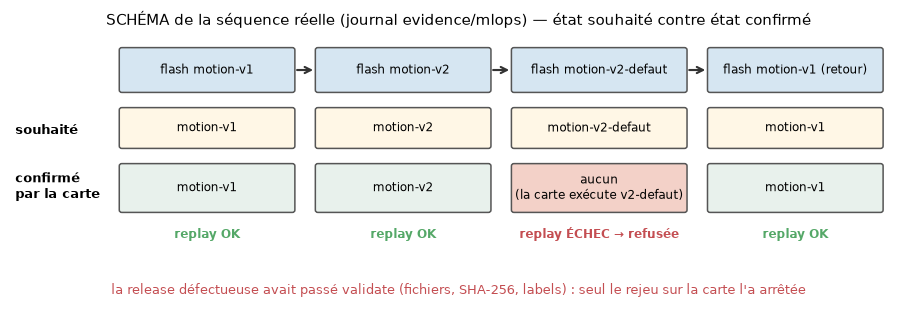

# Extension — Versionner et vérifier un modèle sur la Nano

**Objectif.** Préparer une version déployable, vérifier le modèle exécuté sur la carte et revenir à une version confirmée.

**Durée.** 2 à 3 h. **Matériel.** Une Nano 33 BLE Sense originale et son câble USB de données. **Prérequis.** Terminez le [TP03](../../labs/03-embedded-inference/README.md) et gardez son modèle `motion-v1`, ses en-têtes générés et le binaire compilé pour la carte originale. Lancez les commandes depuis la racine du dépôt.

Le MLOps regroupe les pratiques qui permettent de suivre, déployer et vérifier les versions d’un modèle. Dans cette extension, nous effectuons la mise à jour par USB et vérifions les calculs par rejeu sur la carte.

## 1. Construire la version de référence

Une *release* est un ensemble de fichiers associés à une version. Elle contient le firmware compilé, le modèle, le prétraitement, les classes, les fenêtres témoins et un manifeste qui décrit la cible et les fichiers. Un SHA-256 est une empreinte calculée à partir des octets d’un fichier. Le manifeste enregistre ces empreintes pour détecter une modification après la construction de la release.


Avant de construire `motion-v2`, créez `motion-v1` avec les fichiers préparés au TP03. Si cette version existe déjà, passez directement à sa validation. Le programme compare l’empreinte dans `model_data.h` à celle du fichier INT8 et vérifie que le binaire est au moins aussi récent que cet en-tête.

```sh
uv run python -m tinyml2027.release build    --version motion-v1     # crée releases/motion-v1/
uv run python -m tinyml2027.release validate releases/motion-v1      # contrôle hors ligne
uv run python -m tinyml2027.release flash    releases/motion-v1      # téléverse et vérifie
uv run python -m tinyml2027.release status                           # que tourne-t-il vraiment ?
```

Attendez `VALIDE` après le contrôle hors ligne. Fermez le moniteur série avant `flash`. Lisez le plan, puis confirmez le téléversement. La carte doit annoncer la version et le SHA-256 du modèle attendus, puis `REPLAY STATUT OK`. Vérifiez que `status` indique `motion-v1` comme état souhaité et confirmé.

## 2. Construire un candidat

Nous passons de 8 à 16 neurones cachés. Gardez les mêmes sessions pour comparer les modèles. Si votre session de test porte un autre identifiant, remplacez `s05` par cet identifiant. Le parcours ci-dessous utilise les enregistrements locaux de `data/`. Si vous avez suivi le parcours avec le jeu publié, utilisez la même option `--data datasets/motion-nano-v1` qu’au TP03 lors de la quantification.

```sh
uv run python -m tinyml2027.train_motion --test-session s05 --hidden 16 --out artifacts/motion-v2
uv run python -m tinyml2027.quantize_motion --artifacts artifacts/motion-v2 --model-version motion-v2
./scripts/compile.sh labs/03-embedded-inference/firmware/infer_nano
uv run python -m tinyml2027.release build --version motion-v2 --artifacts artifacts/motion-v2
```

Comparez les deux fichiers `metrics.json`. Dans l’essai de référence, le macro-F1 moyen en validation croisée passe de 0,864 à 0,874. Les deux modèles obtiennent 0,961 sur `s05). Cette comparaison fait partie de la démonstration. Pour choisir ou régler un modèle, utilisez les résultats de validation croisée et gardez une session indépendante pour l’évaluation finale.

## 3. Vérifier l’intégrité avant le téléversement

Copiez `releases/motion-v2/` dans `releases/essai-modifie/` et ajoutez un espace dans le fichier `labels.json` de la copie. Le JSON reste lisible, mais son empreinte change.

```sh
uv run python -m tinyml2027.release validate releases/essai-modifie
```

Vérifiez que la commande refuse la copie en signalant un SHA-256 différent. Supprimez ensuite uniquement la copie. `flash` lance le même contrôle avant de proposer un téléversement. La validation vérifie aussi les fichiers attendus, la cible et l’ordre des classes et des entrées.

```sh
uv run pytest tests/test_release.py
```

Les tests ci-dessus couvrent les contrôles logiciels. Utilisez la release d’origine pour la manipulation sur carte.

## 4. Téléverser le candidat puis restaurer la référence

```sh
uv run python -m tinyml2027.release flash releases/motion-v2
uv run python -m tinyml2027.release status
```

Vérifiez que `motion-v2` est confirmée. Dans `releases/device_state.json`, l’état souhaité indique la version demandée. L’état confirmé indique celle que la carte a annoncée et dont le rejeu a réussi.



Dans l’essai de référence, une version construite avec un écart-type erroné pour `crest_factor` a passé la validation hors ligne. Le modèle et son empreinte correspondaient au manifeste. Le rejeu a détecté l’écart dans les codes INT8 d’entrée, bien que les classes prédites soient restées identiques. Examinez le [journal du déploiement](../../evidence/mlops/mlops-demo-macos15.6-v1.txt).

Pour revenir à la référence, retéléversez sa release et vérifiez l’état annoncé.

```sh
uv run python -m tinyml2027.release flash releases/motion-v1
uv run python -m tinyml2027.release status
```

Attendez l’état confirmé `motion-v1`. Après une interruption du téléversement, utilisez au besoin le mode bootloader décrit au [TP03](../../labs/03-embedded-inference/README.md#6-mesurer-les-ressources-et-vérifier-la-version).

## Questions

1. Pourquoi une release peut-elle passer `validate` alors qu’un calcul du firmware est erroné ?
2. Pourquoi conserver le binaire de chaque version confirmée ?
3. Quel état la carte annonce-t-elle après le retour à `motion-v1` ? Quels contrôles permettent de le confirmer ?

Les [essais sur carte originale](../../evidence/mlops/) documentent le refus avant téléversement, l’échec au rejeu et le retour à la version confirmée.

## Corrigé

<details>
<summary>Afficher les réponses</summary>

1. `validate` vérifie l’intégrité des fichiers et les informations du manifeste. Une erreur présente au moment de la construction peut se trouver dans un binaire dont l’empreinte est correcte. Le rejeu vérifie que les calculs exécutés sur la carte donnent les valeurs attendues.
2. Le binaire conservé permet de remettre exactement la version vérifiée, avec ses paramètres et son prétraitement. Une reconstruction peut produire un autre binaire ou intégrer des fichiers différents.
3. Après restauration, `status` doit indiquer `motion-v1` comme état souhaité et confirmé. Vérifiez la version et l’empreinte SHA-256 annoncées par la carte ainsi que la réussite du rejeu (`REPLAY STATUT OK`).

</details>
