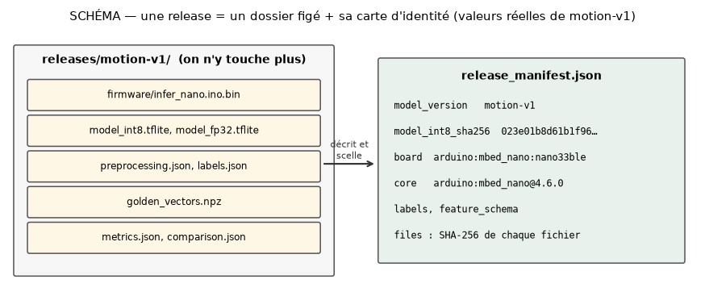
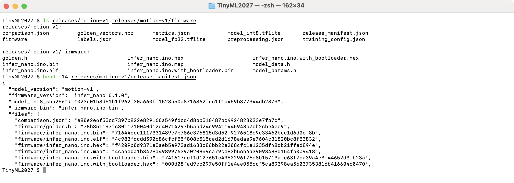
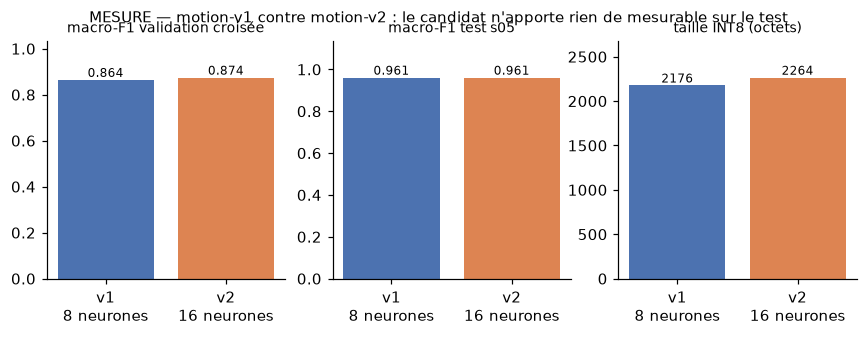
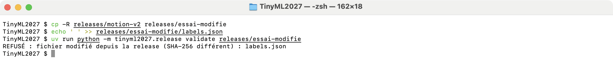
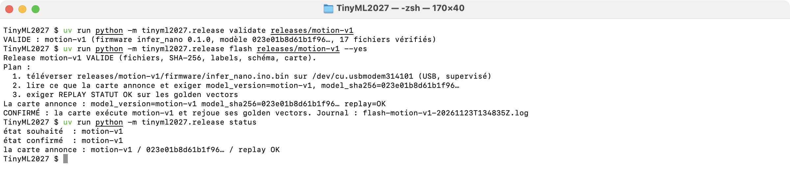

# Pour aller plus loin B — Edge MLOps sur une seule Nano

**Durée :** 2 à 3 h. **Matériel :** la même Nano et son câble USB. Pas de cloud, pas de mise à jour à distance. **Prérequis :** le [TP03](../../labs/03-embedded-inference/README.md) terminé.

**Statut : validé sur matériel le 23/11/2026** (Nano 33 BLE Sense V1, macOS 15.6). Les journaux sont dans [evidence/mlops](../../evidence/mlops/).

## L'idée

Téléverser un modèle ne suffit pas. Il faut aussi pouvoir :
1. savoir **quelle version** tourne vraiment sur la carte ;
2. **refuser** une version incohérente **avant** de la téléverser ;
3. **vérifier** une nouvelle version sur la carte, et pas seulement sur l'ordinateur ;
4. **revenir** à la dernière version qui marchait.

Tout se fait avec un seul outil :

```sh
uv run python -m tinyml2027.release build    --version motion-v1     # crée releases/motion-v1/
uv run python -m tinyml2027.release validate releases/motion-v1      # contrôle hors ligne
uv run python -m tinyml2027.release flash    releases/motion-v1      # téléverse et vérifie
uv run python -m tinyml2027.release status                           # que tourne-t-il vraiment ?
```

---

## Étape 1 — Une release, c'est quoi ?

Une release est un **dossier qu'on ne modifie plus jamais** :

```text
releases/motion-v1/
  firmware/infer_nano.ino.bin          le programme compilé, prêt à téléverser
  firmware/model_data.h, model_params.h, golden.h
  model_int8.tflite, model_fp32.tflite
  preprocessing.json, labels.json      le contrat d'entrée/sortie
  golden_vectors.npz                   les fenêtres témoins
  metrics.json, comparison.json, training_config.json
  release_manifest.json                la carte d'identité de la release
```



*Schéma, avec les valeurs réelles de motion-v1.*



*Capture réelle, Terminal macOS 15.6, 23/11/2026.*

Le `release_manifest.json` contient, entre autres :

| Champ | Exemple (motion-v1) |
|---|---|
| `model_version` | `motion-v1` |
| `firmware_version` | `infer_nano 0.1.0` |
| `model_int8_sha256` | `023e01b8d61b1f96…` |
| `board`, `board_core`, `board_revision` | `arduino:mbed_nano:nano33ble`, `arduino:mbed_nano@4.6.0`, `original` |
| `runtime` | `Arduino_TensorFlowLite@7948b85e` |
| `feature_schema`, `labels` | l'ordre exact des 4 entrées et des 3 classes |
| `files` | le SHA-256 de **chaque** fichier de la release |
| `acceptance_status` | `candidate` |

**Le SHA-256** est une empreinte de 64 caractères calculée sur le contenu d'un fichier. Si un seul octet change, l'empreinte change complètement.

## Étape 2 — Construire deux versions

**motion-v1** est le modèle du TP03 (réseau 4-8-3). **motion-v2** est un candidat avec 16 neurones cachés au lieu de 8, entraîné sur les mêmes sessions et évalué sur la même session de test s05, qu'on n'a pas utilisée pour le régler.

```sh
uv run python -m tinyml2027.train_motion --test-session s05 --hidden 16 --out artifacts/motion-v2
uv run python -m tinyml2027.quantize_motion --artifacts artifacts/motion-v2 --model-version motion-v2
./scripts/compile.sh labs/03-embedded-inference/firmware/infer_nano
uv run python -m tinyml2027.release build --version motion-v2 --artifacts artifacts/motion-v2
```

**Résultats réels :**

| | motion-v1 (8 neurones) | motion-v2 (16 neurones) |
|---|---|---|
| macro-F1, validation croisée | 0,864 | 0,874 |
| macro-F1, test s05 | 0,961 | 0,961 (même matrice de confusion) |
| Taille INT8 | 2 176 octets | 2 264 octets |



*Mesure : métriques et tailles réelles des deux modèles.*

Le candidat n'apporte rien de mesurable sur le test. **Ce constat compte aussi** : une release n'est pas forcément une amélioration.

`build` refuse de créer une release si les en-têtes du firmware ne correspondent pas au modèle, si le firmware compilé est plus ancien que ces en-têtes, ou si la version existe déjà.

## Étape 3 — Refuser avant de téléverser

`validate`, lancé automatiquement par `flash`, refuse une release dans les cas suivants :

| Défaut | Message |
|---|---|
| manifest tronqué ou illisible | `REFUSÉ : manifest illisible (JSON invalide)` |
| un fichier modifié après la release | `fichier modifié depuis la release (SHA-256 différent)` |
| un fichier manquant (golden vectors, binaire…) | `fichier manquant` |
| ordre des classes différent | `labels [...] différents du contrat` |
| schéma de features différent | `schéma de features différent du contrat` |
| carte ou core différents de ceux du dépôt | `carte/core ... différents du dépôt` |

Pour le voir vous-même, abîmez une **copie** (jamais la release elle-même) :



*Capture réelle, Terminal macOS 15.6, 23/11/2026.* Un seul espace ajouté à `labels.json` suffit : son SHA-256 change et la release est refusée. Supprimez ensuite la copie (`rm -rf releases/essai-modifie`).

**Essai réel**, sur deux copies abîmées de motion-v2 ([journal](../../evidence/mlops/mlops-refus-avant-flash-macos15.6-v1.txt)) :
```text
===== manifest tronqué =====
REFUSÉ : manifest illisible (JSON invalide) : Expecting property name enclosed in double quotes: line 1 column 32 (char 31)
===== labels inversés =====
REFUSÉ : labels ['periodic', 'stationary', 'impact'] différents du contrat ['stationary', 'periodic', 'impact']
```

Dans les deux cas, **rien n'a été téléversé**. Ces refus sont aussi couverts par les tests automatiques (`uv run pytest tests/test_release.py`).

## Étape 4 — Téléverser, puis vérifier ce que la carte annonce

`flash` affiche son plan, demande confirmation, téléverse **par USB**, puis interroge la carte :

1. la carte doit annoncer **la bonne version** (`# model_version=…`) ;
2. elle doit annoncer **le bon SHA-256 du modèle** (`# model_sha256=…`) ;
3. elle doit **rejouer ses golden vectors** sans écart (`REPLAY STATUT OK`).

L'outil distingue **l'état souhaité** (la version qu'on a voulu installer) et **l'état confirmé** (ce que la carte a prouvé). Les deux sont écrits dans `releases/device_state.json`.



*Capture réelle, Terminal macOS 15.6, carte Nano 33 BLE Sense V1, 23/11/2026.*

**Un téléversement réussi ne prouve rien sur le modèle qui tourne.** Seule la réponse de la carte compte.

## Étape 5 — Un échec volontaire, puis le retour à v1

Pour la démonstration, on fabrique une release **motion-v2-defaut** : le même modèle que v2, mais avec une erreur dans le prétraitement C++ (l'écart-type de `crest_factor` est doublé dans `model_params.h`). C'est le genre d'erreur qui arrive en recopiant des paramètres à la main.

**Séquence réelle** ([journal complet](../../evidence/mlops/mlops-demo-macos15.6-v1.txt)) :

```text
===== flash motion-v1 =====
La carte annonce : model_version=motion-v1 model_sha256=023e01b8d61b1f96… replay=OK
CONFIRMÉ : la carte exécute motion-v1 et rejoue ses golden vectors.
===== flash motion-v2 =====
La carte annonce : model_version=motion-v2 model_sha256=9acece88c0e4579a… replay=OK
CONFIRMÉ : la carte exécute motion-v2 et rejoue ses golden vectors.
===== flash motion-v2-defaut =====
Release motion-v2-defaut VALIDE (fichiers, SHA-256, labels, schéma, carte).
La carte annonce : model_version=motion-v2-defaut model_sha256=9acece88c0e4579a… replay=ECHEC
ACCEPTATION REFUSÉE ['replay'].
===== flash motion-v1 =====
CONFIRMÉ : la carte exécute motion-v1 et rejoue ses golden vectors.
===== status =====
état souhaité  : motion-v1
état confirmé  : motion-v1
la carte annonce : motion-v1 / 023e01b8d61b1f96… / replay OK
```


*Schéma de la séquence ci-dessus. Après l'échec, l'outil n'enregistre **aucun** état confirmé, alors que la carte exécute bien v2-defaut.*

**Trois enseignements :**
1. La release défectueuse a passé **tous les contrôles hors ligne** : fichiers cohérents, SHA-256 corrects, bon schéma. Elle était fausse dès le départ, sans avoir été corrompue après coup.
2. **Le SHA-256 du modèle était le bon**, car le défaut ne se trouvait pas dans le modèle mais dans le prétraitement. Seul le **rejeu sur la carte** l'a détecté.
3. Dans le rejeu, **les classes prédites étaient toutes correctes**. Les scores étant déjà saturés à 1,00, l'erreur ne se voyait pas en sortie. Ce sont les **codes int8 d'entrée** (jusqu'à 42 crans d'écart, [journal](../../evidence/mlops/)) qui l'ont révélée. Un contrôle limité à « la carte donne-t-elle la bonne classe ? » l'aurait laissée passer.

Le retour à v1 se fait simplement en **téléversant à nouveau la release v1**. Elle est immuable, son binaire n'a donc pas bougé, et la carte confirme à nouveau `motion-v1`.

## Questions

1. Pourquoi la release v2-defaut a-t-elle passé `validate` ? Que faudrait-il ajouter au manifest pour la refuser plus tôt ?
2. Que se passerait-il si l'on reconstruisait `motion-v1` aujourd'hui avec un nouvel entraînement ? Pourquoi une release doit-elle être immuable ?
3. Si le câble se débranche pendant le téléversement, dans quel état est la carte ? Comment la récupérer ? (Indice : double appui sur RESET, mode bootloader.)

## Ce que cette extension ne fait pas : la mise à jour à distance (OTA)

Une vraie mise à jour à distance demanderait au minimum :
- une **signature** cryptographique du firmware, vérifiée par la carte, pour qu'elle n'accepte que des firmwares authentifiés ;
- **deux emplacements** en mémoire Flash (A/B), pour écrire la nouvelle version sans effacer celle qui tourne ;
- un **basculement atomique** et un **chien de garde** (*watchdog*) qui revient à l'ancienne version si la nouvelle ne démarre pas ;
- un canal **authentifié et chiffré**.

Rien de cela n'est implémenté ici. Le cours n'utilise qu'une mise à jour **USB supervisée**.

## Source

Ce TP adapte le chapitre 13 de [AIoT-Book](https://github.com/wld-code/AIoT-Book/tree/main/labs/ch13-edge-model-update). Le code est réécrit pour ce dépôt.
