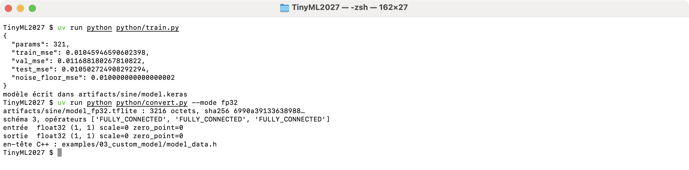
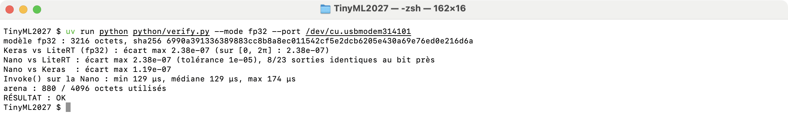

# Exemple 03 — Notre propre modèle (FP32) sur la Nano

> **Testé** sur une carte originale avec macOS 15.6, le 23/11/2026 ([preuves](../../evidence/phase5/README.md)).

**Objectif :** entraîner un petit réseau sur le Mac, le convertir pour TensorFlow Lite Micro, l'exécuter sur la carte et **prouver** que la carte calcule la même chose que l'ordinateur.

## Pourquoi un sinus ?

Le résultat attendu est connu d'avance, et le réseau tient en 321 paramètres. Toute la chaîne est ainsi exercée (apprentissage, conversion, tableau C++, firmware, comparaison) avant de passer aux données réelles de l'IMU.

## Étapes

Lancez toutes les commandes depuis la racine du dépôt.

1. **Entraîner.** La commande crée `artifacts/sine/model.keras`, `data.npz` et `train_log.json`.

   ```sh
   uv run python python/train.py
   ```

   Résultat attendu : une MSE de test proche de 0,010, c'est-à-dire la variance du bruit ajouté aux données.

2. **Convertir.** La commande crée `artifacts/sine/model_fp32.tflite`, puis `model_data.h` et `test_vectors.h` dans ce dossier.

   ```sh
   uv run python python/convert.py --mode fp32
   ```

   Le script **s'arrête en erreur** dans trois cas : si le schéma n'est pas la version 3, si un opérateur n'est pas enregistré dans le firmware, ou si la sortie ne correspond pas à ce qu'attend la bibliothèque Arduino.

3. **Compiler et téléverser.** Le port est détecté automatiquement. Si plusieurs cartes sont branchées, le script refuse de choisir à votre place.

   ```sh
   ./scripts/compile.sh examples/03_custom_model
   ./scripts/upload.sh examples/03_custom_model
   ```

4. **Vérifier.** Lorsque la commande le demande, saisissez le chemin affiché après `PORT=` à l’étape 3.

   ```sh
   printf 'Port de la carte : '
   read -r PORT && uv run python python/verify.py --mode fp32 --port "$PORT"
   ```

   La dernière ligne doit être `RÉSULTAT : OK`. On peut aussi ouvrir le moniteur avec `./scripts/arduino.sh monitor -p "$PORT" -c baudrate=115200`, puis appuyer sur Entrée pour relancer les 23 tests.





## Lire la sortie de la carte

```text
i,x,y,y_hex,y_attendu,ecart_abs,us,statut
5,1.570796,0.974537,0x3f797b4a,0.974537,0.000000119,130,OK
```

- `y` est la prédiction de la carte, et `y_hex` ses bits IEEE-754 exacts, que `verify.py` relit sans perte.
- `y_attendu` est la valeur de LiteRT sur le Mac. `ecart_abs` doit rester ≤ 1e−5.
- `us` est la durée de `Invoke()` en microsecondes.

Le firmware **affiche toute erreur** au lieu de la masquer : schéma incompatible, opérateur manquant, échec de `AllocateTensors()` ou type de tenseur inattendu. Pour le constater, réduisez `kArenaSize` à 512, recompilez et téléversez : la carte affiche `ERREUR init=AllocateTensors`.

## Questions

1. Pourquoi la carte et LiteRT ne donnent-ils pas toujours le même résultat au bit près, alors qu'ils exécutent les mêmes opérations en float32 ? Indice : l'ordre des additions.
2. `arena_used=880` alors que `kArenaSize=4096`. Que gagne-t-on en réduisant la réserve, et que risque-t-on si on la réduit trop ?
3. Pourquoi ce sketch occupe-t-il 200 Ko de Flash de moins que l'exemple officiel `hello_world` ?

## Corrigé

<details>
<summary>Afficher les réponses</summary>

1. En float32, chaque opération peut être arrondie. Changer l’ordre des additions peut donc changer les derniers bits du résultat. L’exemple compare l’écart absolu à la tolérance annoncée.
2. Réduire `kArenaSize` libère de la RAM statique. Si la réserve devient trop petite pour les tenseurs et leurs buffers, `AllocateTensors()` échoue à l’initialisation.
3. Ce firmware enregistre uniquement l’opérateur `FULLY_CONNECTED`. L’exemple officiel utilise `AllOpsResolver`, qui enregistre tous les opérateurs et augmente la taille du programme en Flash.

</details>
