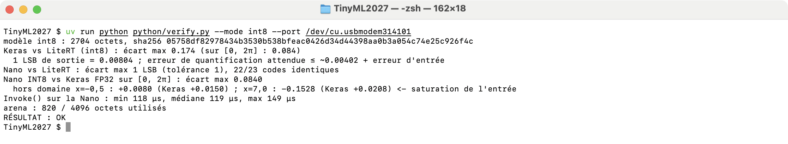

# Exemple 05 — Le même modèle en INT8

> **Testé** sur une carte originale avec macOS 15.6, le 23/11/2026 ([preuves](../../evidence/phase5/README.md)).

**Objectif :** quantifier en entiers 8 bits le modèle de l'[exemple 03](../03_custom_model/README.md), puis mesurer ce que l'on gagne (taille, temps) et ce que l'on perd (précision) **sur les mêmes entrées**.

## Étapes

```sh
uv run python python/train.py                 # si artifacts/sine n'existe pas encore
uv run python python/convert.py --mode int8
./scripts/compile.sh examples/05_int8_model
./scripts/upload.sh examples/05_int8_model
uv run python python/verify.py --mode int8 --port PORT
```



## Ce que fait la conversion INT8

- **Calibration sur le train uniquement.** Le convertisseur fait passer les 600 x d'entraînement dans le réseau pour mesurer la plage de chaque tenseur. Le jeu de test n'y participe jamais.
- **Quantification complète.** L'entrée, la sortie et les activations sont en int8, les biais en int32. Le script refuse le modèle si un seul tenseur reste en float.
- **Une seule échelle par tenseur de poids.** La bibliothèque Arduino de 2023 ne gère pas la quantification par canal de `FULLY_CONNECTED`, que TensorFlow 2.21 active par défaut. `convert.py` la désactive et contrôle qu'il ne reste aucun tenseur par canal.

## Les deux formules à connaître

Pour un tenseur de paramètres `scale` (réel > 0) et `zero_point` (entier) :

- **quantifier** : `q = clamp(round(x / scale) + zero_point, −128, 127)` ;
- **dé-quantifier** : `x ≈ (q − zero_point) · scale`.

Pour notre entrée, `scale = 0,02463` et `zero_point = −128`. La plage représentable va donc de x = 0 (q = −128) à x ≈ 6,28 (q = 127). Toute valeur au-delà est **saturée** : x = 7,0 est traité comme x ≈ 6,28.

## Résultats mesurés (FP32 → INT8)

| | FP32 | INT8 |
|---|---|---|
| Taille du modèle | 3 216 octets | 2 704 octets (−16 %) |
| `Invoke()`, médiane | 129 µs | 119 µs |
| Arena utilisée | 880 octets | 820 octets |
| Écart max avec Keras FP32 sur [0, 2π] | 1,2·10⁻⁷ | 0,084 |
| Parité avec LiteRT desktop | ≤ 2,4·10⁻⁷ | ≤ 1 LSB (22/23 identiques) |

Pour un modèle aussi petit, le gain de l'INT8 reste modeste. **L'INT8 ne garantit pas un fichier beaucoup plus petit** : les métadonnées du format pèsent autant que les 321 poids. Sur un réseau plus gros, le gain approche un facteur 4.

## Questions

1. Le test n° 8 donne 72 sur la carte et 73 sur le Mac, avec pourtant le même code d'entrée. D'où peut venir cet écart d'un cran ? Voir [evidence/phase5](../../evidence/phase5/README.md).
2. Que répond le modèle INT8 pour x = 7,0, et pourquoi est-ce si loin du modèle FP32 ?
3. Pourquoi ne faut-il pas calibrer la quantification avec le jeu de test ?

## Corrigé

<details>
<summary>Afficher les réponses</summary>

1. Les noyaux de calcul peuvent arrondir différemment lors de la remise à l’échelle de l’accumulateur en INT8. Près d’une limite entre deux codes, cela peut produire un écart d’un cran avec la même entrée quantifiée.
2. Pour `x = 7,0`, le code d’entrée sature à 127, qui représente environ 6,28. Dans l’essai de référence, la carte renvoie le code −14, soit environ −0,153 après déquantification. Le modèle FP32 reçoit 7,0 et prédit environ 0,021. Les deux modèles reçoivent donc des valeurs effectives différentes et 7,0 se trouve hors du domaine d’entraînement. [Mesures de référence](../../evidence/phase5/README.md)
3. La calibration choisit les échelles de quantification. Si elle utilisait les données de test, les plages du modèle seraient ajustées à ces données avant l’évaluation. Calibrez sur l’entraînement et gardez le test pour la comparaison FP32–INT8.

</details>
