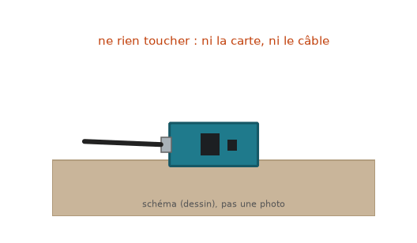
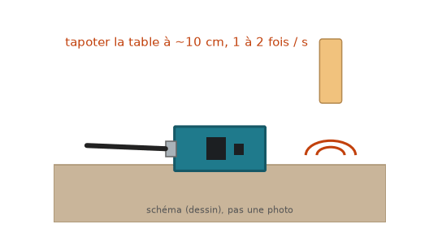
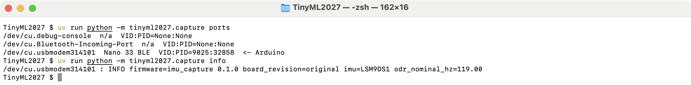
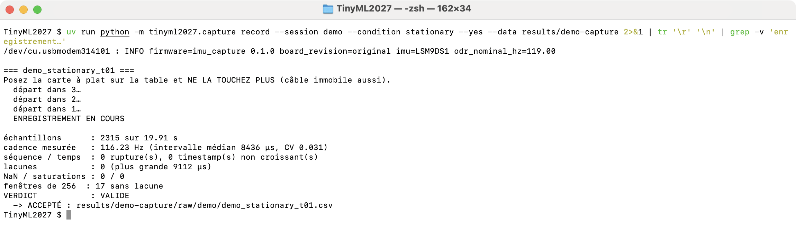
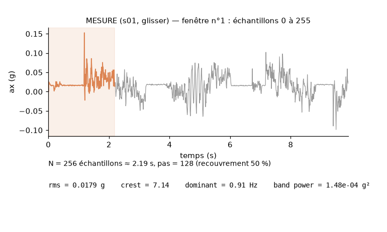
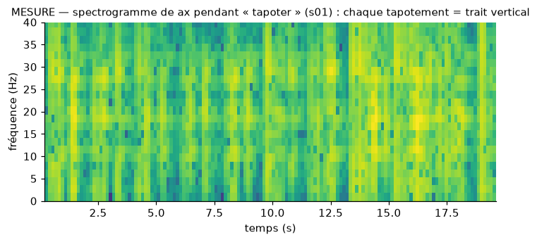
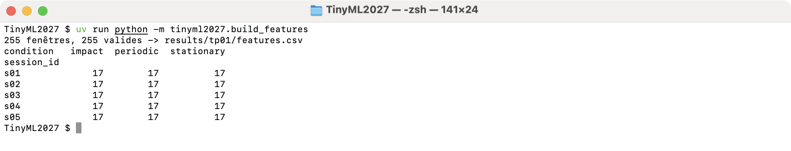
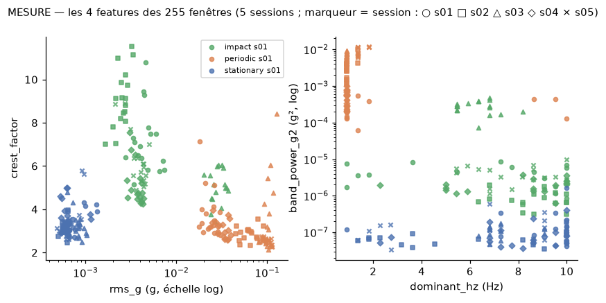

# TP01 — Du capteur au dataset

**Durée :** environ 4 h. **Matériel :** une Arduino Nano 33 BLE Sense (originale ou Rev2), un câble USB de données et un ordinateur préparé avec le [README principal](../../README.md).

**Statut : validé sur matériel le 23/11/2026** (Nano 33 BLE Sense originale, macOS 15.6). 5 sessions et 15 enregistrements ont été faits, tous valides. Les preuves sont dans [evidence/tp01](../../evidence/tp01/). La version Rev2 du firmware est **compilée mais pas testée** faute de carte.

## Ce que vous allez faire

Vous allez enregistrer trois gestes avec l'accéléromètre de la carte, vérifier que les mesures sont correctes, puis transformer chaque tranche de 2 secondes en **4 nombres**, les *features*. Ces 4 nombres serviront au TP02 à entraîner un modèle qui reconnaît le geste.

| Geste | Nom dans les fichiers | Ce que vous faites |
|---|---|---|
|  | `stationary` | rien : la carte est posée, personne ne la touche |
|  | `periodic` | faire glisser la carte en avant et en arrière **dans le sens du câble**, environ 1 aller-retour par seconde |
|  | `impact` | tapoter la **table** à 10 cm de la carte, 1 à 2 fois par seconde. **Ne frappez jamais la carte.** |

*Ces animations sont des schémas dessinés, pas des photos.*

Ce sont des manipulations de laboratoire. Elles ne disent rien de l'état d'un vrai moteur ou d'une vraie machine.

---

## Étape 1 — Téléverser le firmware d'acquisition

**Objectif :** la carte envoie ses mesures au PC sur demande.

1. Branchez la carte, puis vérifiez qu'elle est reconnue :
   ```sh
   uv run python -m tinyml2027.capture ports
   ```
   Une ligne doit se terminer par `<- Arduino`.
2. Compilez et téléversez :
   ```sh
   ./scripts/compile.sh labs/01-sensor-data/firmware/imu_capture
   ./scripts/upload.sh  labs/01-sensor-data/firmware/imu_capture
   ```
   Pour une carte **Rev2**, ajoutez `REV=rev2` devant les deux commandes. Dans Arduino IDE ([captures](../../tutorials/02-arduino-nano/README.md#arduino-ide-pas-à-pas)), décommentez la ligne `#define NANO_REV2` en haut du sketch.
3. Interrogez la carte :
   ```sh
   uv run python -m tinyml2027.capture info
   ```

**Résultat obtenu sur la carte de référence :**
```text
/dev/cu.usbmodem314101 : INFO firmware=imu_capture 0.1.0 board_revision=original imu=LSM9DS1 odr_nominal_hz=119.00
```



*Capture réelle, Terminal macOS 15.6, carte Nano 33 BLE Sense V1, 23/11/2026.*

**Si ça ne marche pas :**
- `0 carte(s) Arduino détectée(s)` : changez de câble. Beaucoup de câbles ne font que la charge.
- `pas de réponse « INFO »` : un autre firmware tourne sur la carte. Refaites l'étape 2.
- `impossible d'ouvrir ... port busy` : fermez le moniteur série, Arduino IDE ou tout notebook qui utilise le port.
- `ERREUR imu_begin : LSM9DS1 absent : carte Rev2 ?` : vous avez une Rev2. Recompilez avec `REV=rev2`.

### Comment la carte envoie ses mesures

Le firmware attend un ordre du PC, puis envoie une ligne par mesure :

```text
PC   -> carte : START s01_stationary_t01
carte -> PC   : BEGIN recording_id=s01_stationary_t01 firmware=imu_capture 0.1.0 ...
                seq,t_us,ax_g,ay_g,az_g
                0,0,-0.00024,-0.00842,0.96509
                1,8424,-0.00012,-0.00964,0.96521
                ...
PC   -> carte : STOP
carte -> PC   : END recording_id=s01_stationary_t01 n=2315
```

| Colonne | Signification | Unité |
|---|---|---|
| `seq` | numéro de la mesure, sans trou ni doublon côté carte | — |
| `t_us` | instant de la mesure **sur la carte**, depuis la première mesure | µs |
| `ax_g`, `ay_g`, `az_g` | accélération sur chaque axe | g (1 g ≈ 9,81 m/s²) |

**Pourquoi `t_us` vient de la carte et non du PC ?** Les lignes arrivent par paquets sur l'USB, si bien que l'heure de réception sur le PC est irrégulière. Seule l'horloge de la carte dit quand la mesure a vraiment été prise.

---

## Étape 2 — Enregistrer une session

**Objectif :** enregistrer les 3 gestes, 20 secondes chacun.

```sh
uv run python -m tinyml2027.capture guided --session s01
```

Pour chaque geste, l'outil procède ainsi :
1. il affiche la consigne et attend que vous appuyiez sur **Entrée** ;
2. il compte 3, 2, 1 ;
3. pour `periodic` et `impact`, il affiche **« COMMENCEZ LE GESTE MAINTENANT »**. Commencez alors le geste. L'enregistrement démarre 2 s plus tard, quand le geste est déjà régulier : **continuez jusqu'à la fin** ;
4. il enregistre pendant 20 s ;
5. il affiche le **contrôle qualité** et vous demande `Accepter cet essai ? [O/n]`.

**Résultat réel pour `s01_stationary_t01` :**
```text
échantillons      : 2315 sur 19.91 s
cadence mesurée   : 116.24 Hz (intervalle médian 8436 µs, CV 0.032)
séquence / temps  : 0 rupture(s), 0 timestamp(s) non croissant(s)
lacunes           : 0 (plus grande 9072 µs)
NaN / saturations : 0 / 0
fenêtres de 256  : 17 sans lacune
VERDICT           : VALIDE
  -> ACCEPTÉ : data/raw/s01/s01_stationary_t01.csv
```



*Capture réelle, Terminal macOS 15.6, carte Nano 33 BLE Sense V1, 23/11/2026.*

**Lire le contrôle qualité :**
- **cadence mesurée** : la carte annonce 119 Hz, mais on en mesure 116. C'est la valeur mesurée qui compte, jamais la valeur annoncée.
- **ruptures, lacunes** : des mesures ont été perdues. Elles ne sont **jamais** inventées ni interpolées.
- **saturations** : l'accéléromètre est réglé sur ±4 g. Au-delà, la valeur est fausse.
- **fenêtres de 256 sans lacune** : le nombre de tranches utilisables pour le TP02.

Si vous refusez un essai, il est **conservé** dans `data/rejected/` et noté `valid=0` dans `data/manifest.csv`. On ne supprime pas une mauvaise mesure : on la met de côté, avec la raison du refus.

### Combien de sessions ?

**Au moins 4, idéalement 5.** Une session contient les 3 gestes et dure environ 3 minutes.

**Entre deux sessions, déplacez la carte** dans un autre coin de la table et tournez-la d'un quart de tour. **Variez aussi les gestes** : glissement lent ou rapide, tapotements doux ou forts. Le TP02 montre ce qui arrive quand une session contient un geste que le modèle n'a jamais vu.

```sh
uv run python -m tinyml2027.capture guided --session s02
# ... jusqu'à s05
```

Pour refaire un seul geste, utilisez la commande ci-dessous. Le numéro d'essai change, car un identifiant n'est jamais réutilisé.

```sh
uv run python -m tinyml2027.capture record --session s02 --condition impact --trial 2
```

---

## Étape 3 — Regarder les signaux

**Objectif :** relier chaque geste à ce que mesure le capteur.


*Mesure réelle, session s01. L'axe az a été décalé de −1 g.*

**À observer :**
- **La gravité.** Carte posée à plat, `az` vaut environ +1 g même quand rien ne bouge, car l'accéléromètre mesure aussi la pesanteur. Retournez la carte et `az` passe à −1 g. Le tutoriel 02 a vérifié les 6 orientations.
- **Glisser** fait osciller `ax`, l'axe qui suit la longueur de la carte, donc le sens du câble.
- **Tapoter** produit des pics brefs, surtout sur `az`, car la table vibre verticalement.

> **Question 1.** Pourquoi faut-il glisser la carte **dans le sens du câble**, et pas en travers ? Indice : le modèle n'utilise que `ax`.

---

## Étape 4 — Découper en fenêtres

**Objectif :** transformer un long enregistrement en tranches de même taille.



*Mesure réelle (s01, glisser). La fenêtre colorée avance de 128 mesures à chaque image.*

- Une fenêtre contient **N = 256 mesures**, soit 256 / 116 ≈ **2,2 s**.
- Elle avance de **128 mesures** à chaque fois : deux fenêtres voisines partagent donc la moitié de leurs mesures (recouvrement de 50 %).
- La cadence de chaque fenêtre est recalculée à partir de ses propres horodatages :
  `fs_win = (N − 1) / ((t_us[N−1] − t_us[0]) · 10⁻⁶)` Hz.
- Une fenêtre est **rejetée** dans trois cas : un `seq` manque, `t_us` recule, ou un intervalle dépasse 1,5 fois la médiane. On ne la répare jamais.

**Fréquence d'échantillonnage et Nyquist.** À 116 Hz, on ne peut pas observer correctement un phénomène plus rapide que 116 / 2 = 58 Hz, la fréquence de Nyquist. Un filtre appliqué *après* l'acquisition ne corrige pas une cadence trop basse : l'information manquante n'a jamais été mesurée.

---

## Étape 5 — Les 4 features

**Objectif :** résumer chaque fenêtre de l'axe `ax` par 4 nombres, avec leurs unités.

On note x[n] la mesure (en g), pour n = 0 … 255. On commence par **retirer la moyenne** : c[n] = x[n] − moyenne(x). Ce retrait élimine la gravité et le décalage du capteur.

| Feature | Formule | Unité | Ce qu'elle mesure |
|---|---|---|---|
| `rms_g` | √(moyenne de c²) | g | l'énergie du mouvement |
| `crest_factor` | max\|c\| / rms | — | à quel point il y a des **pics** isolés |
| `dominant_hz` | fréquence du plus grand pic du spectre, entre 0,5 et 10 Hz | Hz | le **rythme** du geste |
| `band_power_g2` | puissance du spectre entre 0,5 et 10 Hz | g² | l'énergie dans la bande des gestes |

Si la fenêtre est parfaitement immobile (rms < 10⁻⁶ g), les trois dernières features valent 0.

Le spectre se calcule ainsi : on multiplie c[n] par une fenêtre de Hann, puis on calcule la FFT et la densité spectrale P[k] en g²/Hz. La définition exacte est dans [docs/DATA_CONTRACT.md](../../docs/DATA_CONTRACT.md). Un test vérifie qu'elle donne le même résultat que `scipy.signal.welch`, à 10⁻¹² près.


*Mesure réelle. Le point marque `dominant_hz`, et la zone grise la bande 0,5–10 Hz.*



*Mesure réelle. Le spectrogramme montre le spectre au cours du temps : chaque tapotement allume toutes les fréquences pendant un instant.*

**Spectre, densité spectrale ou spectrogramme ?**
- Le **spectre** (FFT) indique quelles fréquences sont présentes dans une fenêtre.
- La **densité spectrale (PSD)** est ce même spectre normalisé en g²/Hz, ce qui le rend comparable d'une cadence à l'autre.
- Le **spectrogramme** montre comment le spectre évolue au cours du temps.

---

## Étape 6 — Construire la table de features

```sh
uv run python -m tinyml2027.build_features
```

**Résultat réel, 5 sessions :**
```text
255 fenêtres, 255 valides -> results/tp01/features.csv
condition   impact  periodic  stationary
session_id
s01             17        17          17
...
s05             17        17          17
```



*Capture réelle, Terminal macOS 15.6, 23/11/2026.*

La commande produit deux fichiers :
- `results/tp01/features.csv` : une ligne par fenêtre (session, geste, position, validité, `fs_win_hz` et les 4 features) ;
- `results/tp01/quality_report.md` : le bilan de chaque enregistrement. Celui de la carte de référence est dans [evidence/tp01](../../evidence/tp01/quality_report.md).



*Mesure réelle, 255 fenêtres. La couleur indique le geste, la forme du marqueur la session.*

**À observer :** les 3 gestes forment des groupes séparés. Ces groupes se chevauchent pourtant un peu d'une session à l'autre : en s03 (triangles), les tapotements ont autant d'énergie que certains glissements. Le TP02 y revient.

> **Question 2.** Quelle feature distingue le mieux `periodic` des deux autres gestes ? Laquelle distingue le mieux `impact` de `stationary` ?
>
> **Question 3.** Pourquoi une figure ne suffit-elle pas à valider la qualité d'un CSV ? Pensez à ce que le contrôle qualité vérifie et qu'un graphique ne montre pas.

---

## Travailler sans carte

Le module `tinyml2027.simulate` génère des enregistrements **simulés**, marqués `source=simulated` dans le manifest. Ils servent aux tests automatiques, mais **ne prouvent rien sur le matériel**. Les vrais signaux sont plus irréguliers (voir le GIF de l'étape 4).

## Provoquer les erreurs

Chacun de ces cas est couvert par un test automatique (`uv run pytest tests/test_recording.py tests/test_capture_protocol.py`). Essayez-les aussi en vrai :

| Erreur | Comment la provoquer | Ce qui doit se passer |
|---|---|---|
| port occupé | ouvrir le moniteur série puis lancer `capture` | message « port déjà ouvert ? » |
| mauvais firmware | téléverser `examples/01_blink`, puis `capture info` | « pas de réponse INFO » |
| carte débranchée pendant l'enregistrement | débrancher le câble | « la carte n'a pas confirmé la fin (END) » |
| mesures perdues | (test simulé) | essai refusé, « échantillons perdus » |

## Livrables

`data/manifest.csv`, `data/raw/…`, `results/tp01/features.csv`, `results/tp01/quality_report.md` et les réponses aux questions. Le dossier `data/` reste sur votre poste : il n'est pas publié sur Git.

## Sources

Ce TP adapte le chapitre 7–8 de [AIoT-Book](https://github.com/wld-code/AIoT-Book/tree/main/labs/ch07-08-acceleration-features). Le code est réécrit pour ce dépôt.
