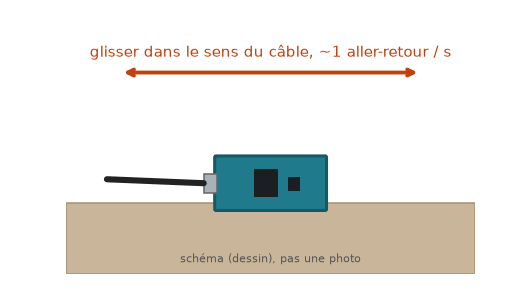
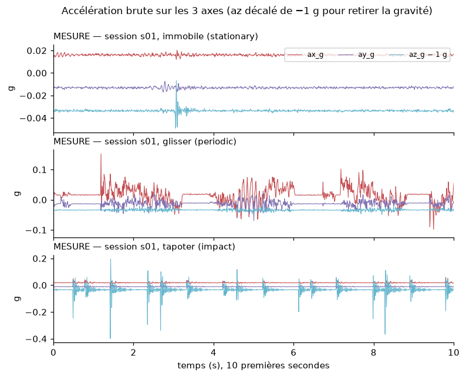
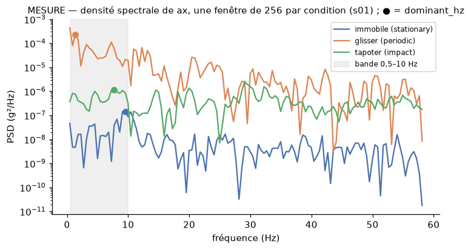

# TP01 — Du capteur au jeu de données

**Objectif.** Enregistrer trois gestes avec un accéléromètre, contrôler la qualité des mesures et préparer les données utilisées pour entraîner le modèle du TP02.

**Durée.** Environ 4 h.

**Matériel.** Une Arduino Nano 33 BLE Sense originale ou Rev2, un câble USB de données, un ordinateur et une table stable.

**Prérequis.** Préparez le poste avec le [guide d’installation](../../docs/INSTALLATION.md) et suivez le [tutoriel Arduino](../../tutorials/02-arduino-nano/README.md) pour identifier la révision de la carte. Lancez les commandes depuis la racine du dépôt, dans Git Bash sous Windows.

Nous allons enregistrer plusieurs sessions contenant les mêmes trois gestes. Nous découperons ensuite chaque enregistrement en fenêtres d’environ deux secondes et résumerons chaque fenêtre par quatre caractéristiques numériques (*features*). Les gestes servent à étudier la classification de signaux en laboratoire.

## 1. Téléverser le firmware d’acquisition

Branchez la carte et repérez son port série. La commande doit signaler le port par `<- Arduino`.

```sh
uv run python -m tinyml2027.capture ports
```

Compilez le firmware, c’est-à-dire le programme d’acquisition exécuté par la carte, puis téléversez-le.

```sh
./scripts/compile.sh labs/01-sensor-data/firmware/imu_capture
./scripts/upload.sh  labs/01-sensor-data/firmware/imu_capture
```

Ces commandes ciblent par défaut la carte originale, équipée du capteur LSM9DS1. Pour la Rev2 et son capteur BMI270, ajoutez `REV=rev2` devant les deux commandes. Si vous utilisez [Arduino IDE](../../tutorials/02-arduino-nano/README.md#arduino-ide-pas-à-pas), décommentez `#define NANO_REV2` en haut de `imu_capture.ino` pour la Rev2.

```sh
uv run python -m tinyml2027.capture info
```

Vérifiez que la réponse `INFO` indique `firmware=imu_capture` et la bonne paire révision-capteur. La cadence nominale annoncée est de 119 Hz pour l’originale et de 100 Hz pour la Rev2.

Si aucun port n’est détecté, essayez un câble USB de données. Si le port est occupé, fermez le moniteur série ou le programme qui l’utilise. Si la carte reste muette, vérifiez le firmware téléversé. En cas d’erreur d’initialisation du capteur, vérifiez la révision utilisée à la compilation.

## 2. Enregistrer les trois gestes

Une session regroupe un enregistrement de 20 s pour chaque geste. Les animations schématisent les manipulations.

| Geste | Étiquette | Consigne |
|---|---|---|
|  | `stationary` | Posez la carte à plat et laissez-la immobile. |
|  | `periodic` | Faites glisser la carte dans le sens du câble, environ un aller-retour par seconde. |
|  | `impact` | Tapotez la table à 10 cm de la carte, une à deux fois par seconde. **Ne frappez jamais la carte.** |

```sh
uv run python -m tinyml2027.capture guided --session s01
```

Pour chaque geste, lisez la consigne et appuyez sur Entrée. Pour un geste en mouvement, commencez dès le message « COMMENCEZ LE GESTE MAINTENANT ». L’enregistrement démarre deux secondes plus tard, le temps d’établir le mouvement. Poursuivez jusqu’à la fin.

Avant d’accepter l’essai, vérifiez que le verdict est `VALIDE` et que le geste a été tenu pendant toute la capture. Le contrôle qualité indique la cadence mesurée, les ruptures de séquence, les horodatages non croissants, les lacunes (intervalles anormalement longs), les valeurs non numériques et les saturations à la limite de mesure de ±4 g. Il indique aussi combien de fenêtres de 256 mesures sont exploitables. Le mode guidé en exige au moins trois par essai.

Un essai accepté est enregistré dans `data/raw/`, sous le dossier de sa session. Refusez un essai invalide ou un geste mal exécuté. L’outil conserve l’essai refusé dans `data/rejected/` et l’inscrit avec `valid=0` dans `data/manifest.csv`, le registre des enregistrements.

Réalisez au moins quatre sessions. Enregistrez cinq sessions pour suivre le parcours de référence du TP02, qui réserve `s05` au test. Entre les sessions, changez l’emplacement de la carte, tournez-la d’un quart de tour et variez légèrement la vitesse du glissement ou la force des tapotements. Le TP02 gardera une session entière pour évaluer le modèle sur des gestes enregistrés séparément.

```sh
uv run python -m tinyml2027.capture guided --session s02
# ... jusqu'à s05
```

Pour refaire un seul geste, choisissez un numéro d’essai encore inutilisé pour ce geste et cette session.

```sh
uv run python -m tinyml2027.capture record --session s02 --condition impact --trial 2
```

## 3. Lire les signaux

Ouvrez un CSV de chaque geste. Chaque ligne contient un numéro de mesure (`seq`), le temps écoulé depuis la première mesure (`t_us`, en microsecondes) et l’accélération sur les trois axes (`ax_g`, `ay_g`, `az_g`). Les accélérations sont exprimées en g (1 g ≈ 9,81 m/s²). Les horodatages pris sur la carte permettent de calculer la cadence d’échantillonnage même si les lignes arrivent par paquets sur le port USB.



*Mesures de la session de référence s01. La courbe de l’axe z est décalée de −1 g sur la figure.*

Dans vos données, repérez la composante due à la pesanteur. À plat et immobile, la carte donne environ +1 g sur l’axe z, ou −1 g si vous la retournez. Sur la figure, le glissement fait osciller l’axe x, orienté dans la longueur de la carte. Les tapotements produisent des pics brefs, surtout sur l’axe z.

## 4. Découper le signal en fenêtres

Nous utilisons des fenêtres de **256 mesures**, décalées de **128 mesures**. Deux fenêtres voisines partagent donc la moitié de leurs mesures. À environ 116 Hz, cadence mesurée sur la carte originale de référence, une fenêtre couvre environ 2,2 s.


*Enregistrement de référence s01, geste `periodic`. La fenêtre avance de 128 mesures à chaque image.*

Pour chaque fenêtre, nous calculons la cadence à partir de ses horodatages. Avec `N = 256`, la cadence `fs_win` vaut `(N − 1) / ((t_us[N−1] − t_us[0]) · 10⁻⁶)` en Hz. Une fenêtre est invalide si la séquence comporte une rupture, si les horodatages cessent de croître strictement ou si un intervalle dépasse 1,5 fois la médiane des intervalles de la fenêtre. Les mesures manquantes restent manquantes.

La cadence fixe aussi la fréquence maximale observable sans repliement spectral, c’est-à-dire sans qu’une fréquence élevée apparaisse comme une fréquence plus basse. Cette limite, appelée fréquence de Nyquist, vaut la moitié de la cadence, soit environ 58 Hz à 116 Hz. Un filtrage après acquisition ne peut pas annuler ce repliement.

## 5. Résumer chaque fenêtre par quatre caractéristiques

Nous utilisons l’axe x. Pour chaque fenêtre, nous calculons le signal centré `c` en soustrayant sa moyenne à chaque mesure. Ce centrage retire la composante constante due à l’orientation et au décalage du capteur.

| Caractéristique | Calcul et interprétation |
|---|---|
| `rms_g` | Valeur efficace, en g. La racine carrée de la moyenne de `c²` mesure l’amplitude des variations. |
| `crest_factor` | Facteur de crête, sans unité. Le maximum de `abs(c)` divisé par la valeur efficace indique l’importance des pics par rapport au niveau moyen du signal. |
| `dominant_hz` | Fréquence du pic spectral le plus élevé entre 0,5 et 10 Hz. Elle donne un indice sur le rythme du geste. |
| `band_power_g2` | Puissance intégrée entre 0,5 et 10 Hz, en g². Elle mesure la contribution de cette bande aux variations du signal. |

Lorsque `rms_g < 10⁻⁶ g`, les trois autres caractéristiques valent zéro. Pour les deux caractéristiques fréquentielles, nous pondérons le signal centré par une fenêtre de Hann afin d’atténuer les effets de bord, puis nous calculons sa transformée de Fourier rapide (FFT). La densité spectrale de puissance répartit la puissance selon la fréquence, en g²/Hz. Le [contrat de données](../../docs/DATA_CONTRACT.md#4-les-4-features) donne les formules utilisées dans Python et sur la carte.



*Mesures de référence. La bande grise va de 0,5 à 10 Hz. Le point indique la fréquence dominante dans cette bande. Repérez le pic du glissement périodique.*

Le [spectrogramme des tapotements](../../docs/figures/tp01-spectrogramme-impact.png) montre comment le contenu fréquentiel varie au cours du temps. Repérez les bandes verticales correspondant aux chocs brefs.

## 6. Construire et contrôler la table de caractéristiques

```sh
uv run python -m tinyml2027.build_features
```

La commande lit les essais acceptés dans le registre et affiche le nombre de fenêtres valides par session et par geste. Vérifiez que les trois gestes sont représentés dans chaque session. Le nombre de fenêtres dépend de la cadence mesurée, de la durée réelle et de la qualité des captures.

- `results/tp01/features.csv` contient une ligne par fenêtre, avec la session, le geste, la cadence et un indicateur de validité. Les quatre caractéristiques sont calculées pour les fenêtres valides.
- `results/tp01/quality_report.md` résume la qualité par enregistrement et les valeurs médianes des caractéristiques par geste.


*Données de référence. La couleur indique le geste et la forme du marqueur la session. Certains tapotements et glissements présentent des valeurs de puissance proches. Comparez les médianes de votre rapport pour voir quelles caractéristiques distinguent les gestes.*

Sans carte, réalisez les étapes 3 à 6 avec les [enregistrements publiés](../../datasets/motion-nano-v1/README.md). Cette commande écrit dans le même dossier de résultats que la commande précédente.

```sh
uv run python -m tinyml2027.build_features --data datasets/motion-nano-v1
```

L’essai de référence a produit 255 fenêtres valides sur 255, à partir de cinq sessions sur la carte originale. La validation de la Rev2 se limite à la compilation. Sa cadence reste à mesurer sur carte. Les [résultats de référence](../../evidence/tp01/) et le [rapport de validation](../../docs/VALIDATION.md) documentent les essais. Le module `tinyml2027.simulate` sert aux tests automatiques et marque ses données `source=simulated`.

## Questions de compréhension

1. Pourquoi faisons-nous glisser la carte dans le sens du câble ? Appuyez-vous sur l’axe utilisé pour calculer les caractéristiques.
2. Quelles caractéristiques distinguent le mieux le glissement des autres gestes et les tapotements de l’immobilité ? Justifiez votre réponse avec les figures ou le rapport.
3. Quels défauts le contrôle qualité peut-il repérer dans un CSV alors qu’ils sont difficiles à voir sur une courbe d’accélération ?

Pour examiner des erreurs d’acquisition, lancez la commande suivante. Les tests couvrent notamment les pertes d’échantillons. Avec la carte, essayez aussi d’interroger le firmware pendant que le moniteur série occupe le port, puis fermez le moniteur et vérifiez que `capture info` répond de nouveau.

```sh
uv run pytest tests/test_recording.py tests/test_capture_protocol.py
```

## Livrables

Pour le parcours sur carte, conservez `data/manifest.csv` et les enregistrements de `data/raw/`. Dans les deux parcours, remettez `results/tp01/features.csv`, `results/tp01/quality_report.md` et vos réponses. Le dossier `data/` reste sur votre poste, hors de Git.

## Corrigé

<details>
<summary>Afficher les réponses</summary>

1. Le modèle utilise uniquement `ax_g`. Un glissement dans le sens du câble sollicite l’axe x et produit une oscillation visible sur cet axe. En glissant en travers, on solliciterait surtout l’axe y.
2. Dans le [rapport de référence](../../evidence/tp01/quality_report.md), le glissement se distingue par une fréquence dominante proche de 0,91 Hz et par une puissance de bande médiane plus élevée. Pour distinguer les tapotements de l’immobilité, comparez notamment le facteur de crête médian (6,037 contre 3,217) et la RMS médiane (0,004083 g contre 0,0006447 g). Ces médianes donnent des repères. Vérifiez la dispersion sur vos propres captures avant de tirer une conclusion.
3. Une courbe peut masquer une mesure manquante ou dupliquée, un horodatage qui recule, un intervalle anormalement long, une valeur non numérique ou une saturation. Le contrôle qualité examine les valeurs et les écarts entre les lignes du CSV.

**Essai de dépannage.** Si le moniteur occupe le port, `capture info` doit signaler un problème d’ouverture. Une fois le port libéré, le firmware d’acquisition doit de nouveau répondre par une ligne `INFO`.

</details>
