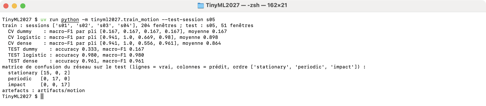
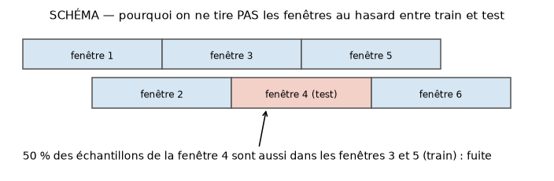
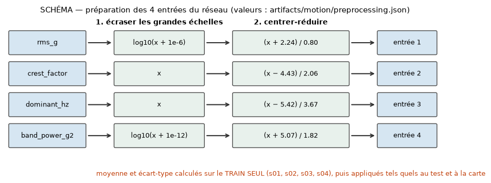
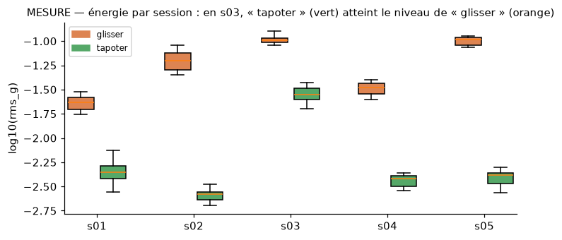
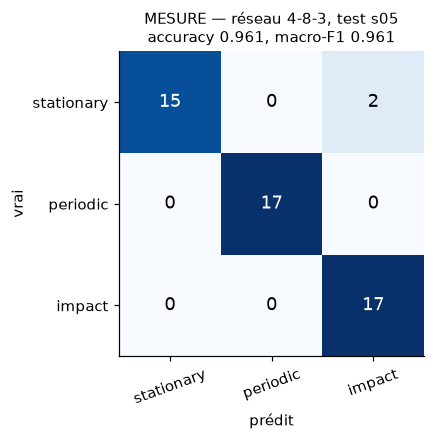
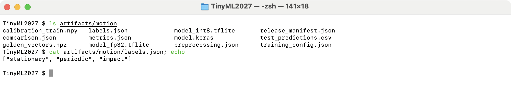
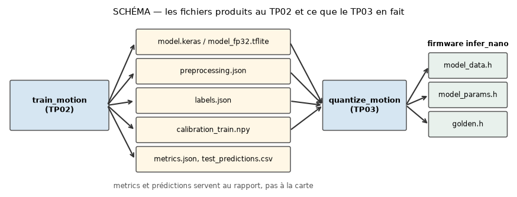

# TP02 — Entraîner un modèle sans tricher

**Durée :** environ 4 h. **Matériel :** l'ordinateur seul. **Entrée :** `results/tp01/features.csv`, produit par le [TP01](../01-sensor-data/README.md).

**Sans données du TP01 ?** Utilisez le dataset réel de la carte de référence, [datasets/motion-nano-v1](../../datasets/motion-nano-v1/README.md) :
```sh
uv run python -m tinyml2027.build_features --data datasets/motion-nano-v1
```

> **Testé** le 23/11/2026 (macOS 15.6) sur les 5 sessions réelles de la carte de référence. Avec vos propres données, vos chiffres seront différents.

## Ce que vous allez faire

Vous allez apprendre à un petit réseau de neurones à reconnaître le geste (`stationary`, `periodic` ou `impact`) à partir des 4 features. Surtout, vous allez **mesurer honnêtement** ce qu'il vaut sur des données qu'il n'a jamais vues.

```sh
uv run python -m tinyml2027.train_motion --test-session s05
```



Le reste de ce document explique ce que fait cette commande, étape par étape.

---

## Étape 1 — Mettre la session de test de côté, avant tout le reste


La session **s05** est mise de côté dès le début. Aucune opération (normalisation, choix du modèle, réglage) ne la regarde avant l'évaluation finale.

**Pourquoi par session, et pas en tirant les fenêtres au hasard ?**



Deux fenêtres voisines partagent 50 % de leurs mesures. Si la fenêtre 4 va dans le test et les fenêtres 3 et 5 dans l'entraînement, le modèle a déjà vu la moitié des données de test. Le score obtenu serait alors trop optimiste. De plus, toutes les fenêtres d'une même session partagent la même position de la carte et la même façon de faire le geste. **Tester sur une session entière jamais vue est la seule façon d'estimer ce qui se passera avec un nouvel essai.**

Le script **refuse** de continuer si une session apparaît à la fois dans l'entraînement et dans le test, ou si une partie ne contient pas les 3 gestes.

---

## Étape 2 — Préparer les entrées (sur l'entraînement uniquement)

Les 4 features n'ont pas du tout la même échelle : `rms_g` varie de 0,0005 à 0,1 g, `band_power_g2` de 10⁻⁸ à 10⁻² g². Le réseau reçoit donc des entrées transformées :

| Entrée | Transformation | Pourquoi |
|---|---|---|
| 1 | log10(rms_g + 10⁻⁶) | ramène 3 ordres de grandeur à une échelle de quelques unités |
| 2 | crest_factor | déjà entre 2 et 12 |
| 3 | dominant_hz | déjà entre 0 et 10 |
| 4 | log10(band_power_g2 + 10⁻¹²) | ramène 6 ordres de grandeur |

On applique ensuite une **standardisation** : (valeur − moyenne) / écart-type. **La moyenne et l'écart-type sont calculés sur l'entraînement seul**, puis appliqués tels quels au test et à la carte. Les calculer sur toutes les données ferait fuir de l'information du test vers le modèle.



*Schéma. Les nombres sont la moyenne et l'écart-type réellement appris sur s01 à s04.*

Ces paramètres sont enregistrés dans `artifacts/motion/preprocessing.json`. La carte les utilisera au TP03.

---

## Étape 3 — Comparer trois modèles par validation croisée

Un réseau de neurones n'est pas forcément meilleur qu'une méthode simple. On compare donc trois modèles :

| Modèle | Idée | Paramètres |
|---|---|---|
| **classe majoritaire** | répond toujours la même classe : c'est le score à battre | 0 |
| **régression logistique** | une frontière linéaire par classe | 15 |
| **réseau dense 4 → 8 → 3** | une couche cachée de 8 neurones (ReLU), puis softmax | 67 |

Pour choisir **sans toucher au test**, on utilise la **validation croisée par session**. Avec 4 sessions d'entraînement, on fait 4 essais : à chaque fois, on entraîne sur 3 sessions et on évalue sur la 4ᵉ.

**Résultat réel (macro-F1 par pli, validation laissant de côté s01, s02, s03 puis s04) :**

```text
CV dummy    : macro-F1 par pli [0.167, 0.167, 0.167, 0.167], moyenne 0.167
CV logistic : macro-F1 par pli [0.941, 1.0, 0.669, 0.98], moyenne 0.898
CV dense    : macro-F1 par pli [0.941, 1.0, 0.556, 0.961], moyenne 0.864
```

**Le pli s03 est nettement moins bon. Pourquoi ?**



*Mesure réelle : énergie des fenêtres, par session.*

En s03, les tapotements ont été **dix fois plus forts** que dans les autres sessions. Leur énergie atteint celle des glissements. Quand s03 est mise de côté, le modèle n'a jamais vu de tapotements aussi énergiques et les prend pour des glissements. C'est une **dérive entre sessions**, le principal risque d'un modèle TinyML entraîné sur peu de données.

> **Mini-expérience.** Relancez avec `--test-session s03`. Le score de test chute alors à environ 0,56 de macro-F1. C'est ce qui s'est passé lors de notre premier essai, avec seulement 3 sessions. Nous avons ensuite enregistré 2 sessions de plus, avec des gestes volontairement variés, et choisi **une nouvelle session de test jamais regardée** (s05). On ne garde pas le même test après l'avoir regardé.

---

## Étape 4 — Une seule évaluation sur le test

Le réseau est réentraîné sur les 4 sessions d'entraînement, puis évalué **une seule fois** sur s05.

**Résultat réel, session s05 (51 fenêtres) :**

```text
TEST dummy    : accuracy 0.333, macro-F1 0.167
TEST logistic : accuracy 0.980, macro-F1 0.980
TEST dense    : accuracy 0.961, macro-F1 0.961
```



*Mesure réelle. Le réseau a classé 2 fenêtres « immobile » sur 17 comme « tapoter ».*

**Lire les métriques :**
- **accuracy** : la part de fenêtres bien classées ;
- **precision** d'une classe : parmi les fenêtres prédites dans cette classe, la part qui l'est vraiment ;
- **recall** d'une classe : parmi les fenêtres vraiment de cette classe, la part retrouvée ;
- **macro-F1** : la moyenne des F1 des 3 classes. Elle ne favorise pas une classe plus fréquente qu'une autre.

**Règle :** une fois le score de test lu, on ne modifie plus le modèle pour l'améliorer **sur ce test**. Toute nouvelle modification demande une nouvelle session de test.

> **Question 1.** La régression logistique (98 %) fait mieux que le réseau (96 %) sur le test. Pourquoi garde-t-on quand même le réseau pour la suite ? Et pourquoi ce choix serait-il discutable pour un vrai produit ?
>
> **Question 2.** 96 % sur 51 fenêtres d'une seule session : que peut-on vraiment affirmer ? Pensez à une autre personne, une autre table ou une carte Rev2.

---

## Étape 5 — Les fichiers exportés pour le TP03

Dans `artifacts/motion/` :

| Fichier | Contenu |
|---|---|
| `model.keras`, `model_fp32.tflite` | le réseau entraîné (FP32) |
| `preprocessing.json` | ordre des entrées, log10, moyenne et écart-type du train |
| `labels.json` | `["stationary", "periodic", "impact"]` : l'ordre compte |
| `calibration_train.npy` | entrées standardisées du **train seul**, pour la quantification INT8 |
| `metrics.json`, `test_predictions.csv` | tous les scores, et la prédiction de chaque fenêtre de test |
| `training_config.json` | seed (2027), époques, sessions et versions des outils |





*Schéma : quels fichiers le TP03 utilise.*

> **Mini-exercice.** Dans `preprocessing.json`, remplacez la moyenne de `crest_factor` par 0, puis prédisez sur le test avec ces mauvais paramètres. Combien de fenêtres changent de classe ? C'est ce qui arrive si la carte et Python n'utilisent pas exactement le même prétraitement.

## Limites à garder en tête

- 5 sessions, une seule personne, une seule table, une seule carte (V1) : rien ne garantit le résultat pour un autre contexte.
- Le modèle ne connaît que 3 classes. Un geste inconnu, comme secouer la carte, sera classé dans l'une des 3, souvent avec un score élevé.

## Source

Ce TP adapte le chapitre 9–10 de [AIoT-Book](https://github.com/wld-code/AIoT-Book/tree/main/labs/ch09-10-motion-classifier). Le code est réécrit pour ce dépôt.
