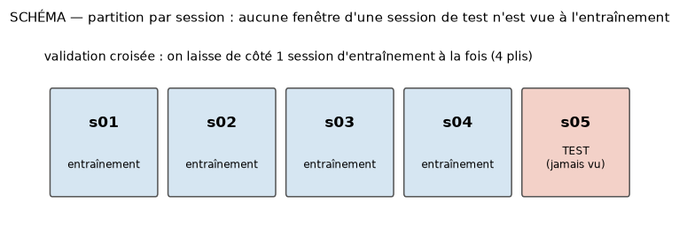

# TP02 — Entraînement et évaluation du modèle

**Objectif.** Reconnaître les trois gestes du TP01 à partir de quatre caractéristiques et mesurer les performances sur une session réservée au test.

**Durée.** Environ 4 h.

**Matériel.** Un ordinateur.

**Prérequis.** Préparez l’environnement Python avec le [guide d’installation](../../docs/INSTALLATION.md). Utilisez `results/tp01/features.csv`, produit au [TP01](../01-sensor-data/README.md). Lancez les commandes depuis la racine du dépôt.

Nous comparerons deux méthodes simples et un réseau de neurones. Le réseau sera exporté avec les paramètres nécessaires pour reproduire ses calculs sur la carte au TP03.

## 1. Réserver une session et lancer l’entraînement

Consultez le rapport qualité du TP01. Vérifiez que les trois gestes sont représentés dans les sessions retenues. Dans le parcours de référence, `s01` à `s04` servent à l’entraînement et `s05` au test. Si vous avez collecté quatre sessions, utilisez l’identifiant de votre session réservée à la place de `s05`.

Sans données du TP01, construisez la table depuis les [enregistrements publiés](../../datasets/motion-nano-v1/README.md). Cette commande écrit dans le dossier de résultats du TP01.

```sh
uv run python -m tinyml2027.build_features --data datasets/motion-nano-v1
```



Deux fenêtres voisines partagent 50 % de leurs mesures. Les répartir au hasard entre entraînement et test permettrait au modèle de retrouver des mesures déjà vues et rendrait le score trop optimiste. Gardez chaque session entière dans le même ensemble.

```sh
uv run python -m tinyml2027.train_motion --test-session s05
```

Vérifiez les identifiants affichés pour l’entraînement et le test. Le programme ignore les fenêtres invalides et exige au moins deux sessions d’entraînement et une session de test. Les deux ensembles doivent contenir les trois gestes.

## 2. Vérifier le prétraitement

Le prétraitement transforme les caractéristiques avant de les fournir au modèle. Le logarithme réduit l’étendue des valeurs de RMS et de puissance de bande. Les petites constantes évitent de calculer le logarithme de zéro. Vérifiez l’ordre des entrées dans `artifacts/motion/preprocessing.json`.

1. `log10(rms_g + 10⁻⁶)`
2. `crest_factor`
3. `dominant_hz`
4. `log10(band_power_g2 + 10⁻¹²)`

Nous standardisons ensuite chaque entrée en soustrayant sa moyenne et en divisant par son écart-type. Ces paramètres sont calculés sur les données d’entraînement et appliqués tels quels aux données à évaluer. Vérifiez que `fitted_on_sessions` contient uniquement les sessions d’entraînement. Le TP03 réutilise ces mêmes paramètres.


*Le schéma indique les paramètres calculés sur les sessions de référence `s01` à `s04`.*

## 3. Comparer les modèles en validation croisée

La classe majoritaire prédit toujours le geste le plus fréquent de l’entraînement. La régression logistique combine linéairement les entrées pour estimer les scores de classe. Le réseau dense reçoit quatre entrées, les combine dans huit neurones cachés avec une activation ReLU (la partie positive de chaque valeur), puis produit trois scores dont la somme vaut un grâce à la fonction softmax.

Nous comparons les modèles par **validation croisée par session**. À chaque passage, appelé pli, une session d’entraînement sert à la validation et les autres servent à ajuster le prétraitement et le modèle. La session de test reste réservée à l’évaluation finale.

Lisez les lignes `CV` ou la section `cv_train` de `metrics.json`. Le macro-F1 est la moyenne du F1 des trois classes. Pour une classe, le F1 combine la précision (part des prédictions de cette classe qui sont correctes) et le rappel (part des fenêtres de cette classe que le modèle retrouve).


*Données de référence. En `s03`, la puissance des tapotements atteint celle de certains glissements.*

Repérez le pli le moins bien classé. Sur les données de référence, le réseau obtient un macro-F1 de 0,556 sur le pli `s03`, pour une moyenne de 0,864. Reliez cette baisse au recouvrement des caractéristiques entre gestes. Les [scores détaillés de référence](../../evidence/linux/TP02_entrainement.log) donnent les résultats par pli.

## 4. Interpréter le test et vérifier les exports

Le programme réentraîne les modèles sur toutes les sessions d’entraînement, puis les évalue sur la session réservée. Comparez les lignes `TEST`. L’*accuracy* est la proportion de fenêtres bien classées. Lisez ensuite la matrice de confusion, avec les classes réelles en ligne et les classes prédites en colonne.


*Résultat de référence sur 51 fenêtres de `s05`. Le réseau atteint 0,961 d’accuracy et confond deux fenêtres immobiles avec des tapotements. La régression logistique atteint 0,980.*

Ces scores décrivent une seule session. Le modèle attribue aussi un geste parmi les trois classes à une fenêtre issue d’un mouvement inconnu. Gardez les scores de test pour le bilan. Si vous vous en servez pour modifier le modèle, réservez une nouvelle session pour la prochaine évaluation finale. Le réseau dense est exporté pour étudier sa quantification et son déploiement au TP03.

Vérifiez le contenu d’`artifacts/motion/`.

- `model.keras` et `model_fp32.tflite` contiennent le réseau entraîné.
- `preprocessing.json` et `labels.json` donnent le prétraitement et l’ordre des classes (`stationary`, `periodic`, `impact`).
- `calibration_train.npy` contient les entrées d’entraînement standardisées qui serviront à déterminer l’échelle INT8.
- `metrics.json`, `test_predictions.csv` et `training_config.json` documentent les scores, les prédictions et la configuration.

Le [schéma des fichiers utilisés au TP03](../../docs/figures/tp02-fichiers-vers-tp03.png) indique leur rôle dans la suite du parcours.

## Questions et livrables

1. Quelle information du test pourrait se retrouver dans l’entraînement si l’on répartissait les fenêtres au hasard ?
2. La régression logistique obtient un meilleur score que le réseau sur `s05`. Quels arguments justifient le choix du réseau pour le TP03 ? Que compareriez-vous pour choisir un modèle à déployer ?
3. Que permettent de conclure les 51 fenêtres d’une seule session sur les performances avec une autre personne, une autre table ou une Rev2 ?
4. Dans `preprocessing.json`, relevez la moyenne utilisée pour `crest_factor`. Pour une ligne de `test_predictions.csv`, comparez la valeur standardisée avec cette moyenne puis avec une moyenne supposée nulle. Expliquez l’effet d’une erreur de ce type sur l’entrée du réseau.

Remettez `metrics.json`, `test_predictions.csv` et vos réponses. Conservez le dossier `artifacts/motion/` pour le [TP03](../03-embedded-inference/README.md).

Ce TP adapte les chapitres 9 et 10 d’[AIoT-Book](../../docs/REFERENCES.md).

## Corrigé

<details>
<summary>Afficher les réponses</summary>

1. Deux fenêtres voisines se recouvrent sur 128 mesures. Une fenêtre de test peut donc contenir des mesures déjà utilisées pour entraîner le modèle. Des fenêtres éloignées d’une même session partagent aussi le montage et la façon de faire le geste. La séparation par session réduit ces deux sources de fuite.
2. Le réseau permet d’étudier la conversion FP32 vers INT8, le prétraitement embarqué et le rejeu avec TensorFlow Lite Micro. Pour choisir un modèle à déployer, comparez les erreurs par classe et la stabilité sur plusieurs sessions indépendantes, puis la Flash, la RAM et la latence sur la cible. Les 51 fenêtres de `s05` donnent un résultat de référence. Le choix du modèle peut s’appuyer sur la validation croisée, avec une session séparée pour le bilan final.
3. Les 51 fenêtres décrivent les performances sur `s05`, dans les conditions de cette collecte. Comme elles se recouvrent et viennent d’une seule session, elles ne représentent pas 51 essais indépendants. Il faut d’autres sessions, avec d’autres personnes, tables ou cartes, pour mesurer l’effet de ces changements.
4. Pour la première fenêtre de référence (`s05_stationary_t01`, `start=0`), `crest_factor` vaut 3,54686. La moyenne d’entraînement vaut environ 4,43068 et l’écart-type 2,05859.

   - Avec la moyenne apprise, `(3,54686 − 4,43068) / 2,05859 ≈ −0,429`.
   - Avec une moyenne supposée nulle, `3,54686 / 2,05859 ≈ 1,723`.

   L’erreur décale cette entrée d’environ +2,152 pour chaque fenêtre. Elle peut modifier les scores et parfois la classe prédite. Reprenez le calcul avec vos fichiers si vous avez utilisé vos propres captures.

</details>
