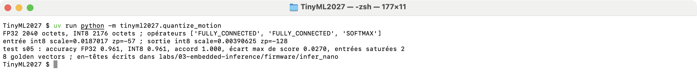
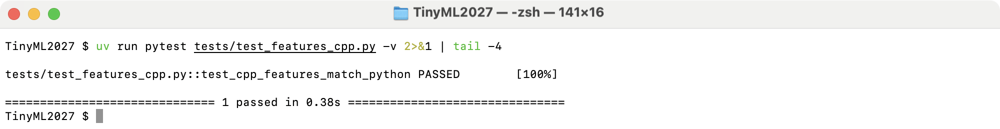
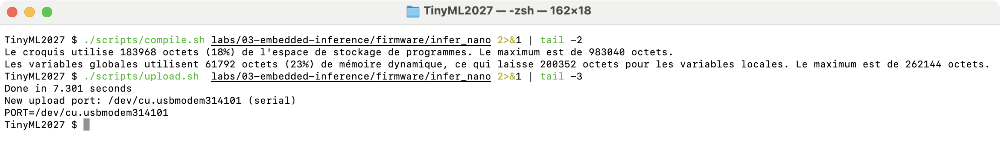
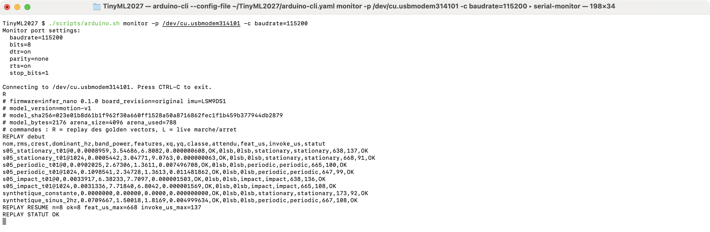
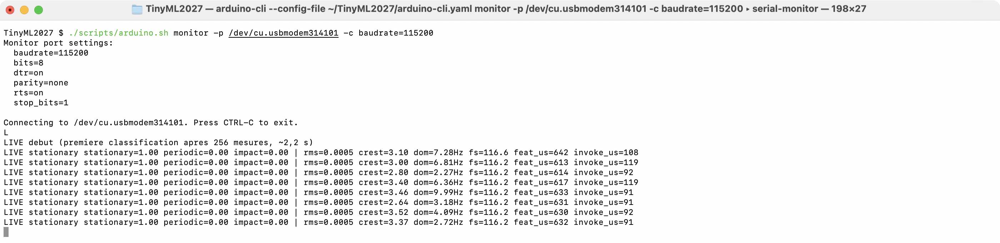
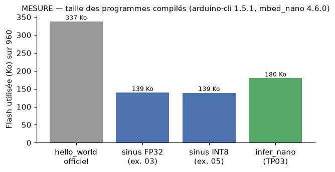

# TP03 — Le modèle sur la carte : INT8, rejeu, puis direct

**Durée :** environ 4 h. **Matériel :** la même Nano 33 BLE Sense, son câble USB et l'ordinateur. **Entrée :** `artifacts/motion/`, produit par le [TP02](../02-model-training/README.md).

**Statut : validé sur matériel le 23/11/2026** (Nano 33 BLE Sense originale, macOS 15.6) : rejeu 8/8 et test en direct sur les 3 gestes. Les preuves sont dans [evidence/tp03](../../evidence/tp03/README.md). La version Rev2 est **compilée mais pas testée**.

## Ce que vous allez faire


Toutes les 128 mesures (≈ 1,1 s), la Nano reprend les 256 dernières mesures et refait **exactement** les calculs de Python : les features, le prétraitement, puis le réseau. Elle affiche ensuite le geste reconnu. Le TP se déroule en trois temps :

1. **Quantifier** le réseau en entiers 8 bits (INT8) et vérifier ce que l'on perd.
2. **Rejouer** sur la carte des fenêtres enregistrées dont on connaît la réponse : ce sont les *golden vectors*. Si la carte ne retrouve pas les mêmes valeurs que Python, inutile de passer au direct.
3. **Passer en direct** avec le capteur.

Bibliothèques utilisées, toutes officielles :
- **Arduino_TensorFlowLite** (TensorFlow Lite Micro, commit figé `7948b85e`), qui fournit aussi la FFT **kissfft** ;
- **Arduino_LSM9DS1** pour la carte originale, ou **Arduino_BMI270_BMM150** pour la Rev2.

---

## Étape 1 — Quantifier en INT8

```sh
uv run python -m tinyml2027.quantize_motion
```

**Résultat réel :**
```text
FP32 2040 octets, INT8 2176 octets ; opérateurs ['FULLY_CONNECTED', 'FULLY_CONNECTED', 'SOFTMAX']
entrée int8 scale=0.0187017 zp=-57 ; sortie int8 scale=0.00390625 zp=-128
test s05 : accuracy FP32 0.961, INT8 0.961, accord 1.000, écart max de score 0.0270, entrées saturées 2
8 golden vectors ; en-têtes écrits dans labs/03-embedded-inference/firmware/infer_nano
```



*Capture réelle, Terminal macOS 15.6, 23/11/2026.*

### Ce que veut dire « quantifier »

Chaque nombre réel x est remplacé par un entier q compris entre −128 et 127 :

`q = clamp(round(x / scale) + zero_point, −128, 127)` et, dans l'autre sens, `x ≈ (q − zero_point) · scale`.


*Paramètres réels de notre modèle. Au-delà de x ≈ 3,4, l'entrée est **saturée** : 2 valeurs du test sont dans ce cas.*

- `scale` et `zero_point` sont choisis par le convertisseur, d'après les valeurs vues pendant la **calibration**. Celle-ci se fait sur `calibration_train.npy`, c'est-à-dire sur l'**entraînement seul**, jamais sur le test.
- La bibliothèque Arduino ne gère qu'**une échelle par tenseur de poids**. Le script désactive donc la quantification par canal et **refuse** tout modèle qui en contiendrait.
- Le script vérifie aussi que **tous** les tenseurs sont entiers (int8 ou int32), et que les opérateurs sont ceux que le firmware enregistre.

### FP32 contre INT8, sur les mêmes fenêtres

| | FP32 | INT8 |
|---|---|---|
| Taille du fichier | 2 040 octets | **2 176 octets** |
| Accuracy sur le test s05 | 0,961 | 0,961 |
| Même classe prédite | — | 51/51 fenêtres |
| Plus grand écart de score | — | 0,027 |

**Surprise : le modèle INT8 est plus gros que le FP32.** Le réseau n'a que 67 paramètres, et ce que la quantification ajoute (échelles, zero-points, informations de format) pèse plus lourd que ce qu'elle fait gagner sur les poids. Sur un modèle de plusieurs milliers de paramètres, l'INT8 divise la taille par près de 4. **L'INT8 n'est pas automatiquement plus petit.**

> **Question 1.** Pourquoi la calibration ne doit-elle pas utiliser le test ?
>
> **Question 2.** Que répond le réseau pour une entrée saturée à 127 ? Est-ce grave pour ce modèle ? Indice : regardez si ces 2 fenêtres sont bien classées dans `artifacts/motion/test_predictions.csv`.

---

## Étape 2 — Vérifier le calcul des features en C++… sur l'ordinateur

Avant de toucher à la carte, on compile le code C++ des features (`firmware/infer_nano/features.h`, qui s'appuie sur la kissfft officielle) **sur l'ordinateur**, puis on le compare à Python :

```sh
uv run pytest tests/test_features_cpp.py -v
```

Résultat attendu : `1 passed`.



*Capture réelle, Terminal macOS 15.6, 23/11/2026.*

Ce test a déjà trouvé un vrai défaut. Sur une fenêtre parfaitement constante, le calcul en float32 laisse un résidu de 7·10⁻⁹ g, alors que Python (float64) obtient 0. Le seuil « fenêtre immobile » du contrat, qui était de 10⁻⁹ g, a donc été porté à 10⁻⁶ g, sur le Mac comme sur la carte. Sans ce test, la carte et Python auraient donné un facteur de crête différent (1 contre 0).

---

## Étape 3 — Compiler et téléverser le firmware

```sh
./scripts/compile.sh labs/03-embedded-inference/firmware/infer_nano
./scripts/upload.sh  labs/03-embedded-inference/firmware/infer_nano
```

Pour la Rev2, ajoutez `REV=rev2` devant les deux commandes. Dans Arduino IDE, décommentez `#define NANO_REV2` en tête de `infer_nano.ino`.

**Compilation réelle (carte originale) :**
```text
Sketch uses 183872 bytes (18%) of program storage space. Maximum is 983040 bytes.
Global variables use 61792 bytes (23%) of dynamic memory, leaving 200352 bytes for local variables.
```



*Capture réelle, Terminal macOS 15.6, carte Nano 33 BLE Sense V1, 23/11/2026. La compilation affiche ici 183 968 octets, contre 183 872 dans le bloc ci-dessus, issu du premier essai. Cet écart de 96 octets entre deux compilations n'a pas été analysé. Notez vos propres chiffres.*

### Ce que contient le dossier du sketch

| Fichier | Rôle | Généré ? |
|---|---|---|
| `infer_nano.ino` | lecture de l'IMU, modes REPLAY et LIVE, affichage | non |
| `features.h` | les 4 features en float32, avec la FFT kissfft | non |
| `kissfft_float.cpp` | compile en float les sources kissfft **de la bibliothèque officielle**, sans les modifier | non |
| `prediction.h` | la structure qui regroupe le résultat d'une classification | non |
| `model_data.h` | le modèle INT8 sous forme de tableau C, avec son SHA-256 | oui (`quantize_motion`) |
| `model_params.h` | labels, log10, moyenne et écart-type du train | oui |
| `golden.h` | 8 fenêtres brutes avec les valeurs attendues | oui |

**Le firmware n'ignore aucune erreur.** Schéma incompatible, opérateur manquant, mémoire de travail (arena) trop petite, mauvaise dimension d'entrée, IMU absente : chaque cas affiche une ligne `ERREUR ...` au lieu de planter ou de classer n'importe quoi.

---

## Étape 4 — Le rejeu (REPLAY)

Au démarrage, puis chaque fois qu'on envoie `R`, la carte rejoue les golden vectors : 6 fenêtres brutes de la session de test et 2 cas synthétiques (une fenêtre constante et un sinus à 2 Hz). Pour chacune, elle compare **ses** résultats à ceux de Python :

| Contrôle | Tolérance déclarée **avant** l'essai |
|---|---|
| rms, crest, band power | 10⁻⁴ en relatif |
| dominant_hz | 1 case de fréquence |
| codes int8 d'entrée | 1 cran |
| codes int8 de sortie | 2 crans |
| classe prédite | identique |

Ouvrez le moniteur (`./scripts/arduino.sh monitor -p PORT -c baudrate=115200`) et tapez `R`.

**Sortie réelle de la carte :**
```text
nom,rms,crest,dominant_hz,band_power,features,xq,yq,classe,attendu,feat_us,invoke_us,statut
s05_stationary_t01@0,0.0008959,3.54686,6.8082,0.000000608,OK,0lsb,0lsb,stationary,stationary,668,108,OK
s05_periodic_t01@0,0.0902025,2.67306,1.3611,0.007496708,OK,0lsb,0lsb,periodic,periodic,620,100,OK
s05_impact_t01@0,0.0033917,6.38233,7.7097,0.000001503,OK,0lsb,0lsb,impact,impact,667,108,OK
synthetique_constante,0.0000000,0.00000,0.0000,0.000000000,OK,0lsb,0lsb,stationary,stationary,184,91,OK
...
REPLAY RESUME n=8 ok=8 feat_us_max=668 invoke_us_max=108
REPLAY STATUT OK
```



*Capture réelle, Terminal macOS 15.6, carte Nano 33 BLE Sense V1, 23/11/2026.*

**8/8, et 0 cran d'écart** sur les entrées comme sur les sorties. La carte fait exactement les mêmes calculs que Python.

> **Si le rejeu échoue, on ne passe pas au direct.** Une erreur dans le prétraitement C++ (un mauvais ordre de features, un log10 oublié…) donnerait des prédictions fausses en direct, sans aucun message d'erreur.

---

## Étape 5 — En direct (LIVE)

Tapez `L` dans le moniteur. La carte classe une fenêtre toutes les 128 mesures. Faites les 3 gestes du TP01.

```text
LIVE periodic stationary=0.00 periodic=1.00 impact=0.00 | rms=0.0589 crest=2.91 dom=0.91Hz fs=116.4 feat_us=659 invoke_us=107
```



*Capture réelle, Terminal macOS 15.6, carte Nano 33 BLE Sense V1, 23/11/2026.*


*Mesure réelle : 20 s par geste, une classification toutes les 1,1 s.*

| Consigne | Classifications | Correctes |
|---|---|---|
| immobile | 17 | 17 |
| glisser | 17 | 17 |
| tapoter | 17 | 16 (la dernière, prise pendant l'arrêt du geste : « stationary ») |

**Un score de 1,00 ne veut pas dire « certain ».** La fenêtre mal classée affichait aussi 1,00. La sortie softmax d'un petit réseau est souvent très tranchée, même quand il se trompe ou quand le geste ne fait partie d'aucune des 3 classes. Le firmware ajoute « (incertain) » quand le meilleur score est sous 0,6, mais cela ne détecte pas tout.

> **Question 3.** Secouez la carte dans tous les sens, un geste jamais appris. Que répond-elle, et avec quel score ? Qu'en concluez-vous sur l'état « inconnu » ?

---

## Étape 6 — Mesurer les ressources

| Mesure | Valeur sur la Nano V1 |
|---|---|
| Flash du programme | 183 872 octets (18 %) |
| RAM statique (arena de 4 096 octets comprise) | 61 792 octets (23 %) |
| Arena réellement utilisée par le modèle | **788 octets** |
| Calcul des 4 features (FFT comprise) | 0,62 à 0,67 ms |
| Inférence `Invoke()` | 0,09 à 0,13 ms |



*Mesures réelles. L'exemple officiel `hello_world` charge tous les opérateurs (`AllOpsResolver`) ; nos firmwares n'enregistrent que ceux du modèle.*

**Le réseau est le calcul le plus léger.** La FFT et les features coûtent 6 fois plus de temps que l'inférence. Tout le traitement d'une fenêtre (≈ 0,8 ms) tient très largement dans l'intervalle entre deux classifications (1,1 s).

> **Question 4.** On réduit `kArenaSize` à 512. Que se passe-t-il ? Essayez : la carte doit afficher `ERREUR init=AllocateTensors`. L'exemple 03 a été vérifié ainsi sur la carte.

---

## Étape 7 — Revenir à une version qui marche

Si un téléversement échoue ou si la carte ne répond plus :

1. **Double-cliquez sur le bouton RESET** : la LED orange pulse, la carte est en mode bootloader et attend un programme.
2. Relancez `./scripts/upload.sh labs/03-embedded-inference/firmware/infer_nano` : il retéléverse la dernière version compilée.
3. Vérifiez le modèle qui tourne vraiment avec `R` : la ligne `# model_sha256=…` doit correspondre à `model_int8_sha256` dans `artifacts/motion/release_manifest.json`.

**Un téléversement réussi ne prouve pas que le bon modèle tourne.** Seul le SHA-256 annoncé par la carte le prouve.

## Source

Ce TP adapte les chapitres 11 et 12 de [AIoT-Book](https://github.com/wld-code/AIoT-Book/tree/main/labs), ainsi que la documentation [LiteRT for Microcontrollers](https://ai.google.dev/edge/litert/microcontrollers/overview). Le code est réécrit pour ce dépôt.
