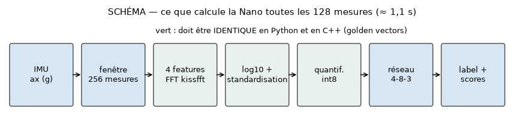
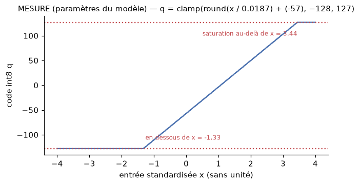
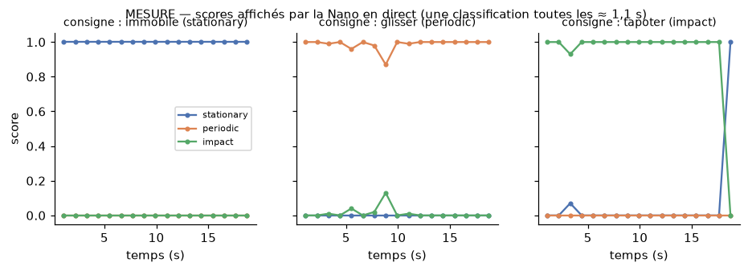

# TP03 — Quantification et inférence sur la Nano

**Objectif.** Quantifier le réseau en INT8, vérifier les calculs sur la Nano et classer les gestes mesurés par son accéléromètre.

**Durée.** Environ 4 h.

**Matériel.** La Nano 33 BLE Sense utilisée pour les acquisitions, son câble USB de données et un ordinateur.

**Prérequis.** Ayez terminé le [TP02](../02-model-training/README.md) et conservé `artifacts/motion/`, la table de caractéristiques et les enregistrements bruts utilisés. Lancez les commandes depuis la racine du dépôt.



Toutes les 128 mesures, la carte reprend les 256 dernières, calcule les quatre caractéristiques, applique le prétraitement du TP02 et classe la fenêtre. Nous vérifions cette chaîne sur des fenêtres connues avant d’utiliser le capteur en direct. Sans carte, réalisez les étapes 1 et 2.

## 1. Quantifier le modèle

La quantification représente les valeurs réelles par des entiers. Avec une échelle `scale` et un décalage entier `zero_point`, une valeur `x` devient `round(x / scale) + zero_point`, ramenée dans l’intervalle [−128, 127]. On retrouve une approximation de `x` par `(q − zero_point) · scale`. Lorsqu’une valeur dépasse la plage représentable, elle est saturée à la borne correspondante.

La calibration utilise `calibration_train.npy`, issu de l’entraînement, pour régler la représentation des activations. Le script désactive la quantification des poids par canal pour utiliser une seule échelle par tenseur de poids, compatible avec la bibliothèque Arduino. Il contrôle les types entiers (INT8 et INT32) et les opérateurs du modèle.

Avec vos données du TP01, lancez la première commande. Si le TP02 utilisait le jeu publié, lancez la seconde pour que les fenêtres témoins proviennent du même jeu.

```sh
uv run python -m tinyml2027.quantize_motion
```

```sh
uv run python -m tinyml2027.quantize_motion --data datasets/motion-nano-v1
```

Dans `artifacts/motion/comparison.json`, comparez les tailles, les scores et les classes prédites sur les mêmes fenêtres de test. Vérifiez que la commande annonce huit fenêtres témoins (*golden vectors*) et produit les en-têtes du firmware.



*Paramètres du modèle de référence. Deux valeurs d’entrée du test atteignent une borne de la plage INT8.*

Sur le test de référence, les versions FP32 et INT8 obtiennent toutes deux une accuracy de 0,961 et prédisent la même classe pour les 51 fenêtres. Le modèle INT8 occupe 2 176 octets contre 2 040 pour le FP32. Pour ce réseau de 67 paramètres, les métadonnées de quantification occupent plus d’espace que l’économie réalisée sur les poids.

## 2. Vérifier les caractéristiques en C++ sur l’ordinateur

Le firmware utilise la FFT kissfft fournie avec Arduino_TensorFlowLite. Lancez le test qui compile le calcul C++ sur l’ordinateur et le compare aux résultats Python. Attendez `1 passed`. Si le test est ignoré, vérifiez que l’étape 1 a produit `golden_vectors.npz`.

```sh
uv run pytest tests/test_features_cpp.py -v
```

## 3. Compiler et téléverser

```sh
./scripts/compile.sh labs/03-embedded-inference/firmware/infer_nano
./scripts/upload.sh  labs/03-embedded-inference/firmware/infer_nano
```

Pour la Rev2, ajoutez `REV=rev2` devant les deux commandes. Dans [Arduino IDE](../../tutorials/02-arduino-nano/README.md#arduino-ide-pas-à-pas), décommentez `#define NANO_REV2` en tête d’`infer_nano.ino`. La carte originale utilise `Arduino_LSM9DS1` et la Rev2 `Arduino_BMI270_BMM150`.

Relevez la Flash et la RAM statique annoncées à la compilation. La Flash stocke le programme. La RAM statique inclut l’*arena*, le tampon de 4 096 octets réservé à l’interpréteur TensorFlow Lite Micro. Après le téléversement, toute ligne `ERREUR` à l’initialisation doit être résolue avant de poursuivre.

## 4. Rejouer les fenêtres témoins sur la carte

Ouvrez le moniteur série en remplaçant `PORT` par le port de la carte. Envoyez `R`.

```sh
./scripts/arduino.sh monitor -p PORT -c baudrate=115200
```

Le mode `REPLAY` exécute la chaîne embarquée sur six fenêtres prises dans le test et deux cas synthétiques (une fenêtre constante et un sinus à 2 Hz). Pour chaque fenêtre, lisez le statut et les écarts en crans de quantification (`lsb`). Les tolérances du [contrat de données](../../docs/DATA_CONTRACT.md#8-tolérances-carte--python) s’appliquent aux quatre caractéristiques, aux codes INT8 d’entrée et de sortie, et à la classe.

Attendez `REPLAY RESUME n=8 ok=8` et `REPLAY STATUT OK`. En cas d’échec, vérifiez que le firmware a été compilé après la génération de `model_data.h`, `model_params.h` et `golden.h`. Corrigez l’écart avant de passer au direct.

## 5. Classer les gestes en direct

Envoyez `L`. La carte affiche la classe, les scores, les caractéristiques et les temps de calcul. Reprenez les [gestes du TP01](../01-sensor-data/README.md#2-enregistrer-les-trois-gestes) dans les conditions de capture. Pour le glissement, suivez l’axe du câble. Pour les tapotements, retrouvez la position et la force utilisées à la capture. **Ne frappez jamais la carte.**

Attendez environ une fenêtre complète après chaque changement de geste avant d’interpréter les prédictions. Les tapotements excitent surtout l’axe z alors que le modèle exploite l’axe x. Si les tapotements sont classés `stationary`, comparez leur RMS à celle mesurée au repos et reprenez le geste de capture.



*Essai de référence. La dernière fenêtre de tapotement, prise pendant l’arrêt du geste, a été classée `stationary`.*

Un meilleur score sous 0,6 déclenche l’indication `(incertain)`. Un score élevé peut aussi accompagner une erreur, notamment pour un geste absent de l’entraînement.

## 6. Mesurer les ressources et vérifier la version

Comparez `feat_us` (calcul des caractéristiques) et `invoke_us` (exécution du modèle) à l’intervalle entre deux décisions. Cet intervalle vaut environ 1,1 s à 116 Hz. Dans l’essai de référence, le calcul des caractéristiques prend 0,62 à 0,67 ms et l’inférence 0,09 à 0,13 ms. Relevez vos mesures ainsi que la mémoire utilisée par le modèle dans l’*arena* (champ `arena_used` dans l’en-tête du rejeu).

En cas d’échec du téléversement, fermez le moniteur et appuyez deux fois rapidement sur RESET. La LED orange pulse quand la carte attend un programme. Relancez `./scripts/upload.sh labs/03-embedded-inference/firmware/infer_nano` avec `REV=rev2` devant la commande si nécessaire. Envoyez ensuite `R` et comparez l’empreinte `# model_sha256` annoncée par la carte à `model_int8_sha256` dans `artifacts/motion/release_manifest.json`. L’[extension MLOps](../../advanced/edge-mlops/README.md) reprend cette vérification pour gérer plusieurs versions.

Le rejeu et le direct ont été vérifiés sur la Nano originale. La validation de la Rev2 se limite à la compilation. Les [mesures sur carte](../../evidence/tp03/README.md), les [tailles compilées](../../evidence/compilation/README.md) et la [synthèse des essais](../../docs/VALIDATION.md) donnent les résultats de référence.

## Questions et livrables

1. Pourquoi les données de calibration proviennent-elles de l’entraînement ? Que devient une entrée qui dépasse la borne INT8 ?
2. Pourquoi vérifier les codes INT8 d’entrée et de sortie alors que la classe prédite est déjà comparée ?
3. Faites un mouvement absent de l’entraînement. Quelle classe et quel score obtenez-vous ? Que peut-on déduire du seuil d’incertitude ?
4. Si l’*arena* est réduite à 512 octets, que se passe-t-il à l’initialisation sachant que le modèle de référence en utilise 788 ?

Remettez `comparison.json`, votre relevé du rejeu, des prédictions et des ressources, ainsi que vos réponses. Pour le parcours sur ordinateur, remettez le résultat du test C++.

Ce TP adapte les chapitres 11 et 12 d’[AIoT-Book](../../docs/REFERENCES.md).
