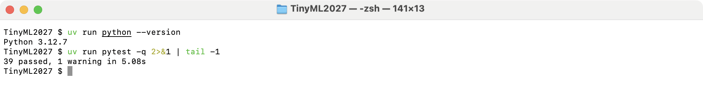
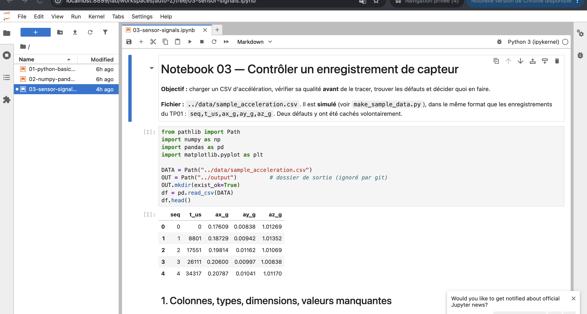
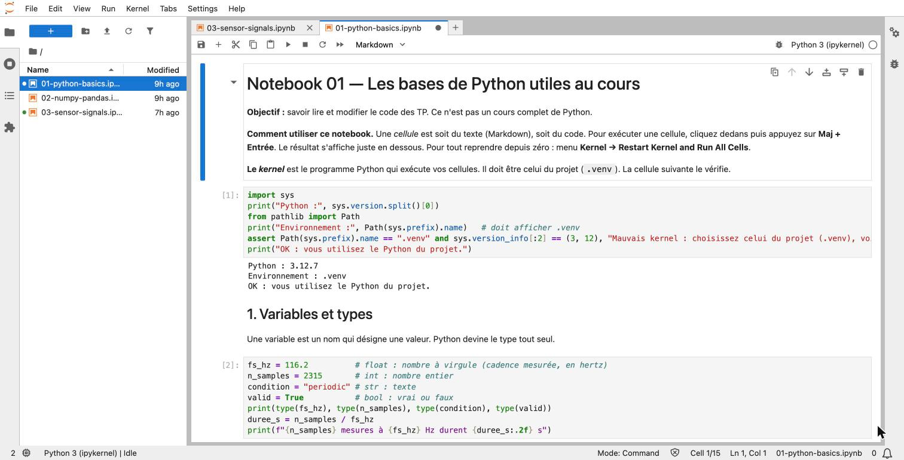
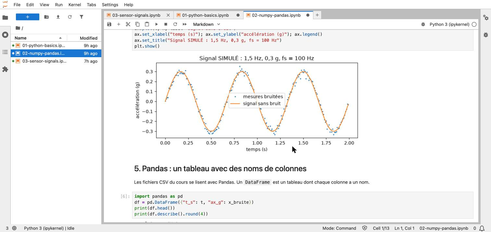
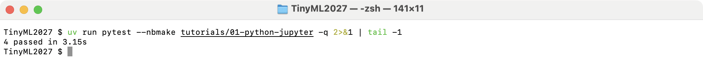

# Tutoriel 01 — Python, Jupyter et premiers signaux

**Durée :** environ 2 h. **Matériel :** l'ordinateur seul.

> **Testé** sur macOS 15.6 le 23/11/2026 : les 4 notebooks tournent de bout en bout. Les captures viennent de cet essai.

## Ce que vous allez faire

Préparer le Python du cours, ouvrir des notebooks, manipuler des tableaux de nombres et **contrôler un vrai fichier de capteur** avant de le tracer. Ce tutoriel prépare le TP01. Ce n'est pas un cours complet de Python.

## Quelques mots à connaître

| Mot | Sens |
|---|---|
| **interpréteur** | le programme `python` qui exécute le code |
| **terminal** | la fenêtre où l'on tape des commandes (Terminal sur macOS, PowerShell sur Windows) |
| **environnement virtuel** (`.venv`) | un dossier qui contient **un** Python et **ses** bibliothèques, propres au projet, sans toucher au Python du système |
| **dépendances** | les bibliothèques nécessaires (NumPy, Pandas…), avec leurs versions figées dans `uv.lock` |
| **notebook** (`.ipynb`) | un document qui mélange texte, code et résultats |
| **kernel** | le Python qui exécute les cellules d'un notebook ; il doit être celui du `.venv` |
| **chemin** | l'adresse d'un fichier, absolue (`/Users/...`) ou relative au dossier courant (`../data/...`) |

## Étape 1 — Installer le Python du cours

Si vous avez suivi le [guide d'installation](../../docs/INSTALLATION.md) (`./scripts/setup.sh`), c'est fait. Sinon, pour la partie Python seulement :

```sh
cd TinyML2027
uv sync --frozen
```

**Pourquoi Python 3.12 ?** TensorFlow 2.21, utilisé au TP02, ne fonctionne qu'avec Python 3.10 à 3.13, et NumPy 2.5 exige au moins Python 3.12. Le « dernier Python » n'est donc pas forcément le bon.

**Contrôle :**
```sh
uv run python --version          # Python 3.12.7
uv run python -c "import numpy, pandas, matplotlib, scipy; print('OK')"
```



## Étape 2 — Ouvrir JupyterLab

```sh
uv run jupyter lab tutorials/01-python-jupyter/notebooks
```

Le navigateur s'ouvre. Double-cliquez sur `01-python-basics.ipynb`.

**Vérifier le kernel :** exécutez la première cellule (**Maj + Entrée**). Elle doit afficher `Environnement : .venv`. Si elle affiche une erreur « Mauvais kernel », c'est que JupyterLab n'a pas été lancé avec `uv run`. Fermez-le, puis relancez la commande ci-dessus.



*À gauche, les 3 notebooks ; en haut à droite, le kernel « Python 3 (ipykernel) » ; la cellule [1] a chargé le CSV.*

**Autre possibilité : VS Code.** Installez les extensions « Python » et « Jupyter », ouvrez le dossier `TinyML2027`, ouvrez un notebook, puis cliquez sur **Select Kernel** en haut à droite et choisissez l'interpréteur `.venv/bin/python` (`.venv\Scripts\python.exe` sous Windows).

## Étape 3 — Les trois notebooks

| Notebook | Contenu |
|---|---|
| `01-python-basics.ipynb` | variables, listes, *slicing*, boucles, fonctions, dictionnaires |
| `02-numpy-pandas.ipynb` | `ndarray` contre liste, un signal à 1,5 Hz échantillonné à 100 Hz, bruit reproductible (seed), moyenne, écart-type et RMS, tracé, `DataFrame` |
| `03-sensor-signals.ipynb` | charger `data/sample_acceleration.csv`, vérifier colonnes, types et valeurs manquantes, mesurer la cadence, tracer, **trouver les défauts cachés**, exporter un PNG et un CSV nettoyé |



*La première cellule du notebook 01 vérifie le kernel : elle doit afficher `Environnement : .venv`.*



*Notebook 02, partie 4 : le tracé du signal simulé (points bruités et sinusoïde sans bruit).*

Exercices : [exercises/README.md](exercises/README.md). Solutions, séparées : [solutions/solutions.ipynb](solutions/solutions.ipynb).

**Le fichier `sample_acceleration.csv` est simulé.** Il est généré par `data/make_sample_data.py` (seed 2027), dans le même format que les enregistrements du TP01. Deux défauts y ont été cachés volontairement : une mesure manquante et deux instants inversés. Il sert à apprendre et ne prouve rien sur le matériel.

**Résultat attendu à la fin du notebook 03 :**
```text
défauts entre les lignes : [(399, 400), (699, 700)]
plus longue portion sans défaut : lignes 700 à 1138 (439 mesures)
```
et deux fichiers dans `tutorials/01-python-jupyter/output/` : `signal.png` et `sample_acceleration_clean.csv`.

## Étape 4 — Tout relancer depuis zéro

Menu **Kernel → Restart Kernel and Run All Cells**. Un notebook rendu doit tourner du début à la fin sans erreur. Sinon, une cellule dépendait d'une autre exécutée dans le désordre.

La vérification automatique fait la même chose :
```sh
uv run pytest --nbmake tutorials/01-python-jupyter
```



`4 passed` : les 4 notebooks (dont les solutions) tournent du début à la fin.

## Dépannage

| Problème | Cause probable | Solution |
|---|---|---|
| `uv: command not found` | uv non installé | macOS : `brew install uv` ; Windows : voir <https://docs.astral.sh/uv/> |
| `ModuleNotFoundError: numpy` dans le notebook | mauvais kernel | relancer avec `uv run jupyter lab` |
| `FileNotFoundError: ../data/...` | notebook lancé depuis un autre dossier | ouvrir JupyterLab sur `tutorials/01-python-jupyter/notebooks` |
| Windows : activation de `.venv` refusée dans PowerShell | politique d'exécution | inutile avec `uv run`, qui n'a pas besoin d'activer le venv |

## Questions

1. Pourquoi utiliser un environnement virtuel ?
2. Pourquoi un signal échantillonné à 100 Hz contient-il 100 échantillons par seconde ?
3. Que signifie « g » ?
4. Pourquoi la figure ne suffit-elle pas à valider la qualité du CSV ?

## Références

[venv](https://docs.python.org/3/library/venv.html) · [JupyterLab](https://jupyterlab.readthedocs.io/) · [NumPy](https://numpy.org/doc/stable/) · [Pandas](https://pandas.pydata.org/docs/) · [Matplotlib](https://matplotlib.org/stable/)
