# Tutoriel 02 — Prendre en main la Nano 33 BLE Sense

**Durée :** 30 à 45 minutes. **Matériel :** une Nano 33 BLE **Sense** (originale ou Rev2), un câble USB **de données** et l'ordinateur préparé avec le [README principal](../../README.md), étapes 1 à 3.

**Statut : validé sur matériel le 23/11/2026** sur une Nano 33 BLE Sense **originale** (macOS 15.6, Apple Silicon). Les versions Rev2 des sketches sont **compilées seulement**. Windows et Linux ne sont **pas testés**.

## Ce que vous allez faire

1. Vérifier que l'ordinateur voit la carte.
2. Faire clignoter la LED (Blink).
3. Savoir **quelle révision** de carte vous avez.
4. Lire l'accéléromètre et le gyroscope avec leurs unités, puis mesurer la **vraie** cadence.
5. Comprendre la gravité et les axes en posant la carte dans 6 positions.

Toutes les commandes se lancent depuis le dossier `TinyML2027`.

---

## Deux façons de travailler : Terminal ou Arduino IDE

Les étapes ci-dessous donnent les commandes du **Terminal** (scripts du dépôt, versions figées). Vous pouvez aussi tout faire dans **Arduino IDE 2**, à la souris : la section suivante montre chaque clic. Les deux donnent le même programme sur la carte.

### Arduino IDE pas à pas

**A. Installer le support de la carte (une seule fois).** Ouvrez Arduino IDE. Si une fenêtre propose une mise à jour de l'IDE ou des cartes, vous pouvez cliquer **NOT NOW** / **LATER** : le cours a été vérifié avec le core `Arduino Mbed OS Nano Boards` **4.6.0**. Cliquez sur l'icône **carte** à gauche (1), tapez `nano 33 ble` (2) et installez **Arduino Mbed OS Nano Boards** (3).

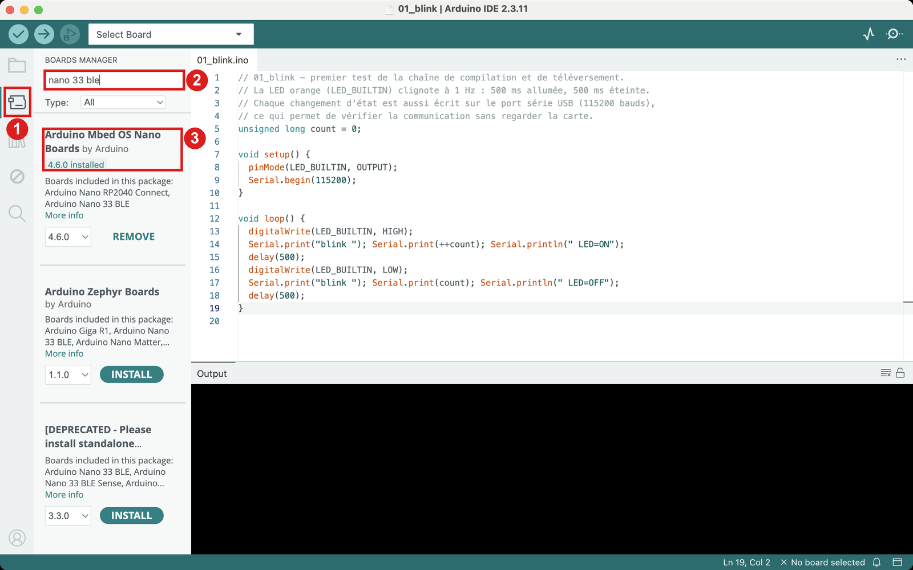

*Capture réelle, Arduino IDE 2.3.11, macOS 15.6, carte Nano 33 BLE Sense originale, 23/11/2026. Les cadres rouges numérotés indiquent l'ordre des clics ; ils ont été ajoutés sur la capture.* *Ne choisissez ni « Arduino Zephyr Boards » ni l'entrée « [DEPRECATED] » visibles en dessous.*

**B. Installer la bibliothèque de l'IMU (une seule fois).** Icône **bibliothèques** (1), tapez `Arduino_LSM9DS1` (2), installez **Arduino_LSM9DS1 by Arduino** (3). Pour une **Rev2**, installez plutôt **Arduino_BMI270_BMM150**.

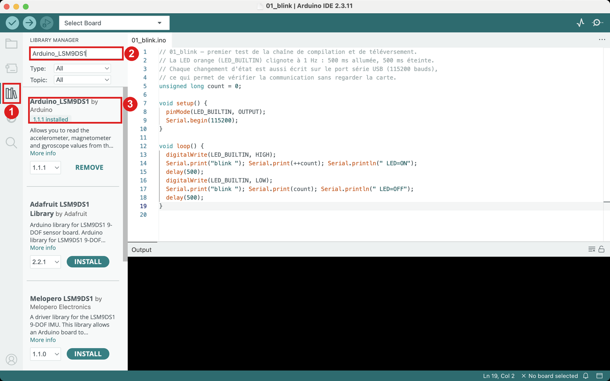

*Capture réelle, Arduino IDE 2.3.11, macOS 15.6, carte Nano 33 BLE Sense originale, 23/11/2026. Les cadres rouges numérotés indiquent l'ordre des clics ; ils ont été ajoutés sur la capture.*

**C. Ouvrir le sketch et choisir la carte.** **File → Open** puis `examples/01_blink/01_blink.ino`. Cliquez sur **Select Board** (1) : la carte branchée apparaît sous le nom **Arduino Nano 33 BLE** avec son port (2). Choisissez-la. Les lignes « Unknown » sont des ports du Mac, pas votre carte.


*Capture réelle, Arduino IDE 2.3.11, macOS 15.6, carte Nano 33 BLE Sense originale, 23/11/2026. Les cadres rouges numérotés indiquent l'ordre des clics ; ils ont été ajoutés sur la capture.*

**D. Vérifier (compiler).** La carte est choisie (1). Cliquez sur **✓ Verify** (2). En bas, « Output » doit afficher la taille du programme (3), ici 85 480 octets (8 %).

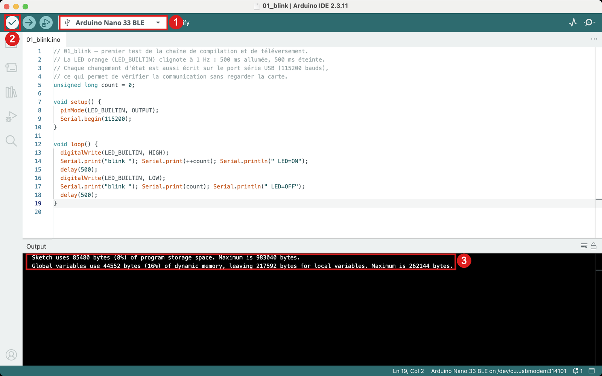

*Capture réelle, Arduino IDE 2.3.11, macOS 15.6, carte Nano 33 BLE Sense originale, 23/11/2026. Les cadres rouges numérotés indiquent l'ordre des clics ; ils ont été ajoutés sur la capture.*

**E. Téléverser.** Cliquez sur **→ Upload** (1). Attendez `Done in … seconds` (2) : la LED orange clignote.

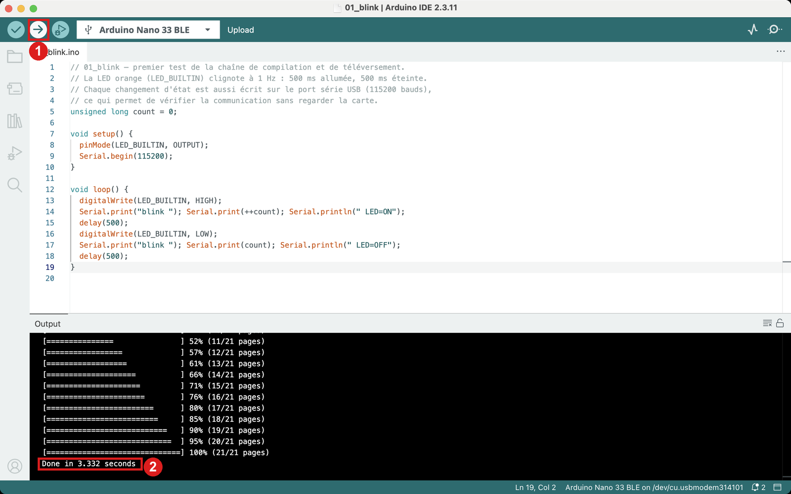

*Capture réelle, Arduino IDE 2.3.11, macOS 15.6, carte Nano 33 BLE Sense originale, 23/11/2026. Les cadres rouges numérotés indiquent l'ordre des clics ; ils ont été ajoutés sur la capture.* *Si le téléversement échoue, double-cliquez sur RESET (la LED orange pulse) et recommencez.*

**F. Moniteur série.** Cliquez sur la **loupe** en haut à droite (1), choisissez **115200 baud** (2). Les lignes `blink … LED=ON/OFF` défilent (3).

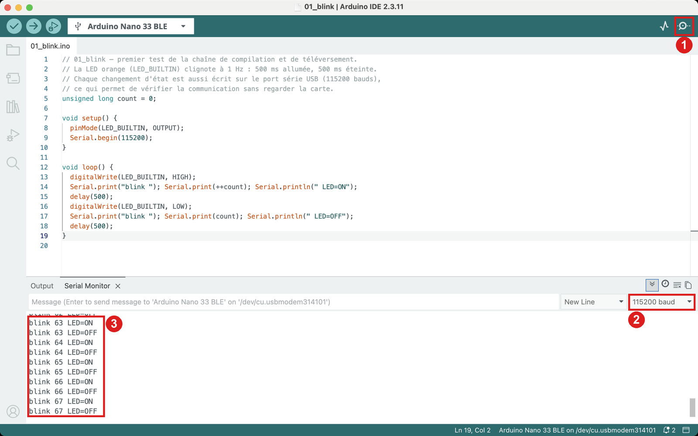

*Capture réelle, Arduino IDE 2.3.11, macOS 15.6, carte Nano 33 BLE Sense originale, 23/11/2026. Les cadres rouges numérotés indiquent l'ordre des clics ; ils ont été ajoutés sur la capture.*

**G. Carte Rev2 : une ligne à changer.** Dans les sketches du cours qui lisent l'IMU, la ligne 7 est `// #define NANO_REV2`. Sur une **Rev2**, enlevez les deux barres `//` au début de cette ligne, puis vérifiez et téléversez. Sur une carte originale, ne touchez à rien.

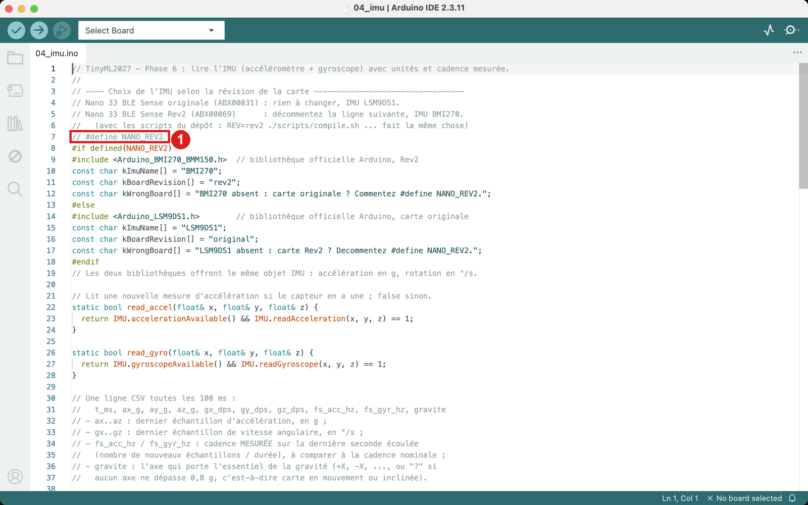

*Capture réelle, Arduino IDE 2.3.11, macOS 15.6, carte Nano 33 BLE Sense originale, 23/11/2026. Les cadres rouges numérotés indiquent l'ordre des clics ; ils ont été ajoutés sur la capture.*

**H. Lire l'IMU dans l'IDE.** Ouvrez `examples/04_imu/04_imu.ino`, téléversez-le comme en E, ouvrez le moniteur à **115200 baud** (1). Chaque ligne contient le temps, les 3 accélérations (g), les 3 vitesses de rotation (°/s), les deux cadences mesurées et l'axe de la gravité (2). L'étape 4 explique chaque colonne.

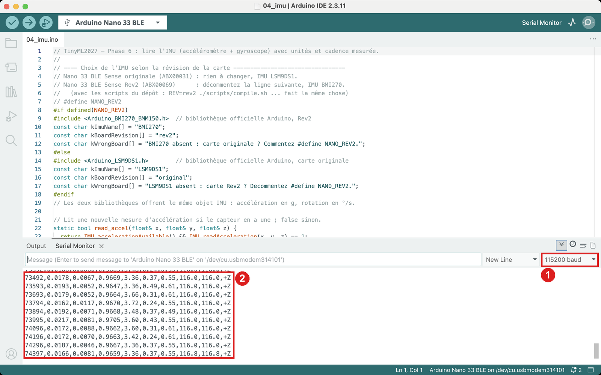

*Capture réelle, Arduino IDE 2.3.11, macOS 15.6, carte Nano 33 BLE Sense originale, 23/11/2026. Les cadres rouges numérotés indiquent l'ordre des clics ; ils ont été ajoutés sur la capture.* *Le traceur série (icône à gauche de la loupe) est peu lisible avec ce sketch : la première colonne, le temps en ms, écrase les autres courbes.*

**Fermez le moniteur série de l'IDE avant d'utiliser les scripts Python du cours** : un port série ne peut être ouvert que par un seul programme à la fois.

---

## Étape 1 — L'ordinateur voit-il la carte ?

1. Branchez la carte avec le câble. La LED verte **ON** s'allume.
2. Listez les ports :
   ```sh
   ./scripts/arduino.sh board list
   ```
   **Résultat attendu :** une ligne avec `Arduino Nano 33 BLE` et `arduino:mbed_nano:nano33ble`, sur un port `/dev/cu.usbmodem…` (macOS), `/dev/ttyACM…` (Linux) ou `COM…` (Windows).
3. Même vérification depuis Python, avec plus de détails :
   ```sh
   uv run python -m serial.tools.list_ports -v
   ```

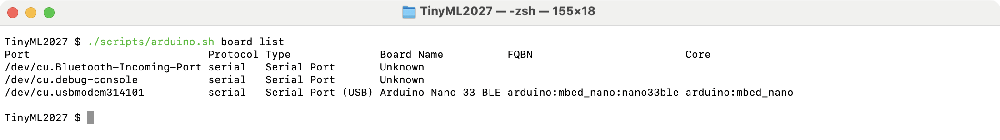

*Capture réelle, Terminal macOS 15.6, carte Nano 33 BLE Sense V1, 23/11/2026.* La carte est la ligne « Arduino Nano 33 BLE » ; les deux autres ports appartiennent au Mac.

**Notez votre port.** Il peut changer si vous branchez la carte sur une autre prise : sur la carte de référence, il est passé de `usbmodem31201` à `usbmodem314101`. Les scripts du cours ne supposent jamais un nom de port. Si plusieurs cartes sont branchées, ils refusent de choisir à votre place.

**Si rien n'apparaît :**
- **Changez de câble en premier.** Beaucoup de câbles USB ne transportent que le courant.
- Essayez une autre prise. Si vous passez par un hub, branchez directement sur l'ordinateur.
- **Double-cliquez rapidement sur le bouton RESET** : la LED orange se met à pulser, ce qui signifie que la carte attend un programme (mode bootloader). Le port peut alors porter un autre nom.
- *Linux* : si le port existe mais affiche « permission denied », vérifiez votre groupe avec `ls -l /dev/ttyACM0` puis `groups`. Le port appartient en général au groupe `dialout` : demandez à l'administrateur de vous y ajouter. N'utilisez jamais `chmod 777`.

---

## Étape 2 — Blink

```sh
./scripts/compile.sh examples/01_blink
./scripts/upload.sh  examples/01_blink
```

**Résultat attendu :** la LED orange clignote, allumée 0,5 s puis éteinte 0,5 s. Le moniteur série (voir l'étape 4) affiche `blink 1 LED=ON`, `blink 2 LED=OFF`, etc.

**Résultat réel :** compilation en 85 504 octets (8 % de la Flash), clignotement confirmé à l'œil ([evidence/phase2](../../evidence/phase2/phase2-blink-macos15.6-v1.txt)).

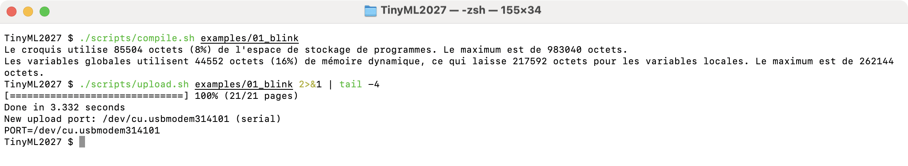

*Capture réelle, Terminal macOS 15.6, carte Nano 33 BLE Sense V1, 23/11/2026.*

**Si le téléversement échoue :** double-cliquez sur RESET (la LED orange pulse), puis relancez `upload.sh`.

---

## Étape 3 — Quelle révision ?

Il existe deux Nano 33 BLE **Sense**, qui n'ont pas le même capteur de mouvement (IMU) :

| | Originale (ABX00031) | Rev2 (ABX00069) |
|---|---|---|
| IMU | LSM9DS1 | BMI270 + BMM150 |
| Bibliothèque Arduino officielle | `Arduino_LSM9DS1` | `Arduino_BMI270_BMM150` |
| Cadence de l'accéléromètre | 119 Hz annoncés, **116 Hz mesurés** | 100 Hz annoncés, non mesuré ici |

Elles portent le **même nom sur l'USB** (« Nano 33 BLE »). Le nom du port ne suffit donc pas : on interroge les capteurs.

```sh
./scripts/compile.sh tutorials/02-arduino-nano/sketches/board_identify
./scripts/upload.sh  tutorials/02-arduino-nano/sketches/board_identify
./scripts/arduino.sh monitor -p PORT -c baudrate=115200
```

Appuyez sur **Entrée** dans le moniteur (et **Ctrl+C** pour en sortir).

**Résultat réel (carte de référence) :**
```text
i2c_devices=0x1E,0x39,0x5C,0x5F,0x6B
lsm9ds1_whoami=0x68
verdict=nano33ble_sense_original
```

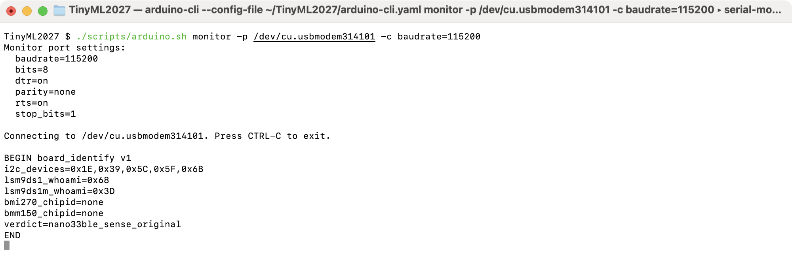

*Capture réelle, Terminal macOS 15.6, carte Nano 33 BLE Sense V1, 23/11/2026.*

Une Rev2 affiche `verdict=nano33ble_sense_rev2`. **Pour une Rev2, tous les sketches suivants se compilent avec `REV=rev2` devant la commande**, par exemple `REV=rev2 ./scripts/compile.sh examples/04_imu`. Dans Arduino IDE, décommentez la ligne `#define NANO_REV2` en tête du sketch.

Si vous vous trompez de révision, la carte affiche une erreur claire, par exemple `ERREUR imu_begin : LSM9DS1 absent : carte Rev2 ? Decommentez #define NANO_REV2.`

---

## Étape 4 — Lire l'IMU

```sh
./scripts/compile.sh examples/04_imu
./scripts/upload.sh  examples/04_imu
./scripts/arduino.sh monitor -p PORT -c baudrate=115200
```

**Sortie réelle, carte posée à plat :**
```text
# firmware=04_imu 0.1.0 board_revision=original imu=LSM9DS1
# accel_odr_nominal_hz=119.00 gyro_odr_nominal_hz=119.00
t_ms,ax_g,ay_g,az_g,gx_dps,gy_dps,gz_dps,fs_acc_hz,fs_gyr_hz,gravite
4038,-0.0006,-0.0117,0.9528,3.54,0.43,0.61,115.8,115.8,+Z
```

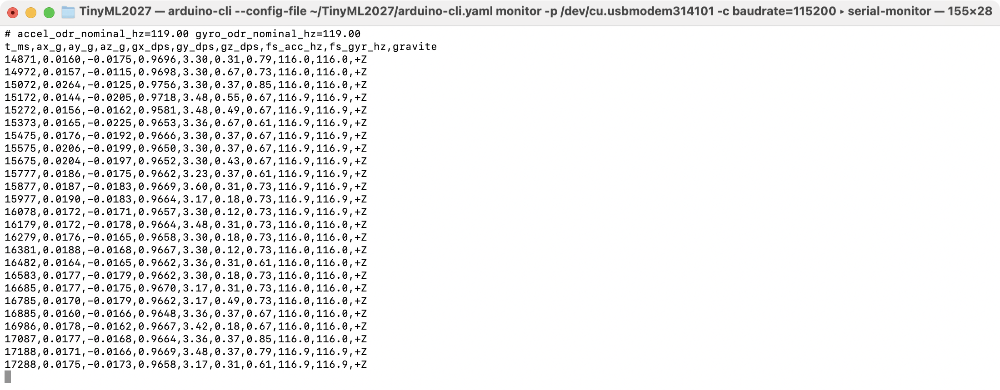

*Capture réelle, Terminal macOS 15.6, carte Nano 33 BLE Sense V1 posée à plat, 23/11/2026. Une ligne toutes les 100 ms ; `az_g` proche de 1 et `gravite=+Z` : la gravité est sur l'axe Z.*

| Colonne | Signification | Unité |
|---|---|---|
| `ax_g`, `ay_g`, `az_g` | accélération | g (1 g ≈ 9,81 m/s²) |
| `gx_dps`, `gy_dps`, `gz_dps` | vitesse de rotation | degrés par seconde (°/s) |
| `fs_acc_hz` | nombre de **nouvelles** mesures reçues pendant la dernière seconde | Hz |
| `gravite` | l'axe qui porte la gravité | — |

**À observer :**
- **116 Hz mesurés, et non les 119 Hz annoncés.** On se fie toujours à la cadence mesurée.
- **az ≈ 0,95 g alors que la carte ne bouge pas.** L'accéléromètre mesure aussi la **gravité**. La valeur n'est pas exactement 1 g, car le capteur présente un petit décalage (environ 0,04 g sur Z, voir l'étape 5).
- **Le gyroscope affiche environ 3,5 °/s au repos** sur X : c'est son **biais**. Une carte immobile ne tourne pas, mais le capteur n'est pas parfait.

---

## Étape 5 — Les axes et la gravité : 6 positions

```sh
uv run python -m tinyml2027.imu_check
```

L'outil vous fait poser la carte dans 6 positions. Pour chacune : **mettez d'abord la carte en place**, puis appuyez sur **Entrée avec l'autre main**, et ne bougez plus pendant 2 secondes.


*Les dessins sont des schémas ; les valeurs sont celles mesurées sur la carte de référence. Le guide illustré utilisé pendant l'essai : <https://claude.ai/artifact/V1pTHJfftNTHS6ZK8o9m7X> (accès privé, à partager par l'enseignant).*

**Ce qu'on apprend :**
- La gravité apparaît successivement sur +Z, −Z, +X, −X, −Y et +Y : les 6 directions sont couvertes et le capteur répond sur ses 3 axes.
- **+Z** sort de la face des composants ; **+X** suit la longueur de la carte, du côté **opposé au connecteur USB**.
- Dans chaque position, |a| reste entre 0,96 et 1,04 g. À plat, on lit 0,96 g en +Z et 1,04 g en −Z : cette asymétrie trahit un **décalage d'environ −0,04 g** sur Z. Les features du TP01 retirent la moyenne de chaque fenêtre, si bien que ce décalage ne les gêne pas.

> **Exercice.** Dans quel sens pointe +Y ? Tenez la carte debout, câble USB à gauche, d'abord puces face à vous, puis puces vers l'extérieur. Comparez le signe de `ay`. Vérifiez ensuite avec la règle de la main droite (X × Y = Z).

À la fin, l'outil vous demande de **faire tourner la carte** pendant 4 s. Chaque axe du gyroscope doit dépasser 30 °/s. **Résultat réel :** 35, 54 et 89 °/s.

Les mesures sont dans [evidence/phase6](../../evidence/phase6/README.md). Le premier essai, qui avait échoué, y est conservé avec sa cause : la mesure commençait pendant que la carte bougeait encore, et les consignes étaient ambiguës.

---

## Questions

1. Pourquoi un script ne doit-il jamais écrire `/dev/ttyACM0` ou `COM3` en dur ?
2. Pourquoi l'accéléromètre affiche-t-il environ 1 g alors que la carte est immobile ?
3. La carte annonce 119 Hz, on en mesure 116. Combien de mesures manquent sur 20 s si l'on suppose 119 Hz ? Quelles conséquences au TP01 si l'on se fiait à la valeur annoncée ?
4. Que se passe-t-il si l'on téléverse un sketch compilé pour la carte originale sur une Rev2 ?

## Références

- <https://docs.arduino.cc/hardware/nano-33-ble-sense/>
- <https://docs.arduino.cc/hardware/nano-33-ble-sense-rev2/>
- <https://docs.arduino.cc/tutorials/nano-33-ble-sense/cheat-sheet>
- [AIoT-Book — tutoriel de démarrage Nano 33 BLE](https://github.com/wld-code/AIoT-Book/blob/main/labs/tutorials/arduino-nano33ble-startup.md)

## Captures d'écran

Les captures du Terminal (étapes 1 à 4) et d'Arduino IDE 2.3.11 (section « Arduino IDE pas à pas ») sont réelles, prises sur macOS 15.6 avec la carte de référence. `TODO: CAPTURE RÉELLE` pour Windows et Linux.
