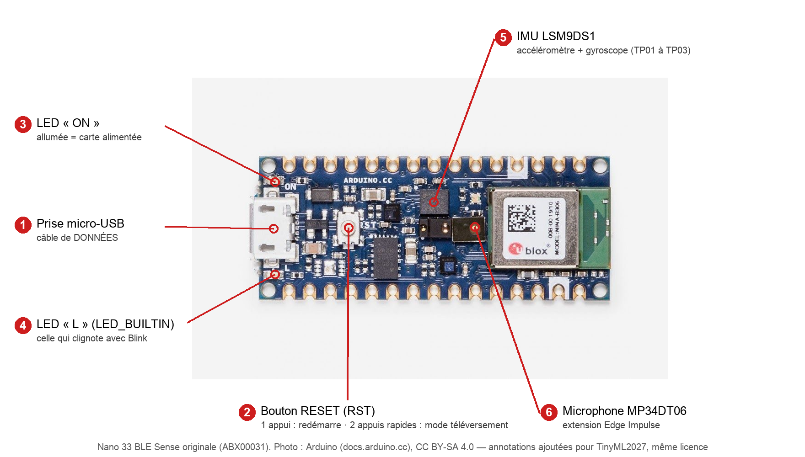
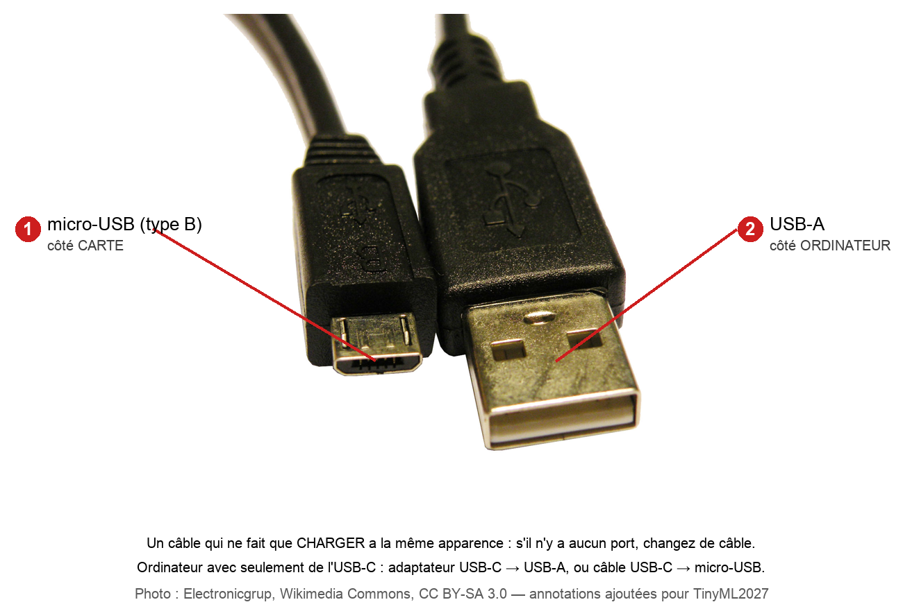
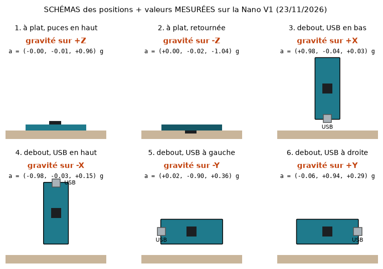
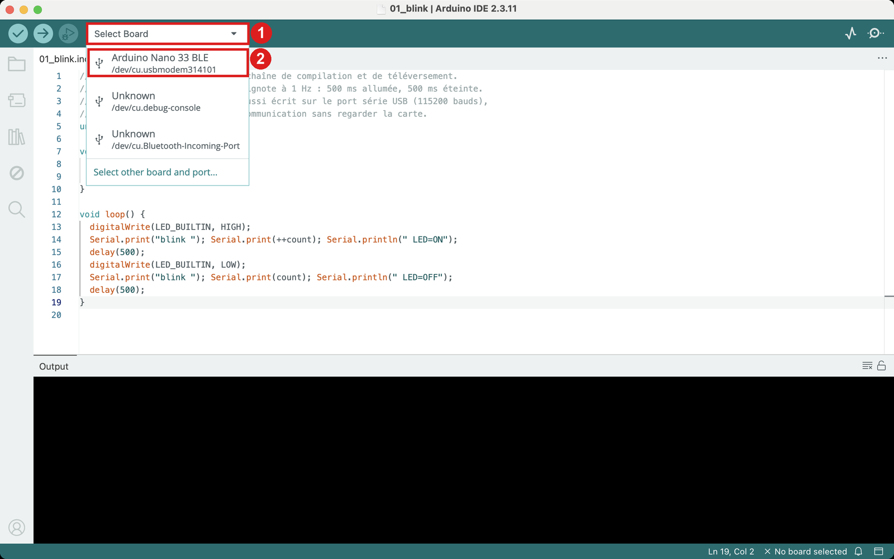

# Tutoriel 02 — Prendre en main la Nano 33 BLE Sense

**Durée.** 30 à 45 min. **Matériel.** Une Nano 33 BLE Sense originale ou Rev2, un câble USB de données et un ordinateur. **Prérequis.** Suivez le [guide d’installation](../../docs/INSTALLATION.md) et lancez les commandes depuis la racine du dépôt.

Nous allons téléverser un programme, identifier la révision de la carte et lire son unité de mesure inertielle (IMU). L’accéléromètre mesure l’accélération sur trois axes et le gyroscope mesure la vitesse de rotation autour de ces axes. Pour compiler et téléverser avec l’IDE, suivez la procédure en fin de tutoriel. [Arduino IDE pas à pas](#arduino-ide-pas-à-pas)

## 1. Repérer la carte et son port



*Photo Arduino (CC BY-SA 4.0), repères ajoutés pour le cours ([crédits](../../docs/photos/CREDITS.md)). Sur une **Rev2**, la disposition est proche mais les capteurs changent (IMU BMI270).*



*Photo Electronicgrup, Wikimedia Commons (CC BY-SA 3.0), repères ajoutés ([crédits](../../docs/photos/CREDITS.md)).*

1. Branchez la carte avec le câble. La LED verte **ON** (repère 3) s'allume.
2. Listez les ports.
   ```sh
   ./scripts/arduino.sh board list
   ```
   Repérez la ligne avec `Arduino Nano 33 BLE` et `arduino:mbed_nano:nano33ble`, sur un port `/dev/cu.usbmodem…` (macOS), `/dev/ttyACM…` (Linux) ou `COM…` (Windows).
3. Vérifiez aussi le port depuis Python.
   ```sh
   uv run python -m serial.tools.list_ports -v
   ```

Notez le port détecté. Il peut changer de nom après un changement de prise USB ou un passage en mode bootloader. Branchez une seule carte pour que le script puisse choisir son port automatiquement.

Si la carte n’apparaît pas, commencez par vérifier la connexion.

- Essayez un autre câble. Beaucoup de câbles USB ne transportent que le courant.
- Essayez une autre prise. Si vous passez par un hub, branchez directement sur l'ordinateur.
- Appuyez deux fois rapidement sur RESET (repère 2). La LED orange pulse quand la carte attend un programme en mode bootloader.
- Sous Linux, en cas de « permission denied », vérifiez les droits du port avec `ls -l /dev/ttyACM0` et vos groupes avec `groups`. Si le port appartient à `dialout`, demandez à l’administrateur de vous ajouter à ce groupe. N'utilisez jamais `chmod 777`.

## 2. Faire clignoter la LED

```sh
./scripts/compile.sh examples/01_blink
./scripts/upload.sh  examples/01_blink
```

Vérifiez que la LED orange « L » (repère 4 sur la photo de l'étape 1) clignote, allumée 0,5 s puis éteinte 0,5 s. Le moniteur série (voir l'étape 4) affiche `blink 1 LED=ON`, `blink 2 LED=OFF`, etc.

Si le téléversement échoue, passez en mode bootloader et relancez `upload.sh`.

## 3. Identifier la révision

La carte originale et la Rev2 utilisent des capteurs et des bibliothèques différents.

| | Originale (ABX00031) | Rev2 (ABX00069) |
|---|---|---|
| IMU | LSM9DS1 | BMI270 + BMM150 |
| Bibliothèque Arduino officielle | `Arduino_LSM9DS1` | `Arduino_BMI270_BMM150` |
| Cadence de l'accéléromètre | 119 Hz annoncés, **116 Hz mesurés** | 100 Hz annoncés, non mesuré ici |

Les deux révisions apparaissent sous le nom « Nano 33 BLE ». Pour les distinguer, téléversez le programme qui interroge les capteurs.

```sh
./scripts/compile.sh tutorials/02-arduino-nano/sketches/board_identify
./scripts/upload.sh  tutorials/02-arduino-nano/sketches/board_identify
./scripts/arduino.sh monitor -p PORT -c baudrate=115200
```

Dans la commande, remplacez `PORT` par le port repéré à l’étape 1. Appuyez sur **Entrée** dans le moniteur, puis sur **Ctrl+C** pour en sortir.

Cherchez `verdict=nano33ble_sense_original` ou `verdict=nano33ble_sense_rev2`. Pour chaque sketch suivant qui lit l’IMU, ajoutez `REV=rev2` devant la compilation et le téléversement si vous utilisez une Rev2. Pour l’étape 4, utilisez par exemple `REV=rev2 ./scripts/compile.sh examples/04_imu`. Dans Arduino IDE, décommentez la ligne `#define NANO_REV2` en tête du sketch.

Si vous vous trompez de révision, la carte affiche une erreur claire, par exemple `ERREUR imu_begin : LSM9DS1 absent : carte Rev2 ? Decommentez #define NANO_REV2.`

## 4. Lire l’IMU

```sh
./scripts/compile.sh examples/04_imu
./scripts/upload.sh  examples/04_imu
./scripts/arduino.sh monitor -p PORT -c baudrate=115200
```

Voici un extrait mesuré sur la carte originale posée à plat.
```text
# firmware=04_imu 0.1.0 board_revision=original imu=LSM9DS1
# accel_odr_nominal_hz=119.00 gyro_odr_nominal_hz=119.00
t_ms,ax_g,ay_g,az_g,gx_dps,gy_dps,gz_dps,fs_acc_hz,fs_gyr_hz,gravite
4038,-0.0006,-0.0117,0.9528,3.54,0.43,0.61,115.8,115.8,+Z
```

| Colonne | Signification | Unité |
|---|---|---|
| `ax_g`, `ay_g`, `az_g` | accélération | g (1 g ≈ 9,81 m/s²) |
| `gx_dps`, `gy_dps`, `gz_dps` | vitesse de rotation | degrés par seconde (°/s) |
| `fs_acc_hz`, `fs_gyr_hz` | cadences mesurées de l’accéléromètre et du gyroscope | Hz |
| `gravite` | direction dominante de la pesanteur | — |

Vérifiez que `az_g` est proche de +1 g et que `gravite` indique `+Z`. Sur la carte de référence, la cadence observée est d’environ 116 Hz pour une cadence nominale de 119 Hz. Utilisez la cadence mesurée pour interpréter le signal. Au repos, le gyroscope de référence affiche environ 3,5 °/s sur X. Ce décalage à rotation nulle est appelé *biais*.

## 5. Vérifier les axes dans six positions

Fermez le moniteur série avant de lancer le contrôle.

```sh
uv run python -m tinyml2027.imu_check
```

L'outil vous fait poser la carte dans 6 positions. Pour chacune : **mettez d'abord la carte en place**, puis appuyez sur **Entrée avec l'autre main**, et ne bougez plus pendant 2 secondes.



*Les dessins sont des schémas ; les valeurs sont celles mesurées sur la carte de référence.*

Vérifiez que la direction dominante passe successivement par +Z, −Z, +X, −X, −Y et +Y. Sur la carte originale, +Z sort de la face des composants et +X pointe dans la longueur, à l’opposé du connecteur USB. Dans l’essai de référence, la norme de l’accélération reste entre 0,96 et 1,04 g selon la position. L’écart entre les mesures en +Z et −Z indique un biais d’environ −0,04 g sur cet axe.

Pour repérer +Y, tenez la carte debout, câble USB à gauche, d’abord composants face à vous puis vers l’extérieur. Comparez le signe de `ay` et vérifiez le sens de l’axe avec la règle de la main droite (X × Y = Z).

À la fin du contrôle, faites tourner la carte pendant 4 s de façon à solliciter les trois axes. La vitesse de rotation doit dépasser 30 °/s sur chacun.

Les essais de référence sur carte concernent la Nano originale. Les sketches ont aussi été compilés pour la Rev2. Consultez le [rapport de validation](../../docs/VALIDATION.md) et les [mesures des six orientations](../../evidence/phase6/README.md).

## Arduino IDE pas à pas

1. Dans le gestionnaire de cartes, installez **Arduino Mbed OS Nano Boards 4.6.0**. Dans le gestionnaire de bibliothèques, installez `Arduino_LSM9DS1` pour l’originale ou `Arduino_BMI270_BMM150` pour la Rev2.
2. Ouvrez `examples/01_blink/01_blink.ino`. Dans **Select Board**, choisissez **Arduino Nano 33 BLE** et le port de la carte.
3. Cliquez sur **Verify**, puis sur **Upload**. Vérifiez que « L » clignote. En cas d’échec, appuyez deux fois sur RESET et recommencez.
4. Ouvrez le moniteur série, réglez-le à **115200 baud** et vérifiez que les lignes `blink … LED=ON/OFF` défilent.
5. Pour lire l’IMU, ouvrez `examples/04_imu/04_imu.ino`. Sur Rev2, décommentez `#define NANO_REV2` avant de compiler et de téléverser. Relisez les colonnes à l’étape 4.



Fermez le moniteur avant de lancer les scripts Python. Le port série est utilisé par un seul programme à la fois.

## Questions

1. Pourquoi un script ne doit-il jamais écrire `/dev/ttyACM0` ou `COM3` en dur ?
2. Pourquoi l'accéléromètre affiche-t-il environ 1 g alors que la carte est immobile ?
3. La carte annonce 119 Hz, on en mesure 116. Quel écart entre les nombres de mesures prévus sur 20 s obtient-on avec ces deux cadences ? Quel effet aurait la cadence nominale sur les fréquences calculées au TP01 ?
4. Que se passe-t-il si l'on téléverse un sketch compilé pour la carte originale sur une Rev2 ?

Retrouvez les fiches Arduino et les crédits du tutoriel dans les [références du cours](../../docs/REFERENCES.md).

## Corrigé

<details>
<summary>Afficher les réponses</summary>

1. Le système attribue le port. Son nom peut changer entre deux ordinateurs, après un changement de prise ou en mode bootloader. Détectez le port ou passez-le en argument.
2. Posée sur la table, la carte subit la force de support qui équilibre son poids. L’accéléromètre mesure cette accélération propre, d’environ 1 g, sur l’axe vertical de la carte. Le signe dépend de son orientation.
3. À 119 Hz, on attend environ 2 380 mesures en 20 s, contre 2 320 à 116 Hz, soit un écart de 60. Si l’on convertissait les indices de la FFT en hertz avec 119 Hz, les fréquences seraient surestimées d’environ 2,6 %.
4. Un sketch prévu pour le LSM9DS1 cherche un capteur absent sur la Rev2. L’initialisation de l’IMU échoue. Recompilez et téléversez avec `REV=rev2` pour utiliser le BMI270.

**Repérage de +Y.** Sur la Nano originale de référence, câble à gauche et composants face à soi, `ay` vaut environ −0,904 g. L’axe +Y pointe donc vers le bas dans cette position. Pour vérifier l’inversion du signe, retournez la carte autour de son axe longitudinal en gardant le câble à gauche. [Mesures des six orientations](../../evidence/phase6/README.md)

</details>
